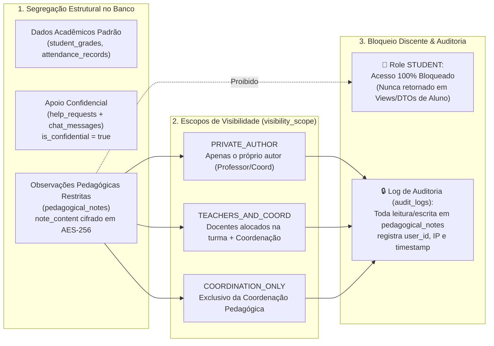

# 🗄️ [DB-001] Modelo Conceitual e Entidades do Domínio Acadêmico SENAI — Projeto NEXA

> **ID do Card**: `DB-001` | **Epic**: `EPIC-01: Autenticação, Perfis (RBAC) & Segurança` | **Sprint / Lote**: `Lote 1 (S1)`  
> **Prioridade**: `P0` | **Estimativa**: `3 SP` | **Status**: `Concluído`  
> **Rastreabilidade**: ⬅️ Início da Trilha | ➡️ Desbloqueia: `DB-002`, `DB-010`, `DB-050`

---

## 1. Visão Geral e Contextualização do Domínio SENAI

O **NEXA (Sistema Inteligente de Monitoramento do Desempenho Acadêmico — SENAI)** modela o ecossistema pedagógico do ensino técnico profissionalizante industrial. Diferentemente de sistemas escolares convencionais voltados apenas a provas teóricas e chamadas estáticas, a metodologia SENAI de **Educação Profissional baseada em Competências** exige o mapeamento integrado de:

1. **Ensino Modular e Prático de Oficina**: Unidades curriculares (disciplinas como *Metrologia Dimensional*, *Desenho Técnico Mecânico*, *Processos de Usinagem Convencional* e *Ajustagem Mecânica*) divididas em **Módulos de Aprendizagem Prática** sequenciais executados em laboratórios e bancadas.
2. **Avaliação por Rubricas e Tolerâncias Técnicas**: Peças usinadas ou medições em oficina são avaliadas segundo critérios objetivos ligados a competências técnicas, de segurança (EPIs) e procedimentais (ex.: tolerância dimensional `±0,02 mm` em micrômetro, acabamento superficial, tempo de setup).
3. **Cruzamento entre Percepção do Aluno (Autoavaliação) e Evidência Docente**: O modelo persiste tanto o nível percebido pelo estudante (`1 a 5`) quanto o nível verificado pelo professor em entregas reais e microavaliações, viabilizando diagnósticos pedagógicos explicáveis sem caixas-pretas ou rótulos punitivos.
4. **Proteção de Dados Pessoais (LGPD) e Sigilo Pedagógico**: Separação estrutural entre credenciais de acesso, dados pessoais identificáveis (PII), solicitações confidenciais de mentoria e observações pedagógicas restritas com criptografia em repouso (`AES-256`) e trilha de auditoria imutável.

---

## 2. Estratégia de Especialização de Usuários sem Redundância (RBAC e LGPD)

Para atender à regra técnica *"Mapear especializações para atender alunos, professores e coordenadores sem redundância"*, o Modelo Conceitual adota o padrão de **Identidade Unificada + Perfil Isolado (1:1) + Papéis Contextuais Associativos**:

```mermaid
flowchart TD
    subgraph Identidade["Camada de Identidade & LGPD (1:1)"]
        U["E01: Usuario (users)<br/>id, email, password_hash, role, is_active"]
        P["E02: PerfilUsuario (user_profiles)<br/>full_name, registration_number, phone, avatar_url"]
        S["E03: SessaoAutenticacao (auth_sessions)<br/>refresh_token_hash, ip_address, is_revoked"]
        A["E04: LogAuditoria (audit_logs)<br/>action, entity, old_values, new_values"]
        U ||--|| P : "1:1 possui (PII isolado)"
        U ||--o{ S : "1:N mantém"
        U ||--o{ A : "1:N gera rastro"
    end

    subgraph Especializacao["Papéis e Vínculos Contextuais no Domínio (Sem Redundância)"]
        EST["Papel: STUDENT (Aluno)"]
        DOC["Papel: TEACHER (Professor)"]
        COORD["Papel: COORDINATOR / ADMIN"]
    end

    U --> EST
    U --> DOC
    U --> COORD

    EST -->|"1:N MatriculaEstudante (enrollments)"| T["E06: TurmaAcademica (classes)"]
    DOC -->|"1:N AlocacaoDocente (teacher_assignments)"| TD["Turma + Disciplina"]
    COORD -->|"Supervisão, Fechamento e Observações Restritas"| GOV["Governança & Apoio Pedagógico"]
```

### Por que essa modelagem elimina redundâncias?
- **Tabela Única de Credenciais (`Usuario` / `users`)**: Evita duplicar campos de autenticação (`email`, `password_hash`, `is_active`, `role`) em múltiplas tabelas (`students`, `teachers`, `coordinators`), simplificando a autenticação JWT e a revogação de sessões (`SessaoAutenticacao`).
- **Isolamento de Dados Pessoais (`PerfilUsuario` / `user_profiles`)**: Mantém `full_name`, `registration_number` (matrícula/registro funcional SENAI), `phone` e `bio` em entidade `1:1` separada. Quando a política de retenção LGPD (`DB-049`) é acionada para um ex-aluno, o perfil pessoal é anonimizado sem quebrar chaves estrangeiras nem destruir o histórico estatístico das turmas.
- **Especialização por Contexto Acadêmico**:
  - **Aluno (`STUDENT`)**: Especializa-se ao se vincular a uma `TurmaAcademica` por meio da entidade associativa `MatriculaEstudante` (`enrollments`), que concentra sua nota final, taxa de presença e status acadêmico naquela turma.
  - **Professor (`TEACHER`)**: Especializa-se ao ser alocado em uma `TurmaAcademica` e `Disciplina` por meio de `AlocacaoDocente` (`teacher_assignments`), podendo atuar como docente titular ou instrutor de oficina prática.
  - **Coordenador (`COORDINATOR`) e Administrador (`ADMIN`)**: Atuam transversalmente na gestão da matriz curricular, resolução de alertas críticos e leitura/registro de observações pedagógicas com escopo `COORDINATION_ONLY` ou `TEACHERS_AND_COORD`.

---

## 3. Catálogo Formal de Entidades Conceituais (32 Entidades + 3 Views Analíticas)

O modelo conceitual supera o requisito mínimo de 15 entidades primárias, mapeando **32 entidades de negócio** organizadas em **6 Subdomínios (Bounded Contexts)** que cobrem integralmente os cards `DB-001` a `DB-050`.

### 3.1. Domínio 1 — Identidade, Segurança (RBAC), Sessões e Auditoria (`EPIC-01` / `EPIC-10`)

| Código | Entidade Conceitual | Tabela Física Alvo | Tipo | Atributos Chave e Identificadores | Regra de Negócio Principal |
|---|---|---|---|---|---|
| **E01** | **Usuário** | `users` | Primária Forte | `id` (PK), `email` (UK), `password_hash`, `role` (`ADMIN`, `COORDINATOR`, `TEACHER`, `STUDENT`), `is_active`, `created_at` | Identidade central do sistema; senhas armazenadas exclusivamente via hash criptográfico (Bcrypt/Argon2). |
| **E02** | **Perfil de Usuário** | `user_profiles` | Fraca / 1:1 | `id` (PK), `user_id` (FK/UK), `full_name`, `registration_number` (UK), `phone`, `avatar_url`, `bio` | Isola PII (Dados Pessoais Identificáveis) das credenciais para conformidade com minimização e anonimização LGPD. |
| **E03** | **Sessão de Autenticação** | `auth_sessions` | Fraca / Dependente | `id` (PK), `user_id` (FK), `refresh_token_hash` (UK), `user_agent`, `ip_address`, `expires_at`, `is_revoked` | Controla sessões ativas JWT e permite revogação imediata de tokens por dispositivo. |
| **E04** | **Log de Auditoria** | `audit_logs` | Primária / Histórica | `id` (PK), `user_id` (FK opcional), `action`, `entity`, `entity_id`, `old_values` (JSONB), `new_values` (JSONB), `ip_address`, `created_at` | Registra trilha imutável de alterações em notas, faltas, matrículas e acessos a observações confidenciais. |

---

### 3.2. Domínio 2 — Estrutura Curricular e Gestão Acadêmica SENAI (`EPIC-02` / `EPIC-04`)

| Código | Entidade Conceitual | Tabela Física Alvo | Tipo | Atributos Chave e Identificadores | Regra de Negócio Principal |
|---|---|---|---|---|---|
| **E05** | **Curso Técnico** | `courses` | Primária Forte | `id` (PK), `code` (UK, ex: `TEC-MEC-01`), `name`, `description`, `total_hours`, `is_active` | Representa o curso profissionalizante SENAI (ex.: Técnico em Mecânica). Não pode ser excluído se possuir turmas. |
| **E06** | **Turma Acadêmica** | `classes` | Primária Forte | `id` (PK), `course_id` (FK), `code` (UK por período), `period` (ex: `2026.1`), `shift` (`MORNING`, `AFTERNOON`, `NIGHT`), `max_students`, `status` (`PLANNING`, `ACTIVE`, `COMPLETED`, `ARCHIVED`), `start_date`, `end_date` | Agrupa alunos em um período letivo e turno. Quando `COMPLETED` ou `ARCHIVED`, bloqueia mutações em notas e faltas (`DB-029`). |
| **E07** | **Disciplina Curricular** | `subjects` | Primária Forte | `id` (PK), `course_id` (FK), `code`, `name` (ex: `Metrologia Dimensional`), `workload_hours`, `syllabus`, `is_active` | Unidade curricular teórico-prática vinculada à matriz de um Curso Técnico. |
| **E08** | **Módulo de Aprendizagem Prática** | `learning_modules` | Primária / Modular | `id` (PK), `subject_id` (FK), `title` (ex: `Tornearia Cilíndrica`), `order_index`, `practical_hours`, `passing_score` (`0.00..10.00`) | Divide a disciplina em etapas práticas sequenciais de oficina com nota mínima de aprovação (`padrão 6.00`). |
| **E09** | **Competência Técnica** | `competencies` | Primária Forte | `id` (PK), `code` (UK, ex: `COMP-MET-01`), `title`, `category` (`TECHNICAL`, `SAFETY`, `PROCEDURAL`), `description` | Taxonomia oficial de habilidades SENAI avaliadas tanto pelo docente quanto na autoavaliação do estudante. |
| **E10** | **Vínculo Módulo-Competência** | `module_competencies` | Associativa (`N:M`) | `module_id` (PK/FK), `competency_id` (PK/FK), `weight` (`DECIMAL`), `required_level` (`1..5`) | Resolve o relacionamento `N:M` entre Módulos e Competências, definindo o peso e o nível esperado (`1 a 5`). |
| **E11** | **Matrícula do Estudante** | `enrollments` | Associativa (`N:M`) | `id` (PK), `student_id` (FK), `class_id` (FK), `enrollment_date`, `status` (`ACTIVE`, `COMPLETED`, `DROPPED`, `SUSPENDED`), `final_grade` (`0..10`), `attendance_rate` (`0..100%`) | Vínculo formal único (`UNIQUE student_id, class_id`) do aluno na turma; âncora de notas, frequência e histórico. |
| **E12** | **Alocação Docente** | `teacher_assignments` | Associativa (`N:M:P`) | `id` (PK), `teacher_id` (FK), `class_id` (FK), `subject_id` (FK), `assigned_at`, `is_main_teacher` | Define quais professores lecionam cada disciplina em cada turma (`UNIQUE teacher_id, class_id, subject_id`), habilitando o RBAC contextual de diário. |

---

### 3.3. Domínio 3 — Diário de Classe, Frequência e Avaliações Formativas (`EPIC-03`)

| Código | Entidade Conceitual | Tabela Física Alvo | Tipo | Atributos Chave e Identificadores | Regra de Negócio Principal |
|---|---|---|---|---|---|
| **E13** | **Aula Ministrada (Diário)** | `class_lessons` | Primária / Evento | `id` (PK), `class_id` (FK), `subject_id` (FK), `module_id` (FK opc.), `teacher_id` (FK), `lesson_date`, `workload_hours` (`1..8`), `topic_summary`, `lab_environment` | Registra o encontro letivo e o laboratório utilizado (ex.: `Oficina de Tornearia 02`), servindo de base para a chamada. |
| **E14** | **Registro de Presença** | `attendance_records` | Associativa / Evento | `id` (PK), `lesson_id` (FK), `enrollment_id` (FK), `student_id` (FK), `status` (`PRESENT`, `ABSENT`, `LATE`, `JUSTIFIED`), `absent_hours`, `justification_note`, `recorded_at` | Presença individual por aula (`UNIQUE lesson_id, student_id`). Alimenta o cálculo do limite legal de 75% de frequência. |
| **E15** | **Avaliação Formativa / Prova** | `academic_assessments` | Primária / Avaliação | `id` (PK), `class_id` (FK), `subject_id` (FK), `module_id` (FK opc.), `title`, `assessment_type` (`EXAM`, `MICRO_EVALUATION`, `PROJECT`), `weight`, `application_date`, `max_grade` | Representa provas teóricas, microavaliações rápidas e projetos integradores aplicados no módulo. |
| **E16** | **Nota de Avaliação do Estudante** | `student_grades` | Associativa / Resultado | `id` (PK), `assessment_id` (FK), `enrollment_id` (FK), `student_id` (FK), `recorded_by` (FK), `grade_value` (`0..10`), `recovery_grade` (`0..10` opc.), `comments` | Armazena a nota obtida pelo aluno em uma Avaliação Formativa (`UNIQUE assessment_id, student_id`) com auditoria de retificação. |

---

### 3.4. Domínio 4 — Oficina Prática, Rubricas de Precisão e Entregas (`EPIC-04`)

| Código | Entidade Conceitual | Tabela Física Alvo | Tipo | Atributos Chave e Identificadores | Regra de Negócio Principal |
|---|---|---|---|---|---|
| **E17** | **Tarefa Prática de Oficina** | `practical_tasks` | Primária / Prática | `id` (PK), `module_id` (FK), `class_id` (FK), `title` (ex: `Eixo Escalonado Ø25mm H7`), `description`, `blueprint_url`, `due_date`, `max_score`, `is_mandatory` | Exercício prático de bancada/máquina vinculado a um Módulo Prático e Turma, com desenho técnico anexo. |
| **E18** | **Critério de Rubrica Prática** | `task_criteria` | Fraca / Rubrica | `id` (PK), `task_id` (FK), `competency_id` (FK), `criterion_name` (ex: `Tolerância ±0,02mm`), `weight`, `min_acceptable_level` (`1..5`) | Decompõe uma Tarefa Prática em critérios técnicos mensuráveis diretamente ligados às Competências SENAI. |
| **E19** | **Submissão de Tarefa Prática** | `task_submissions` | Associativa / Entrega | `id` (PK), `task_id` (FK), `student_id` (FK), `enrollment_id` (FK), `status` (`PENDING`, `SUBMITTED`, `EVALUATED`, `LATE`), `completed_at`, `evidence_url`, `student_notes`, `final_task_score` | Controla o estado de execução da peça/tarefa pelo estudante (`UNIQUE task_id, student_id`) e alimenta o painel de pendências. |
| **E20** | **Avaliação de Rubrica pelo Docente** | `submission_evaluations` | Associativa / Rubrica | `id` (PK), `submission_id` (FK), `criterion_id` (FK), `evaluator_id` (FK), `achieved_level` (`1..5`), `score_awarded`, `technical_feedback`, `evaluated_at` | Nota e nível de domínio (`1 a 5`) atribuídos pelo professor para cada critério de uma submissão (`UNIQUE submission_id, criterion_id`). |

---

### 3.5. Domínio 5 — Autoavaliação, Evidências, Alertas e Diagnóstico Explicável 360° (`EPIC-05` / `EPIC-06` / `EPIC-07`)

| Código | Entidade Conceitual | Tabela Física Alvo | Tipo | Atributos Chave e Identificadores | Regra de Negócio Principal |
|---|---|---|---|---|---|
| **E21** | **Formulário de Autoavaliação** | `self_assessment_forms` | Primária / Ciclo | `id` (PK), `module_id` (FK), `class_id` (FK), `title`, `instructions`, `opens_at`, `closes_at`, `is_active`, `created_by` (FK) | Abre janela temporal ao final de um módulo prático para reflexão estruturada dos estudantes. |
| **E22** | **Resposta de Autoavaliação** | `student_self_assessments` | Associativa / Percepção | `id` (PK), `form_id` (FK), `student_id` (FK), `competency_id` (FK), `perceived_level` (`1..5`), `confidence_score` (`1..5`), `difficulty_notes`, `submitted_at` | Registra a autopercepção do aluno por competência (`UNIQUE form_id, student_id, competency_id`). **Isolada entre estudantes**. |
| **E23** | **Evidência Prática de Habilidade** | `skill_evidences` | Primária / Evidência | `id` (PK), `student_id` (FK), `competency_id` (FK), `source_submission_id` (FK opc.), `source_assessment_id` (FK opc.), `verified_level` (`1.00..5.00`), `verified_by` (FK), `recorded_at` | Consolida na escala `1 a 5` as comprovações práticas avaliadas pelo docente em oficinas e microavaliações. |
| **E24** | **Alerta de Risco Acadêmico** | `academic_alerts` | Primária / Alerta | `id` (PK), `student_id` (FK), `enrollment_id` (FK), `class_id` (FK), `module_id` (FK opc.), `risk_level` (`LOW`, `MODERATE`, `HIGH`, `CRITICAL`), `alert_category`, `explainable_reason`, `metric_snapshot` (JSONB), `status`, `resolved_by` (FK opc.) | Alerta precoce baseado em evidências (faltas, queda de nota, tarefas atrasadas), exigindo justificativa transparente (`explainable_reason`). |
| **E25** | **Diagnóstico Explicável** | `explainable_diagnostics` | Primária / Diagnóstico | `id` (PK), `student_id` (FK), `class_id` (FK), `module_id` (FK), `competency_id` (FK opc.), `self_perceived_level`, `teacher_verified_level`, `discrepancy_gap`, `diagnostic_type`, `explanation_text`, `limitations_note`, `recommended_action` | Compara percepção do aluno vs. evidência docente (`ALIGNED`, `OVERCONFIDENCE_RISK`, `UNDERCONFIDENCE_SUPPORT`, `INSUFFICIENT_EVIDENCE`). |
| **E26** | **Histórico de Marcos do Estudante** | `student_milestone_history` | Primária / Linha do Tempo | `id` (PK), `student_id` (FK), `enrollment_id` (FK), `module_id` (FK opc.), `milestone_type`, `title`, `description`, `metadata` (JSONB), `achieved_at` | Constrói a linha do tempo positiva de evolução técnica do estudante ao longo do curso. |

---

### 3.6. Domínio 6 — Comunicação Oficial, Apoio Confidencial, Notas Pedagógicas e Gamificação (`EPIC-08` / `EPIC-09`)

| Código | Entidade Conceitual | Tabela Física Alvo | Tipo | Atributos Chave e Identificadores | Regra de Negócio Principal |
|---|---|---|---|---|---|
| **E27** | **Comunicado da Turma (Mural)** | `class_announcements` | Primária / Comunicação | `id` (PK), `class_id` (FK), `subject_id` (FK opc.), `author_id` (FK), `title`, `content`, `priority` (`NORMAL`, `IMPORTANT`, `URGENT`), `is_pinned`, `published_at`, `expires_at` | Avisos oficiais publicados por professores/coordenação para a turma (ex.: normas de EPI ou troca de oficina). |
| **E28** | **Solicitação de Apoio Confidencial** | `help_requests` | Primária / Sigilosa | `id` (PK), `student_id` (FK), `enrollment_id` (FK), `subject_id` (FK), `module_id` (FK opc.), `assigned_teacher_id` (FK opc.), `category`, `subject_title`, `description`, `is_confidential` (`true`), `status`, `resolution_summary` | Canal seguro para o aluno pedir ajuda sem exposição perante os colegas da turma. |
| **E29** | **Observação Pedagógica Restrita** | `pedagogical_notes` | Primária / Ultrassigilosa | `id` (PK), `student_id` (FK), `enrollment_id` (FK), `author_id` (FK), `visibility_scope` (`PRIVATE_AUTHOR`, `TEACHERS_AND_COORD`, `COORDINATION_ONLY`), `category`, `note_content` (Criptografado AES-256), `requires_followup`, `followup_date` | Registro restrito de acompanhamento docente/coordenação. **Jamais acessível por estudantes**; auditado em `audit_logs`. |
| **E30** | **Mensagem Interna de Apoio** | `chat_messages` | Fraca / Conversação | `id` (PK), `help_request_id` (FK), `sender_id` (FK), `message_body`, `is_read`, `read_at`, `sent_at` | Mensagens trocadas exclusivamente entre o estudante solicitante e o docente responsável dentro de um `help_request`. |
| **E31** | **Insígnia de Gamificação (Badge)** | `gamification_badges` | Primária / Catálogo | `id` (PK), `code` (UK), `title`, `description`, `criteria_explanation`, `icon_name`, `xp_reward`, `competency_id` (FK opc.), `is_active` | Conquistas pedagógicas com critérios transparentes (`criteria_explanation`), sem ranking competitivo punitivo. |
| **E32** | **Conquista Desbloqueada** | `student_achievements` | Associativa (`N:M`) | `id` (PK), `student_id` (FK), `enrollment_id` (FK), `badge_id` (FK), `unlocked_at`, `origin_reference` | Registra cada insígnia conquistada pelo estudante (`UNIQUE student_id, badge_id`) e sua origem prática. |

---

### 3.7. Entidades Derivadas / Views Analíticas Consolidadas (`EPIC-05` / `EPIC-07`)

Além das 32 entidades persistidas em tabelas base, o Modelo Conceitual prevê **3 Visões Analíticas Derivadas**:
1. **`V01 — vw_student_360_performance` (`DB-036`)**: Consolida por matrícula (`enrollment_id`) a média ponderada, taxa de presença, contadores de tarefas (`PENDING`, `SUBMITTED`, `EVALUATED`, `LATE`), alertas ativos e nível de risco atual.
2. **`V02 — vw_module_attendance_risk` (`DB-037`)**: Agrega carga horária ministrada por módulo, horas de presença/falta do aluno, percentual exato de frequência e flag de risco crítico (`< 78%`).
3. **`V03 — vw_self_eval_discrepancy` (`DB-038`)**: Cruza `student_self_assessments` com `skill_evidences` por `(student_id, competency_id)`, calculando o delta entre percepção discente e avaliação docente (`>= 1.5` pontos destaca divergência).

---

## 4. Diagrama Entidade-Relacionamento Conceitual Completo (Mermaid `erDiagram`)

O diagrama abaixo representa formalmente as entidades primárias e associativas do domínio SENAI e suas respectivas cardinalidades:

```mermaid
erDiagram
    %% =====================================================================
    %% DOMINIO 1: IDENTIDADE, ACESSO (RBAC), SESSOES E AUDITORIA
    %% =====================================================================
    USERS ||--|| USER_PROFILES : "1:1 possui (isola PII LGPD)"
    USERS ||--o{ AUTH_SESSIONS : "1:N mantem sessoes"
    USERS ||--o{ AUDIT_LOGS : "1:N gera auditoria"

    USERS {
        uuid id PK
        varchar email UK
        varchar password_hash
        enum role "ADMIN | COORDINATOR | TEACHER | STUDENT"
        boolean is_active
        timestamp created_at
    }

    USER_PROFILES {
        uuid id PK
        uuid user_id FK, UK
        varchar full_name
        varchar registration_number UK
        varchar phone
        varchar avatar_url
    }

    AUTH_SESSIONS {
        uuid id PK
        uuid user_id FK
        varchar refresh_token_hash UK
        varchar ip_address
        timestamp expires_at
        boolean is_revoked
    }

    AUDIT_LOGS {
        uuid id PK
        uuid user_id FK
        varchar action
        varchar entity
        varchar entity_id
        jsonb old_values
        jsonb new_values
        timestamp created_at
    }

    %% =====================================================================
    %% DOMINIO 2: ESTRUTURA CURRICULAR E GESTAO ACADEMICA SENAI
    %% =====================================================================
    COURSES ||--o{ CLASSES : "1:N oferta turmas"
    COURSES ||--o{ SUBJECTS : "1:N compoe matriz"
    SUBJECTS ||--o{ LEARNING_MODULES : "1:N divide-se em modulos"
    LEARNING_MODULES ||--o{ MODULE_COMPETENCIES : "1:N requer"
    COMPETENCIES ||--o{ MODULE_COMPETENCIES : "1:N treinada em"

    USERS ||--o{ ENROLLMENTS : "1:N aluno matricula-se"
    CLASSES ||--o{ ENROLLMENTS : "1:N recebe matriculas"

    USERS ||--o{ TEACHER_ASSIGNMENTS : "1:N docente alocado"
    CLASSES ||--o{ TEACHER_ASSIGNMENTS : "1:N possui alocacoes"
    SUBJECTS ||--o{ TEACHER_ASSIGNMENTS : "1:N ministrada por"

    COURSES {
        uuid id PK
        varchar code UK
        varchar name
        integer total_hours
        boolean is_active
    }

    CLASSES {
        uuid id PK
        uuid course_id FK
        varchar code UK
        varchar period
        enum shift "MORNING | AFTERNOON | NIGHT"
        integer max_students
        enum status "PLANNING | ACTIVE | COMPLETED | ARCHIVED"
    }

    SUBJECTS {
        uuid id PK
        uuid course_id FK
        varchar code
        varchar name
        integer workload_hours
    }

    LEARNING_MODULES {
        uuid id PK
        uuid subject_id FK
        varchar title
        integer order_index
        integer practical_hours
        decimal passing_score
    }

    COMPETENCIES {
        uuid id PK
        varchar code UK
        varchar title
        enum category "TECHNICAL | SAFETY | PROCEDURAL"
    }

    MODULE_COMPETENCIES {
        uuid module_id PK, FK
        uuid competency_id PK, FK
        decimal weight
        integer required_level "1..5"
    }

    ENROLLMENTS {
        uuid id PK
        uuid student_id FK
        uuid class_id FK
        enum status "ACTIVE | COMPLETED | DROPPED | SUSPENDED"
        decimal final_grade
        decimal attendance_rate
    }

    TEACHER_ASSIGNMENTS {
        uuid id PK
        uuid teacher_id FK
        uuid class_id FK
        uuid subject_id FK
        boolean is_main_teacher
    }

    %% =====================================================================
    %% DOMINIO 3: DIARIO DE CLASSE, FREQUENCIA E AVALIACOES FORMATIVAS
    %% =====================================================================
    CLASSES ||--o{ CLASS_LESSONS : "1:N realiza aulas"
    SUBJECTS ||--o{ CLASS_LESSONS : "1:N lecionada em"
    LEARNING_MODULES o|--o{ CLASS_LESSONS : "0..1:N vincula modulo"
    CLASS_LESSONS ||--o{ ATTENDANCE_RECORDS : "1:N registra chamada"
    ENROLLMENTS ||--o{ ATTENDANCE_RECORDS : "1:N contabiliza frequencia"

    CLASSES ||--o{ ACADEMIC_ASSESSMENTS : "1:N aplica avaliacoes"
    SUBJECTS ||--o{ ACADEMIC_ASSESSMENTS : "1:N avalia disciplina"
    LEARNING_MODULES o|--o{ ACADEMIC_ASSESSMENTS : "0..1:N avalia modulo"
    ACADEMIC_ASSESSMENTS ||--o{ STUDENT_GRADES : "1:N possui notas"
    ENROLLMENTS ||--o{ STUDENT_GRADES : "1:N recebe notas"

    CLASS_LESSONS {
        uuid id PK
        uuid class_id FK
        uuid subject_id FK
        uuid module_id FK
        uuid teacher_id FK
        date lesson_date
        integer workload_hours
        varchar lab_environment
    }

    ATTENDANCE_RECORDS {
        uuid id PK
        uuid lesson_id FK
        uuid enrollment_id FK
        uuid student_id FK
        enum status "PRESENT | ABSENT | LATE | JUSTIFIED"
        integer absent_hours
    }

    ACADEMIC_ASSESSMENTS {
        uuid id PK
        uuid class_id FK
        uuid subject_id FK
        uuid module_id FK
        varchar title
        enum assessment_type "EXAM | MICRO_EVALUATION | PROJECT"
        decimal weight
    }

    STUDENT_GRADES {
        uuid id PK
        uuid assessment_id FK
        uuid enrollment_id FK
        uuid student_id FK
        decimal grade_value
        decimal recovery_grade
    }

    %% =====================================================================
    %% DOMINIO 4: OFICINA PRATICA, RUBRICAS E SUBMISSOES
    %% =====================================================================
    LEARNING_MODULES ||--o{ PRACTICAL_TASKS : "1:N define tarefas praticas"
    CLASSES ||--o{ PRACTICAL_TASKS : "1:N atribuida a turma"
    PRACTICAL_TASKS ||--o{ TASK_CRITERIA : "1:N decompoe-se em rubricas"
    COMPETENCIES ||--o{ TASK_CRITERIA : "1:N mensurada por"
    PRACTICAL_TASKS ||--o{ TASK_SUBMISSIONS : "1:N recebe entregas"
    ENROLLMENTS ||--o{ TASK_SUBMISSIONS : "1:N submete pratica"
    TASK_SUBMISSIONS ||--o{ SUBMISSION_EVALUATIONS : "1:N avaliada por rubrica"
    TASK_CRITERIA ||--o{ SUBMISSION_EVALUATIONS : "1:N pontua criterio"

    PRACTICAL_TASKS {
        uuid id PK
        uuid module_id FK
        uuid class_id FK
        varchar title
        timestamp due_date
        decimal max_score
        boolean is_mandatory
    }

    TASK_CRITERIA {
        uuid id PK
        uuid task_id FK
        uuid competency_id FK
        varchar criterion_name
        decimal weight
        integer min_acceptable_level
    }

    TASK_SUBMISSIONS {
        uuid id PK
        uuid task_id FK
        uuid student_id FK
        uuid enrollment_id FK
        enum status "PENDING | SUBMITTED | EVALUATED | LATE"
        decimal final_task_score
    }

    SUBMISSION_EVALUATIONS {
        uuid id PK
        uuid submission_id FK
        uuid criterion_id FK
        uuid evaluator_id FK
        integer achieved_level "1..5"
        decimal score_awarded
    }

    %% =====================================================================
    %% DOMINIO 5: AUTOAVALIACAO, EVIDENCIAS, ALERTAS E DIAGNOSTICO 360
    %% =====================================================================
    LEARNING_MODULES ||--o{ SELF_ASSESSMENT_FORMS : "1:N abre autoavaliacao"
    CLASSES ||--o{ SELF_ASSESSMENT_FORMS : "1:N direcionada a turma"
    SELF_ASSESSMENT_FORMS ||--o{ STUDENT_SELF_ASSESSMENTS : "1:N coleta percepcoes"
    USERS ||--o{ STUDENT_SELF_ASSESSMENTS : "1:N aluno autoavalia-se"
    COMPETENCIES ||--o{ STUDENT_SELF_ASSESSMENTS : "1:N percepcao na competencia"

    COMPETENCIES ||--o{ SKILL_EVIDENCES : "1:N comprovada por"
    TASK_SUBMISSIONS o|--o{ SKILL_EVIDENCES : "0..1:N gera evidencia pratica"
    ACADEMIC_ASSESSMENTS o|--o{ SKILL_EVIDENCES : "0..1:N gera evidencia teorica"

    ENROLLMENTS ||--o{ ACADEMIC_ALERTS : "1:N monitorada por alertas"
    CLASSES ||--o{ EXPLAINABLE_DIAGNOSTICS : "1:N consolida diagnosticos"
    ENROLLMENTS ||--o{ STUDENT_MILESTONE_HISTORY : "1:N registra linha do tempo"

    SELF_ASSESSMENT_FORMS {
        uuid id PK
        uuid module_id FK
        uuid class_id FK
        varchar title
        boolean is_active
    }

    STUDENT_SELF_ASSESSMENTS {
        uuid id PK
        uuid form_id FK
        uuid student_id FK
        uuid competency_id FK
        integer perceived_level "1..5"
        integer confidence_score "1..5"
    }

    SKILL_EVIDENCES {
        uuid id PK
        uuid student_id FK
        uuid competency_id FK
        uuid source_submission_id FK
        uuid source_assessment_id FK
        decimal verified_level "1.00..5.00"
    }

    ACADEMIC_ALERTS {
        uuid id PK
        uuid student_id FK
        uuid enrollment_id FK
        uuid class_id FK
        enum risk_level "LOW | MODERATE | HIGH | CRITICAL"
        text explainable_reason
        enum status "ACTIVE | ACKNOWLEDGED | RESOLVED"
    }

    EXPLAINABLE_DIAGNOSTICS {
        uuid id PK
        uuid student_id FK
        uuid class_id FK
        uuid module_id FK
        uuid competency_id FK
        decimal discrepancy_gap
        enum diagnostic_type "ALIGNED | OVERCONFIDENCE_RISK | UNDERCONFIDENCE_SUPPORT | INSUFFICIENT_EVIDENCE"
    }

    STUDENT_MILESTONE_HISTORY {
        uuid id PK
        uuid student_id FK
        uuid enrollment_id FK
        enum milestone_type "MODULE_COMPLETED | SKILL_LEVEL_UP | PERFECT_ATTENDANCE | RECOVERY_ACHIEVED"
        timestamp achieved_at
    }

    %% =====================================================================
    %% DOMINIO 6: COMUNICACAO, APOIO CONFIDENCIAL, NOTAS PEDAGOGICAS E GAMIFICACAO
    %% =====================================================================
    CLASSES ||--o{ CLASS_ANNOUNCEMENTS : "1:N publica no mural"
    ENROLLMENTS ||--o{ HELP_REQUESTS : "1:N solicita apoio sigiloso"
    HELP_REQUESTS ||--o{ CHAT_MESSAGES : "1:N contem mensagens"
    ENROLLMENTS ||--o{ PEDAGOGICAL_NOTES : "1:N possui observacoes restritas"
    COMPETENCIES o|--o{ GAMIFICATION_BADGES : "0..1:N inspira insignia"
    GAMIFICATION_BADGES ||--o{ STUDENT_ACHIEVEMENTS : "1:N concedida em"
    ENROLLMENTS ||--o{ STUDENT_ACHIEVEMENTS : "1:N desbloqueia conquista"

    CLASS_ANNOUNCEMENTS {
        uuid id PK
        uuid class_id FK
        uuid author_id FK
        varchar title
        enum priority "NORMAL | IMPORTANT | URGENT"
        boolean is_pinned
    }

    HELP_REQUESTS {
        uuid id PK
        uuid student_id FK
        uuid enrollment_id FK
        uuid subject_id FK
        uuid assigned_teacher_id FK
        boolean is_confidential "DEFAULT true"
        enum status "OPEN | IN_PROGRESS | RESOLVED | CLOSED"
    }

    PEDAGOGICAL_NOTES {
        uuid id PK
        uuid student_id FK
        uuid enrollment_id FK
        uuid author_id FK
        enum visibility_scope "PRIVATE_AUTHOR | TEACHERS_AND_COORD | COORDINATION_ONLY"
        text note_content "AES-256 Encrypted"
    }

    CHAT_MESSAGES {
        uuid id PK
        uuid help_request_id FK
        uuid sender_id FK
        text message_body
        boolean is_read
    }

    GAMIFICATION_BADGES {
        uuid id PK
        varchar code UK
        varchar title
        text criteria_explanation
        integer xp_reward
    }

    STUDENT_ACHIEVEMENTS {
        uuid id PK
        uuid student_id FK
        uuid enrollment_id FK
        uuid badge_id FK
        timestamp unlocked_at
    }
```



---

## 5. Matriz de Cardinalidades e Regras de Relacionamento (`1:1`, `1:N`, `N:M`)

Atendendo ao Critério de Aceitação *"Cardinalidades definidas (1:N, N:M) entre Aluno, Turma, Módulo e Avaliações"*, a tabela abaixo explicita todas as cardinalidades estruturais e como os relacionamentos `N:M` são decompostos em entidades associativas:

| Entidade Origem (A) | Cardinalidade Conceitual | Entidade Destino (B) | Entidade Associativa / Implementação | Regra de Integridade e Semântica no Domínio SENAI |
|---|:---:|---|---|---|
| **Usuário** (`users`) | **`1 : 1`** | **Perfil de Usuário** (`user_profiles`) | Chave estrangeira única `user_profiles.user_id` | Cada conta possui exatamente um perfil institucional; separa credenciais de dados pessoais (LGPD). |
| **Aluno** (`users` role=`STUDENT`) | **`N : M`** | **Turma Acadêmica** (`classes`) | **`MatriculaEstudante` (`enrollments`)** (`1:N` de `users` e `1:N` de `classes`) | Um aluno pode matricular-se em várias turmas ao longo de sua trajetória; uma turma possui até `max_students` alunos (`UNIQUE student_id, class_id`). |
| **Professor** (`users` role=`TEACHER`) | **`N : M`** | **Turma + Disciplina** (`classes` + `subjects`) | **`AlocacaoDocente` (`teacher_assignments`)** | Um professor leciona em múltiplas turmas/disciplinas, e uma disciplina prática pode ter mais de um instrutor de oficina (`is_main_teacher`). |
| **Curso Técnico** (`courses`) | **`1 : N`** | **Turma Acadêmica** (`classes`) | FK `classes.course_id` (`ON DELETE RESTRICT`) | Um curso técnico oferta diversas turmas por semestre letivo; uma turma pertence a um único curso. |
| **Curso Técnico** (`courses`) | **`1 : N`** | **Disciplina** (`subjects`) | FK `subjects.course_id` | Um curso é composto por várias unidades curriculares (Metrologia, Tornearia, Desenho Técnico). |
| **Disciplina** (`subjects`) | **`1 : N`** | **Módulo Prático** (`learning_modules`) | FK `learning_modules.subject_id` | Cada disciplina é subdividida em módulos práticos sequenciais (`order_index`) com carga horária de oficina própria. |
| **Módulo Prático** (`learning_modules`) | **`N : M`** | **Competência Técnica** (`competencies`) | **`Vínculo Módulo-Competência` (`module_competencies`)** | Um módulo desenvolve múltiplas competências (ex.: precisão dimensional + segurança EPI), e uma mesma competência é exercitada em vários módulos. |
| **Módulo Prático** (`learning_modules`) | **`1 : N`** | **Tarefa Prática de Oficina** (`practical_tasks`) | FK `practical_tasks.module_id` | Um módulo prático exige a execução de uma ou mais peças/exercícios de bancada pela turma. |
| **Tarefa Prática** (`practical_tasks`) | **`1 : N`** | **Critério de Rubrica** (`task_criteria`) | FK `task_criteria.task_id` | Uma tarefa prática possui múltiplos critérios objetivos de avaliação, cada qual vinculado (`N:1`) a uma `CompetenciaTecnica`. |
| **Aluno Matriculado** (`enrollments`) | **`N : M`** | **Tarefa Prática** (`practical_tasks`) | **`Submissão Prática` (`task_submissions`)** | Cada aluno matriculado realiza uma entrega (`task_submission`) para cada tarefa prática da turma (`UNIQUE task_id, student_id`). |
| **Submissão Prática** (`task_submissions`) | **`N : M`** | **Critério de Rubrica** (`task_criteria`) | **`Avaliação de Rubrica` (`submission_evaluations`)** | O professor avalia cada rubrica da peça entregue pelo aluno atribuindo nível `1 a 5` e nota (`UNIQUE submission_id, criterion_id`). |
| **Módulo / Disciplina** (`learning_modules` / `subjects`) | **`1 : N`** | **Avaliação Formativa** (`academic_assessments`) | FKs `subject_id` (obrigatória) e `module_id` (opcional) | Uma disciplina/módulo aplica múltiplas microavaliações, provas teóricas e projetos com pesos específicos. |
| **Aluno Matriculado** (`enrollments`) | **`N : M`** | **Avaliação Formativa** (`academic_assessments`) | **`Nota do Estudante` (`student_grades`)** | Cada estudante recebe uma nota (`grade_value`) e eventual recuperação (`recovery_grade`) por avaliação formativa (`UNIQUE assessment_id, student_id`). |
| **Módulo Prático + Turma** | **`1 : N`** | **Formulário de Autoavaliação** (`self_assessment_forms`) | FKs `module_id` e `class_id` | Ao final de cada módulo, o docente abre um ciclo de autoavaliação para a turma. |
| **Aluno + Formulário** | **`N : M`** | **Competência Técnica** (`competencies`) | **`Resposta de Autoavaliação` (`student_self_assessments`)** | O aluno avalia seu nível percebido (`1..5`) e grau de confiança (`1..5`) em cada competência do módulo (`UNIQUE form_id, student_id, competency_id`). |
| **Aula Ministrada** (`class_lessons`) | **`N : M`** | **Aluno Matriculado** (`enrollments`) | **`Registro de Presença` (`attendance_records`)** | Uma aula possui registros de presença para os N alunos da turma; um aluno possui presença em M aulas (`UNIQUE lesson_id, student_id`). |
| **Aluno Matriculado** (`enrollments`) | **`1 : N`** | **Observação Pedagógica Restrita** (`pedagogical_notes`) | FK `pedagogical_notes.enrollment_id` | Professores e coordenadores registram observações sigilosas vinculadas à matrícula do aluno, com isolamento estrito por `visibility_scope`. |

---

## 6. Regra de Isolamento de Notas Pedagógicas Confidenciais e Privacidade (LGPD)

Atendendo ao Critério de Aceitação *"Regra de isolamento de notas pedagógicas confidenciais registrada no modelo"*, o modelo conceitual estabelece **quatro camadas de proteção e isolamento arquitetural** para informações sensíveis:



### 6.1. Segregação Física e Conceitual de Entidades
As anotações de acompanhamento psicopedagógico, intervenções comportamentais, adaptações de acessibilidade (`ACCOMMODATION`) e mentorias docentes **jamais são armazenadas em colunas de comentário geral** (`student_grades.comments` ou `attendance_records.justification_note`, que são visíveis ao aluno no boletim/diário). Elas residem exclusivamente na entidade dedicada **`ObservacaoPedagogicaRestrita` (`pedagogical_notes` — `DB-043`)**.

### 6.2. Controle Granular de Escopo (`visibility_scope`)
A entidade `pedagogical_notes` possui o atributo obrigatório `visibility_scope` que governa o isolamento de leitura mesmo entre funcionários:
- **`PRIVATE_AUTHOR`**: Visível exclusivamente para o usuário (`author_id`) que redigiu a anotação e para o papel `ADMIN` em auditoria técnica.
- **`TEACHERS_AND_COORD`**: Visível apenas para professores com alocação ativa na turma do estudante (`teacher_assignments`) e para a Coordenação Pedagógica (`COORDINATOR`).
- **`COORDINATION_ONLY`**: Visível estritamente para usuários com papel `COORDINATOR` (ex.: casos sensíveis encaminhados à orientação educacional).
- **Bloqueio Absoluto para `STUDENT`**: Usuários com papel `STUDENT` (inclusive o próprio aluno a quem a nota se refere ou seus colegas) **não possuem permissão de leitura em hipótese alguma** sobre `pedagogical_notes`.

### 6.3. Exclusão de Views Analíticas Compartilhadas e Criptografia em Repouso
- **Isolamento nas Views Analíticas**: As views `vw_student_360_performance`, `vw_module_attendance_risk` e `vw_self_eval_discrepancy` **não fazem `JOIN`** com `pedagogical_notes`, garantindo que o Portal de Autonomia do Aluno (`EPIC-06`) nunca vaze metadados ou contadores de observações restritas.
- **Criptografia de Conteúdo (`AES-256`)**: O campo `note_content` em `pedagogical_notes` é criptografado na camada de serviço (`BE-045` via módulo `cryptography` / Fernet AES-256) antes de ser persistido no PostgreSQL, protegendo o texto sensível até mesmo contra leitura direta em dumps de banco não autorizados.
- **Rastreabilidade Obrigatória (`audit_logs`)**: Qualquer operação de criação, atualização, exclusão ou leitura detalhada de `pedagogical_notes` gera obrigatoriamente um registro em `audit_logs` (`DB-009` / `BE-048`) contendo `user_id`, `entity = 'PedagogicalNote'`, `entity_id` e `ip_address`.

### 6.4. Isolamento Horizontal entre Estudantes (Autoavaliações e Pedidos de Ajuda)
- **Pedidos de Ajuda (`help_requests` e `chat_messages`)**: Possuem `is_confidential = true` por padrão; apenas o estudante titular (`student_id`), o professor atribuído (`assigned_teacher_id`) e a coordenação podem acessar o chamado.
- **Autoavaliações (`student_self_assessments`)**: Cada estudante acessa apenas suas próprias respostas (`student_id = current_user.id`); comparações de turma para o professor são agregadas sem expor fragilidades individuais no mural coletivo.

---

## 7. Matriz de Rastreabilidade com os Cards Subsequentes (`DB-002` a `DB-050`)

Este modelo conceitual desbloqueia diretamente toda a trilha de Banco de Dados, Back-end e Documentação:

| Lote / Sprint | Cards do Banco de Dados (`DB`) | Entidades Conceituais Mapeadas neste Documento | Desbloqueio Direto |
|---|---|---|---|
| **Lote 1 (S1)** | `DB-001` a `DB-010` | `E01 (users)`, `E02 (user_profiles)`, `E03 (auth_sessions)`, `E04 (audit_logs)` | Desbloqueia `DB-002` (Modelo Lógico 3FN) e `DB-010` (Script Base de Migração Inicial). |
| **Lote 2 (S2)** | `DB-011` a `DB-020` | `E05 (courses)`, `E06 (classes)`, `E07 (subjects)`, `E08 (learning_modules)`, `E09 (competencies)`, `E10 (module_competencies)`, `E11 (enrollments)`, `E12 (teacher_assignments)` | Estrutura curricular SENAI e RBAC contextual por turma. |
| **Lote 3 (S3)** | `DB-021` a `DB-030` | `E13 (class_lessons)`, `E14 (attendance_records)`, `E15 (academic_assessments)`, `E16 (student_grades)`, `E17 (practical_tasks)`, `E18 (task_criteria)`, `E19 (task_submissions)`, `E20 (submission_evaluations)` | Diário eletrônico, chamada em 1 clique e rubricas de oficina. |
| **Lote 4 (S4)** | `DB-031` a `DB-040` | `E21 (self_assessment_forms)`, `E22 (student_self_assessments)`, `E23 (skill_evidences)`, `E24 (academic_alerts)`, `E25 (explainable_diagnostics)`, `E26 (student_milestone_history)` + Views `V01`, `V02`, `V03` | Motor de diagnóstico explicável e Dashboard Híbrido 360°. |
| **Lote 5 (S5)** | `DB-041` a `DB-050` | `E27 (class_announcements)`, `E28 (help_requests)`, `E29 (pedagogical_notes)`, `E30 (chat_messages)`, `E31 (gamification_badges)`, `E32 (student_achievements)` | Isolamento confidencial LGPD, gamificação transparente e validação final (`DB-050`). |

---

## 8. Checklist de Verificação dos Critérios de Aceitação (`DB-001`)

- [x] **Critério 1 — Diagrama conceitual elaborado cobrindo no mínimo 15 entidades primárias**: Elaborado com **32 entidades conceituais** (22 entidades primárias fortes/eventos + 10 entidades associativas/fracas) e **3 views analíticas**, diagramadas em Mermaid (`erDiagram` e `flowchart`).
- [x] **Critério 2 — Cardinalidades definidas (`1:N`, `N:M`) entre Aluno, Turma, Módulo e Avaliações**: Documentadas no diagrama ER e na Matriz de Cardinalidades (Seção 5), especificando todas as tabelas associativas (`enrollments`, `teacher_assignments`, `module_competencies`, `attendance_records`, `task_submissions`, `submission_evaluations`, `student_grades`, `student_self_assessments`).
- [x] **Critério 3 — Regra de isolamento de notas pedagógicas confidenciais registrada no modelo**: Formalizada na Seção 6 com segregação na entidade `pedagogical_notes`, controle por enum `visibility_scope` (`PRIVATE_AUTHOR`, `TEACHERS_AND_COORD`, `COORDINATION_ONLY`), criptografia `AES-256`, bloqueio total ao perfil `STUDENT`, exclusão das views compartilhadas e auditoria obrigatória em `audit_logs`.
- [x] **Observação Técnica — Especializações sem redundância**: Modelada na Seção 2 unificando autenticação em `users`, isolando PII em `user_profiles` (`1:1`) e delegando papéis acadêmicos às entidades contextuais (`enrollments` e `teacher_assignments`).
