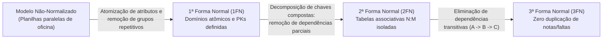

# 🗄️ [DB-002] Modelo Lógico Relacional Normalizado (3FN) — Projeto NEXA

> **ID do Card**: `DB-002` | **Epic**: `EPIC-01: Autenticação, Perfis (RBAC) & Segurança` | **Sprint / Lote**: `Lote 1 (S1)`  
> **Prioridade**: `P0` | **Estimativa**: `5 SP` | **Status**: `Concluído`  
> **Stack de Banco**: `PostgreSQL 16 + Docker + SQL DDL Nativo`  
> **Script SQL Físico**: [`BancoNexa/sql/02_modelo_logico_3fn.sql`](../../BancoNexa/sql/02_modelo_logico_3fn.sql)  
> **Rastreabilidade**: ⬅️ Anterior: [`DB-001`](./01-modelo-conceitual.md) | ➡️ Próximo: `DB-003` | 🔓 Desbloqueia: `DB-010`

---

## 1. Objetivo e Diretrizes Arquiteturais (Docker + SQL Puro)

Este documento transforma o [Modelo Conceitual (`DB-001`)](./01-modelo-conceitual.md) em um **Modelo Lógico Relacional Normalizado até a 3ª Forma Normal (3FN)**, projetado especificamente para **PostgreSQL 16 rodando em container Docker** e acompanhado de seu script DDL completo em SQL nativo ([`BancoNexa/sql/02_modelo_logico_3fn.sql`](../../BancoNexa/sql/02_modelo_logico_3fn.sql)).

### Pilares Técnicos Aplicados
1. **Chaves Primárias `UUID v4` (`gen_random_uuid()`)**: Todas as entidades principais utilizam `UUID` nativo de 128 bits do PostgreSQL 16, prevenindo ataques de *ID Enumeration (IDOR)* nas rotas da API e permitindo geração distribuída sem colisão de sequências em ambientes containerizados.
2. **Normalização Rigorosa (`1FN → 2FN → 3FN`)**: Eliminação total de anomalias de inserção, atualização e exclusão, garantindo que **nenhuma informação de notas ou faltas seja duplicada entre módulos ou disciplinas**.
3. **Chaves Compostas em Tabelas Associativas**: Modelagem explícita de chaves primárias compostas (`PRIMARY KEY (col_a, col_b)`) e restrições compostas de unicidade (`UNIQUE (col_a, col_b)`) para relacionamentos `N:M` (como `module_competencies`, `student_subjects`, `enrollments`, `teacher_assignments`, `attendance_records`, `student_grades`, `task_submissions` e `submission_evaluations`).
4. **Integridade Referencial Defensiva (`ON DELETE RESTRICT`)**: Proteção no nível do motor SQL contra exclusão acidental de histórico acadêmico.

---

## 2. Comprovação Formal de Normalização (1FN, 2FN e 3FN)



### 2.1. Primeira Forma Normal (1FN) — Atomicidade e Sem Grupos Repetitivos
- **Regra**: Todos os atributos possuem valores atômicos e indivisíveis; não existem arrays de notas (`nota_1, nota_2, nota_3`) nem listas de competências separadas por vírgula.
- **Aplicação no NEXA**:
  - As rubricas de uma peça prática foram decompostas na tabela `task_criteria` e suas avaliações individuais em `submission_evaluations`.
  - O tipo `JSONB` no PostgreSQL 16 é utilizado **exclusivamente para snapshots históricos imutáveis de auditoria** (`audit_logs.old_values/new_values`, `academic_alerts.metric_snapshot`, `student_milestone_history.metadata`), nunca para substituir relacionamentos transacionais.

### 2.2. Segunda Forma Normal (2FN) — Eliminação de Dependências Funcionais Parciais
- **Regra**: Todo atributo não-chave deve depender funcionalmente da **chave candidata/primária inteira**, e nunca de apenas parte de uma chave composta.
- **Aplicação nas Tabelas Associativas do NEXA**:
  - **`module_competencies (module_id, competency_id)`**: Os atributos `weight` (peso da competência naquele módulo) e `required_level` (nível de 1 a 5 exigido naquele módulo) dependem simultaneamente de `module_id` **e** `competency_id`. O título e a categoria da competência ficam isolados em `competencies`.
  - **`student_subjects (enrollment_id, subject_id)`**: Modela o vínculo `N:M` Aluno-Disciplina com chave primária composta `PRIMARY KEY (enrollment_id, subject_id)`. A carga horária e ementa ficam apenas em `subjects`.
  - **`submission_evaluations (submission_id, criterion_id)`**: A nota `score_awarded` e o nível `achieved_level` dependem do par `(submission_id, criterion_id)`, enquanto o peso da rubrica fica em `task_criteria`.

### 2.3. Terceira Forma Normal (3FN) — Eliminação de Dependências Transitivas e Zero Duplicação entre Módulos
- **Regra**: Nenhum atributo não-chave pode depender de outro atributo não-chave ($A \to B \to C$).
- **Como garantimos que NENHUMA nota ou falta seja duplicada entre módulos**:
  1. **Frequência Atômica por Aula (`attendance_records`)**:
     - Em vez de gravar faltas duplicadas na tabela do módulo e na tabela da disciplina, a presença é gravada **uma única vez** em `attendance_records` vinculada a `lesson_id` (`class_lessons`).
     - Como `class_lessons` possui `subject_id` e `module_id`, o cálculo de presença por módulo (`vw_module_attendance_risk`) ou geral da turma (`vw_student_360_performance`) é derivado via `JOIN` em tempo real, eliminando qualquer anomalia de atualização.
  2. **Notas Formativas Atômicas (`student_grades`)**:
     - Cada nota é gravada **uma única vez** em `student_grades` referenciando `assessment_id` (`academic_assessments`). O peso (`weight`) e o módulo (`module_id`) residem exclusivamente em `academic_assessments`, nunca copiados para `student_grades`.
  3. **Notas Práticas de Oficina Atômicas (`submission_evaluations` → `task_submissions`)**:
     - A avaliação de cada critério técnico de usinagem/metrologia é registrada em `submission_evaluations`, vinculada à entrega `task_submissions`, que por sua vez pertence a `practical_tasks` (ligada a `module_id`). Não há tabela redundante copiando notas práticas entre módulos.
  4. **Separação Credenciais vs. Dados Pessoais (`users` ↔ `user_profiles`)**:
     - Dados institucionais e de contato (`full_name`, `registration_number`, `phone`) não ficam misturados com hashes de autenticação e sessões.

---

## 3. Política de Integridade Referencial (`ON DELETE` / `ON UPDATE`)

Todas as chaves estrangeiras do script [`02_modelo_logico_3fn.sql`](../../BancoNexa/sql/02_modelo_logico_3fn.sql) seguem uma política explícita de integridade referencial:

| Regra SQL | Onde é Aplicada | Justificativa de Engenharia de Dados |
|---|---|---|
| **`ON DELETE RESTRICT`** | `courses`, `classes`, `subjects`, `learning_modules`, `competencies`, `enrollments`, `student_subjects`, `teacher_assignments`, `class_lessons`, `attendance_records`, `academic_assessments`, `student_grades`, `practical_tasks`, `task_submissions`, `submission_evaluations`, `self_assessment_forms`, `student_self_assessments`, `skill_evidences`, `pedagogical_notes` | **Proteção absoluta do histórico acadêmico**: impede que um curso, turma, módulo, matrícula ou aula seja deletado fisicamente caso possua notas, presenças ou entregas vinculadas. |
| **`ON DELETE CASCADE`** | `user_profiles`, `auth_sessions`, `module_competencies` (FK `module_id`), `task_criteria` (FK `task_id`), `chat_messages` (FK `help_request_id`) | Entidades fracas de composição direta cujo ciclo de vida depende integralmente do registro pai. |
| **`ON DELETE SET NULL`** | `audit_logs.user_id`, `academic_alerts.resolved_by`, `help_requests.assigned_teacher_id` | Preserva o registro histórico de auditoria, alerta ou chamado mesmo se o usuário operador for desvinculado no futuro. |

---

## 4. Tipos Enumerados Nativos do PostgreSQL 16 (`CREATE TYPE ... AS ENUM`)

O schema define **17 tipos enumerados nativos**, garantindo validação em nível de byte no PostgreSQL sem custo de `JOIN` adicional:

| Nome do Tipo SQL (`ENUM`) | Valores Permitidos | Tabelas Consumidoras |
|---|---|---|
| `user_role_enum` | `'ADMIN'`, `'COORDINATOR'`, `'TEACHER'`, `'STUDENT'` | `users.role` |
| `shift_enum` | `'MORNING'`, `'AFTERNOON'`, `'NIGHT'` | `classes.shift` |
| `class_status_enum` | `'PLANNING'`, `'ACTIVE'`, `'COMPLETED'`, `'ARCHIVED'` | `classes.status` |
| `enrollment_status_enum` | `'ACTIVE'`, `'COMPLETED'`, `'DROPPED'`, `'SUSPENDED'` | `enrollments.status`, `student_subjects.status` |
| `competency_category_enum` | `'TECHNICAL'`, `'SAFETY'`, `'PROCEDURAL'` | `competencies.category` |
| `attendance_status_enum` | `'PRESENT'`, `'ABSENT'`, `'LATE'`, `'JUSTIFIED'` | `attendance_records.status` |
| `submission_status_enum` | `'PENDING'`, `'SUBMITTED'`, `'EVALUATED'`, `'LATE'` | `task_submissions.status` |
| `assessment_type_enum` | `'EXAM'`, `'MICRO_EVALUATION'`, `'PROJECT'` | `academic_assessments.assessment_type` |
| `risk_level_enum` | `'LOW'`, `'MODERATE'`, `'HIGH'`, `'CRITICAL'` | `academic_alerts.risk_level` |
| `alert_category_enum` | `'ATTENDANCE'`, `'GRADE_DROP'`, `'PENDING_TASKS'`, `'SELF_EVAL_GAP'` | `academic_alerts.alert_category` |
| `alert_status_enum` | `'ACTIVE'`, `'ACKNOWLEDGED'`, `'RESOLVED'` | `academic_alerts.status` |
| `diagnostic_type_enum` | `'ALIGNED'`, `'OVERCONFIDENCE_RISK'`, `'UNDERCONFIDENCE_SUPPORT'`, `'INSUFFICIENT_EVIDENCE'` | `explainable_diagnostics.diagnostic_type` |
| `milestone_type_enum` | `'MODULE_COMPLETED'`, `'SKILL_LEVEL_UP'`, `'PERFECT_ATTENDANCE'`, `'RECOVERY_ACHIEVED'` | `student_milestone_history.milestone_type` |
| `announcement_priority_enum` | `'NORMAL'`, `'IMPORTANT'`, `'URGENT'` | `class_announcements.priority` |
| `help_request_category_enum` | `'TECHNICAL_DOUBT'`, `'PRACTICAL_DIFFICULTY'`, `'PERSONAL_PEDAGOGICAL'` | `help_requests.category` |
| `help_request_status_enum` | `'OPEN'`, `'IN_PROGRESS'`, `'RESOLVED'`, `'CLOSED'` | `help_requests.status` |
| `note_visibility_scope_enum` | `'PRIVATE_AUTHOR'`, `'TEACHERS_AND_COORD'`, `'COORDINATION_ONLY'` | `pedagogical_notes.visibility_scope` |
| `note_category_enum` | `'INTERVENTION'`, `'MENTORING'`, `'BEHAVIORAL'`, `'ACCOMMODATION'` | `pedagogical_notes.category` |

---

## 5. Especificação Relacional das Tabelas em 3FN (Tipos, PKs, FKs e Constraints)

### 5.1. Domínio 1 — Identidade, Acesso (RBAC), Sessões e Auditoria

#### `T01 — users`
| Coluna | Tipo PostgreSQL 16 | Nulo? | Default | Constraints e Chaves |
|---|---|:---:|---|---|
| `id` | `UUID` | `NOT NULL` | `gen_random_uuid()` | `PRIMARY KEY` |
| `email` | `VARCHAR(255)` | `NOT NULL` | — | `UNIQUE (uq_users_email)`, `CHECK (email = LOWER(email))` |
| `password_hash` | `VARCHAR(255)` | `NOT NULL` | — | Hash Bcrypt/Argon2 |
| `role` | `user_role_enum` | `NOT NULL` | `'STUDENT'` | RBAC global |
| `is_active` | `BOOLEAN` | `NOT NULL` | `TRUE` | Flag de conta ativa |
| `created_at` / `updated_at` | `TIMESTAMPTZ` | `NOT NULL` | `CURRENT_TIMESTAMP` | Auditoria temporal |

#### `T02 — user_profiles`
| Coluna | Tipo PostgreSQL 16 | Nulo? | Default | Constraints e Chaves |
|---|---|:---:|---|---|
| `id` | `UUID` | `NOT NULL` | `gen_random_uuid()` | `PRIMARY KEY` |
| `user_id` | `UUID` | `NOT NULL` | — | `UNIQUE`, `FK -> users(id) ON DELETE CASCADE` |
| `full_name` | `VARCHAR(150)` | `NOT NULL` | — | Nome completo (isolado para LGPD) |
| `registration_number` | `VARCHAR(50)` | `NOT NULL` | — | `UNIQUE (uq_user_profiles_registration_number)` |
| `phone` | `VARCHAR(25)` | `NULL` | `NULL` | Telefone de contato |
| `avatar_url` / `bio` | `VARCHAR(500)` / `TEXT` | `NULL` | `NULL` | Perfil visual |
| `created_at` / `updated_at` | `TIMESTAMPTZ` | `NOT NULL` | `CURRENT_TIMESTAMP` | Auditoria temporal |

#### `T03 — auth_sessions` & `T04 — audit_logs`
- **`auth_sessions`**: `id (UUID PK)`, `user_id (UUID FK -> users ON DELETE CASCADE)`, `refresh_token_hash (VARCHAR(255) UNIQUE)`, `user_agent (VARCHAR(500))`, `ip_address (VARCHAR(45))`, `expires_at (TIMESTAMPTZ)`, `is_revoked (BOOLEAN DEFAULT FALSE)`, `created_at (TIMESTAMPTZ)`. Constraint `CHECK (expires_at > created_at)`.
- **`audit_logs`**: `id (UUID PK)`, `user_id (UUID FK -> users ON DELETE SET NULL)`, `action (VARCHAR(100))`, `entity (VARCHAR(100))`, `entity_id (VARCHAR(100))`, `old_values (JSONB)`, `new_values (JSONB)`, `ip_address (VARCHAR(45))`, `created_at (TIMESTAMPTZ)`.

---

### 5.2. Domínio 2 — Estrutura Curricular, Matrículas e Tabelas Associativas com Chaves Compostas

#### `T05 — courses`
- `id (UUID PK)`, `code (VARCHAR(30) UNIQUE)`, `name (VARCHAR(150) NOT NULL)`, `description (TEXT)`, `total_hours (INTEGER NOT NULL CHECK (total_hours > 0))`, `is_active (BOOLEAN DEFAULT TRUE)`, `created_at`, `updated_at`.

#### `T06 — classes`
- `id (UUID PK)`, `course_id (UUID FK -> courses ON DELETE RESTRICT)`, `code (VARCHAR(40))`, `period (VARCHAR(20))`, `shift (shift_enum)`, `max_students (INTEGER DEFAULT 40 CHECK (max_students BETWEEN 1 AND 100))`, `status (class_status_enum DEFAULT 'PLANNING')`, `start_date (DATE)`, `end_date (DATE)`.
- **Constraints**: `UNIQUE (code, period)` e `CHECK (start_date < end_date)`.

#### `T07 — subjects`
- `id (UUID PK)`, `course_id (UUID FK -> courses ON DELETE RESTRICT)`, `code (VARCHAR(50))`, `name (VARCHAR(150))`, `workload_hours (INTEGER CHECK (workload_hours > 0))`, `syllabus (TEXT)`, `is_active (BOOLEAN DEFAULT TRUE)`.
- **Constraint Composta**: `UNIQUE (course_id, code)`.

#### `T08 — learning_modules`
- `id (UUID PK)`, `subject_id (UUID FK -> subjects ON DELETE RESTRICT)`, `title (VARCHAR(120))`, `order_index (INTEGER CHECK (order_index > 0))`, `description (TEXT)`, `practical_hours (INTEGER CHECK (practical_hours >= 0))`, `module_weight (NUMERIC(4,2) DEFAULT 1.00 CHECK (module_weight > 0))`, `passing_score (NUMERIC(4,2) DEFAULT 6.00 CHECK (passing_score BETWEEN 0.00 AND 10.00))`.
- **Constraint Composta**: `UNIQUE (subject_id, order_index)`.

#### `T09 — competencies` & `T10 — module_competencies` *(Chave Primária Composta)*
- **`competencies`**: `id (UUID PK)`, `code (VARCHAR(50) UNIQUE)`, `title (VARCHAR(150))`, `category (competency_category_enum)`, `description (TEXT)`.
- **`module_competencies`**:
  - **Chave Primária Composta**: `PRIMARY KEY (module_id, competency_id)`
  - `module_id (UUID FK -> learning_modules ON DELETE CASCADE)`
  - `competency_id (UUID FK -> competencies ON DELETE RESTRICT)`
  - `weight (NUMERIC(3,2) DEFAULT 1.00 CHECK (weight BETWEEN 0.01 AND 9.99))`
  - `required_level (INTEGER DEFAULT 3 CHECK (required_level BETWEEN 1 AND 5))`

#### `T11 — enrollments`, `T12 — student_subjects` *(Chave Composta Aluno-Disciplina)* & `T13 — teacher_assignments`
- **`enrollments` (Aluno ↔ Turma)**:
  - `id (UUID PK)`, `student_id (UUID FK -> users ON DELETE RESTRICT)`, `class_id (UUID FK -> classes ON DELETE RESTRICT)`, `enrollment_date (DATE)`, `status (enrollment_status_enum DEFAULT 'ACTIVE')`, `final_grade (NUMERIC(4,2) NULL CHECK (0..10))`, `attendance_rate (NUMERIC(5,2) NULL CHECK (0..100))`.
  - **Chave Candidata Composta**: `UNIQUE (student_id, class_id)`.
- **`student_subjects` (Tabela Associativa Aluno ↔ Disciplina)**:
  - **Chave Primária Composta**: `PRIMARY KEY (enrollment_id, subject_id)`
  - `enrollment_id (UUID FK -> enrollments ON DELETE RESTRICT)`
  - `subject_id (UUID FK -> subjects ON DELETE RESTRICT)`
  - `status (enrollment_status_enum DEFAULT 'ACTIVE')`, `enrolled_at (TIMESTAMPTZ)`
- **`teacher_assignments` (Professor ↔ Turma ↔ Disciplina)**:
  - `id (UUID PK)`, `teacher_id (UUID FK -> users ON DELETE RESTRICT)`, `class_id (UUID FK -> classes ON DELETE RESTRICT)`, `subject_id (UUID FK -> subjects ON DELETE RESTRICT)`, `assigned_at (TIMESTAMPTZ)`, `is_main_teacher (BOOLEAN DEFAULT TRUE)`.
  - **Chave Candidata Composta**: `UNIQUE (teacher_id, class_id, subject_id)`.

---

### 5.3. Domínio 3 — Diário de Classe, Frequência e Avaliações Formativas (3FN)

| Tabela | Chave Primária | Chaves Compostas (`UNIQUE`) | Chaves Estrangeiras (`ON DELETE RESTRICT`) | Constraints de Domínio (`CHECK`) |
|---|---|---|---|---|
| **`T14 — class_lessons`** | `id (UUID)` | — | `class_id -> classes`, `subject_id -> subjects`, `module_id -> learning_modules`, `teacher_id -> users` | `workload_hours BETWEEN 1 AND 8` |
| **`T15 — attendance_records`** | `id (UUID)` | `UNIQUE (lesson_id, student_id)` e `UNIQUE (lesson_id, enrollment_id)` | `lesson_id -> class_lessons`, `enrollment_id -> enrollments`, `student_id -> users` | `absent_hours BETWEEN 0 AND 8` |
| **`T16 — academic_assessments`** | `id (UUID)` | — | `class_id -> classes`, `subject_id -> subjects`, `module_id -> learning_modules` | `weight > 0.00`, `max_grade BETWEEN 0.01 AND 10.00` |
| **`T17 — student_grades`** | `id (UUID)` | `UNIQUE (assessment_id, student_id)` e `UNIQUE (assessment_id, enrollment_id)` | `assessment_id -> academic_assessments`, `enrollment_id -> enrollments`, `student_id -> users`, `recorded_by -> users` | `grade_value BETWEEN 0.00 AND 10.00`, `recovery_grade BETWEEN 0.00 AND 10.00` |

---

### 5.4. Domínio 4 — Oficina Prática, Rubricas de Precisão e Entregas (3FN)

| Tabela | Chave Primária | Chaves Compostas (`UNIQUE`) | Chaves Estrangeiras | Constraints de Domínio (`CHECK`) |
|---|---|---|---|---|
| **`T18 — practical_tasks`** | `id (UUID)` | — | `module_id -> learning_modules (RESTRICT)`, `class_id -> classes (RESTRICT)` | `max_score BETWEEN 1.00 AND 10.00` |
| **`T19 — task_criteria`** | `id (UUID)` | `UNIQUE (task_id, criterion_name)` | `task_id -> practical_tasks (CASCADE)`, `competency_id -> competencies (RESTRICT)` | `weight > 0.00`, `min_acceptable_level BETWEEN 1 AND 5` |
| **`T20 — task_submissions`** | `id (UUID)` | `UNIQUE (task_id, student_id)` | `task_id -> practical_tasks (RESTRICT)`, `student_id -> users (RESTRICT)`, `enrollment_id -> enrollments (RESTRICT)` | `final_task_score BETWEEN 0.00 AND 10.00` |
| **`T21 — submission_evaluations`** | `id (UUID)` | `UNIQUE (submission_id, criterion_id)` | `submission_id -> task_submissions (RESTRICT)`, `criterion_id -> task_criteria (RESTRICT)`, `evaluator_id -> users (RESTRICT)` | `achieved_level BETWEEN 1 AND 5`, `score_awarded BETWEEN 0.00 AND 10.00` |

---

### 5.5. Domínio 5 — Autoavaliação, Evidências, Alertas e Diagnóstico Explicável 360°

| Tabela | Chave Primária | Chaves Compostas (`UNIQUE`) | Chaves Estrangeiras (`ON DELETE RESTRICT`) | Constraints de Domínio (`CHECK`) |
|---|---|---|---|---|
| **`T22 — self_assessment_forms`** | `id (UUID)` | — | `module_id -> learning_modules`, `class_id -> classes`, `created_by -> users` | `opens_at < closes_at` |
| **`T23 — student_self_assessments`** | `id (UUID)` | `UNIQUE (form_id, student_id, competency_id)` | `form_id -> self_assessment_forms`, `student_id -> users`, `competency_id -> competencies` | `perceived_level BETWEEN 1 AND 5`, `confidence_score BETWEEN 1 AND 5` |
| **`T24 — skill_evidences`** | `id (UUID)` | — | `student_id -> users`, `competency_id -> competencies`, `source_submission_id -> task_submissions`, `source_assessment_id -> academic_assessments`, `verified_by -> users` | `verified_level BETWEEN 1.00 AND 5.00`, `source_submission_id IS NOT NULL OR source_assessment_id IS NOT NULL` |
| **`T25 — academic_alerts`** | `id (UUID)` | — | `student_id -> users`, `enrollment_id -> enrollments`, `class_id -> classes`, `module_id -> learning_modules`, `resolved_by -> users (SET NULL)` | `explainable_reason NOT NULL`, `metric_snapshot JSONB NOT NULL` |
| **`T26 — explainable_diagnostics`** | `id (UUID)` | — | `student_id -> users`, `class_id -> classes`, `module_id -> learning_modules`, `competency_id -> competencies` | `self_perceived_level BETWEEN 1.00 AND 5.00`, `teacher_verified_level BETWEEN 1.00 AND 5.00` |
| **`T27 — student_milestone_history`** | `id (UUID)` | — | `student_id -> users`, `enrollment_id -> enrollments`, `module_id -> learning_modules` | — |

---

### 5.6. Domínio 6 — Comunicação Oficial, Apoio Confidencial, Notas Pedagógicas e Gamificação

| Tabela | Chave Primária | Chaves Compostas (`UNIQUE`) | Chaves Estrangeiras | Constraints de Domínio (`CHECK`) |
|---|---|---|---|---|
| **`T28 — class_announcements`** | `id (UUID)` | — | `class_id -> classes (RESTRICT)`, `subject_id -> subjects (RESTRICT)`, `author_id -> users (RESTRICT)` | `expires_at IS NULL OR expires_at > published_at` |
| **`T29 — help_requests`** | `id (UUID)` | — | `student_id -> users (RESTRICT)`, `enrollment_id -> enrollments (RESTRICT)`, `subject_id -> subjects (RESTRICT)`, `module_id -> learning_modules (RESTRICT)`, `assigned_teacher_id -> users (SET NULL)` | `is_confidential DEFAULT TRUE` |
| **`T30 — pedagogical_notes`** | `id (UUID)` | — | `student_id -> users (RESTRICT)`, `enrollment_id -> enrollments (RESTRICT)`, `author_id -> users (RESTRICT)` | `visibility_scope` (`PRIVATE_AUTHOR`, `TEACHERS_AND_COORD`, `COORDINATION_ONLY`) |
| **`T31 — chat_messages`** | `id (UUID)` | — | `help_request_id -> help_requests (CASCADE)`, `sender_id -> users (RESTRICT)` | — |
| **`T32 — gamification_badges`** | `id (UUID)` | `UNIQUE (code)` | `competency_id -> competencies (RESTRICT)` | `xp_reward > 0` |
| **`T33 — student_achievements`** | `id (UUID)` | `UNIQUE (student_id, badge_id)` | `student_id -> users (RESTRICT)`, `enrollment_id -> enrollments (RESTRICT)`, `badge_id -> gamification_badges (RESTRICT)` | — |

---

## 6. Diagrama Lógico Relacional Normalizado (3FN) em Mermaid

```mermaid
erDiagram
    USERS ||--|| USER_PROFILES : "user_id (CASCADE)"
    USERS ||--o{ AUTH_SESSIONS : "user_id (CASCADE)"
    USERS ||--o{ AUDIT_LOGS : "user_id (SET NULL)"

    COURSES ||--o{ CLASSES : "course_id (RESTRICT)"
    COURSES ||--o{ SUBJECTS : "course_id (RESTRICT)"
    SUBJECTS ||--o{ LEARNING_MODULES : "subject_id (RESTRICT)"

    LEARNING_MODULES ||--o{ MODULE_COMPETENCIES : "PK(module_id, competency_id)"
    COMPETENCIES ||--o{ MODULE_COMPETENCIES : "PK(module_id, competency_id)"

    USERS ||--o{ ENROLLMENTS : "UQ(student_id, class_id) RESTRICT"
    CLASSES ||--o{ ENROLLMENTS : "UQ(student_id, class_id) RESTRICT"

    ENROLLMENTS ||--o{ STUDENT_SUBJECTS : "PK(enrollment_id, subject_id)"
    SUBJECTS ||--o{ STUDENT_SUBJECTS : "PK(enrollment_id, subject_id)"

    USERS ||--o{ TEACHER_ASSIGNMENTS : "UQ(teacher_id, class_id, subject_id)"
    CLASSES ||--o{ TEACHER_ASSIGNMENTS : "RESTRICT"
    SUBJECTS ||--o{ TEACHER_ASSIGNMENTS : "RESTRICT"

    CLASSES ||--o{ CLASS_LESSONS : "class_id (RESTRICT)"
    LEARNING_MODULES o|--o{ CLASS_LESSONS : "module_id (RESTRICT)"
    CLASS_LESSONS ||--o{ ATTENDANCE_RECORDS : "UQ(lesson_id, enrollment_id)"
    ENROLLMENTS ||--o{ ATTENDANCE_RECORDS : "enrollment_id (RESTRICT)"

    LEARNING_MODULES o|--o{ ACADEMIC_ASSESSMENTS : "module_id (RESTRICT)"
    ACADEMIC_ASSESSMENTS ||--o{ STUDENT_GRADES : "UQ(assessment_id, enrollment_id)"
    ENROLLMENTS ||--o{ STUDENT_GRADES : "enrollment_id (RESTRICT)"

    LEARNING_MODULES ||--o{ PRACTICAL_TASKS : "module_id (RESTRICT)"
    PRACTICAL_TASKS ||--o{ TASK_CRITERIA : "task_id (CASCADE)"
    PRACTICAL_TASKS ||--o{ TASK_SUBMISSIONS : "UQ(task_id, student_id)"
    ENROLLMENTS ||--o{ TASK_SUBMISSIONS : "enrollment_id (RESTRICT)"
    TASK_SUBMISSIONS ||--o{ SUBMISSION_EVALUATIONS : "UQ(submission_id, criterion_id)"
    TASK_CRITERIA ||--o{ SUBMISSION_EVALUATIONS : "criterion_id (RESTRICT)"

    LEARNING_MODULES ||--o{ SELF_ASSESSMENT_FORMS : "module_id (RESTRICT)"
    SELF_ASSESSMENT_FORMS ||--o{ STUDENT_SELF_ASSESSMENTS : "UQ(form_id, student_id, competency_id)"
    COMPETENCIES ||--o{ SKILL_EVIDENCES : "competency_id (RESTRICT)"
    ENROLLMENTS ||--o{ ACADEMIC_ALERTS : "enrollment_id (RESTRICT)"
    CLASSES ||--o{ EXPLAINABLE_DIAGNOSTICS : "class_id (RESTRICT)"
    ENROLLMENTS ||--o{ STUDENT_MILESTONE_HISTORY : "enrollment_id (RESTRICT)"

    CLASSES ||--o{ CLASS_ANNOUNCEMENTS : "class_id (RESTRICT)"
    ENROLLMENTS ||--o{ HELP_REQUESTS : "enrollment_id (RESTRICT)"
    HELP_REQUESTS ||--o{ CHAT_MESSAGES : "help_request_id (CASCADE)"
    ENROLLMENTS ||--o{ PEDAGOGICAL_NOTES : "enrollment_id (RESTRICT)"
    GAMIFICATION_BADGES ||--o{ STUDENT_ACHIEVEMENTS : "UQ(student_id, badge_id)"
```



---

## 7. Como Executar o Script SQL no PostgreSQL 16 via Docker

Quando o container PostgreSQL 16 estiver ativo (configurado no card `DB-003`), o schema relacional completo em 3FN pode ser aplicado diretamente via `docker exec` com `psql`:

```bash
docker exec -i nexa-postgres psql -U postgres -d nexa_db < BancoNexa/sql/02_modelo_logico_3fn.sql
```

---

## 8. Checklist de Verificação dos Critérios de Aceitação (`DB-002`)

- [x] **Critério 1 — Todas as tabelas em 3FN documentadas com tipos e constraints**: Documentadas **33 tabelas** e **18 tipos `ENUM` nativos** tanto neste documento quanto no script executável [`BancoNexa/sql/02_modelo_logico_3fn.sql`](../../BancoNexa/sql/02_modelo_logico_3fn.sql).
- [x] **Critério 2 — Nenhuma informação de notas ou faltas duplicada entre módulos**: Garantido na Seção 2.3; `attendance_records`, `student_grades` e `submission_evaluations` armazenam fatos atômicos uma única vez com chaves estrangeiras `ON DELETE RESTRICT`.
- [x] **Critério 3 — Chaves compostas modeladas para tabelas associativas (ex: aluno-disciplina)**: Implementadas chaves primárias compostas em `student_subjects` (`PRIMARY KEY (enrollment_id, subject_id)`) e `module_competencies` (`PRIMARY KEY (module_id, competency_id)`), além de constraints compostas em todas as demais tabelas associativas (`enrollments`, `teacher_assignments`, `attendance_records`, `student_grades`, `task_submissions`, `submission_evaluations`, `student_self_assessments` e `student_achievements`).
- [x] **Observação Técnica — UUID v4 como PK**: Padronizado com `UUID PRIMARY KEY DEFAULT gen_random_uuid()` nativo do PostgreSQL 16.
