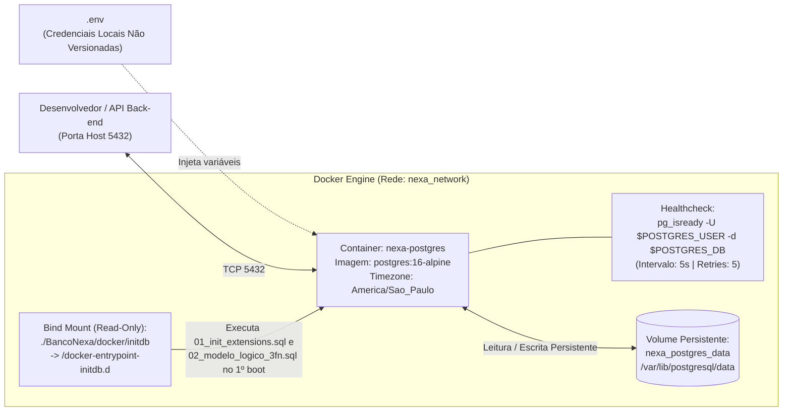

# 🐳 [DB-003] Instância PostgreSQL 16 e Ambiente Docker Compose — Projeto NEXA

> **ID do Card**: `DB-003` | **Epic**: `EPIC-01: Autenticação, Perfis (RBAC) & Segurança` | **Sprint / Lote**: `Lote 1 (S1)`  
> **Prioridade**: `P0` | **Estimativa**: `2 SP` | **Tipo**: `Infraestrutura` | **Status**: `Concluído`  
> **Arquivos Principais**: [`docker-compose.yml`](../../docker-compose.yml), [`.env.example`](../../.env.example), [`BancoNexa/docker/initdb/01_init_extensions.sql`](../../BancoNexa/docker/initdb/01_init_extensions.sql)  
> **Rastreabilidade**: ⬅️ Anterior: [`DB-002`](./02-modelo-logico-3fn.md) | ➡️ Próximo: `DB-004` | 🔓 Desbloqueia: `DB-004`, `DB-010`, `DB-048`, `DOC-010`, `DOC-012`

---

## 1. Objetivo da Infraestrutura de Banco de Dados

O card **`DB-003`** disponibiliza um ambiente de banco de dados relacional **PostgreSQL 16 Alpine** padronizado, reprodutível e isolado via **Docker Compose**. Com um único comando (`docker compose up -d`), qualquer integrante da equipe sobe a instância configurada com:
- Imagem oficial leve e segura: **`postgres:16-alpine`**;
- Persistência garantida em volume nomeado (`nexa_postgres_data`);
- Fuso horário padronizado do Brasil: **`America/Sao_Paulo`** (tanto no sistema operacional do container via `TZ`/`PGTZ` quanto no motor PostgreSQL via `-c timezone=America/Sao_Paulo`);
- Monitoramento ativo de saúde (**Healthcheck**) via utilitário nativo **`pg_isready`**;
- Credenciais 100% parametrizadas por variáveis de ambiente (`.env`), **sem senhas em texto puro versionadas no código**.
- Inicialização automática de extensões (`pgcrypto`, `uuid-ossp`) e do schema 3FN via diretório `/docker-entrypoint-initdb.d`.

---

## 2. Arquitetura do Container e Volumes (`docker-compose.yml`)



---

## 3. Variáveis de Ambiente Parametrizadas (`.env.example`)

Para cumprir a regra de negócio *"Não versionar senhas em texto puro; utilizar referências a `.env`"*, o arquivo [`docker-compose.yml`](../../docker-compose.yml) exige que as credenciais sejam carregadas do arquivo `.env` (ignorado pelo `.gitignore`), utilizando a sintaxe de obrigatoriedade `${VAR:?Mensagem}` do Docker Compose v2+:

| Variável no `.env` | Valor de Exemplo (`.env.example`) | Finalidade na Infraestrutura |
|---|---|---|
| `POSTGRES_CONTAINER_NAME` | `nexa-postgres` | Nome padronizado do container Docker para comandos `docker exec`. |
| `POSTGRES_HOST` | `localhost` | Host de conexão local para Back-end e clientes SQL. |
| `POSTGRES_PORT` | `5432` | Porta exposta no host mapeada para a porta `5432` do container. |
| `POSTGRES_USER` | `nexa_admin` | Superusuário administrativo da instância local PostgreSQL 16. |
| `POSTGRES_PASSWORD` | `troque_esta_senha_local_segura` | Senha obrigatória (não versionada no `.env` real). |
| `POSTGRES_DB` | `nexa_senai_db` | Nome do banco de dados principal criado automaticamente no boot. |
| `POSTGRES_TZ` | `America/Sao_Paulo` | Fuso horário oficial para timestamps de chamadas, entregas e auditoria. |
| `DATABASE_URL` | `postgresql://...` | String de conexão completa para ORM / drivers assíncronos e scripts SQL. |

---

## 4. Guia Rápido de Operação (Comandos Docker + SQL)

### Passo 1 — Criar o arquivo `.env` local
Na raiz do repositório, copie o template `.env.example` para `.env`:

```powershell
Copy-Item .env.example .env
```

### Passo 2 — Subir o Banco de Dados em Background
```bash
docker compose up -d
```

### Passo 3 — Verificar o Healthcheck (`healthy`)
```bash
docker compose ps
```

### Passo 4 — Testar Conexão Autenticada e Timezone via `psql`
```bash
docker exec -it nexa-postgres psql -U nexa_admin -d nexa_senai_db -c "SHOW TIME ZONE; SELECT version();"
```

### Passo 5 — Parar ou Reiniciar preservando os dados
```bash
# Para o container mantendo 100% dos dados salvos no volume nexa_postgres_data:
docker compose stop

# Inicia novamente sem perda de dados:
docker compose start
```

---

## 5. Checklist de Verificação dos Critérios de Aceitação (`DB-003`)

- [x] **Critério 1 — `docker-compose.yml` funcional com PostgreSQL 16**: Configurado com a imagem oficial `postgres:16-alpine`, timezone `America/Sao_Paulo` e porta `5432` parametrizada. Validado com `docker compose --env-file .env.example config`.
- [x] **Critério 2 — Volume persistente mapeado para evitar perda de dados no reinício do container**: Volume nomeado `nexa_postgres_data` mapeado em `/var/lib/postgresql/data`.
- [x] **Critério 3 — Healthcheck configurado garantindo que o serviço responda ao comando `pg_isready`**: Configurado com `pg_isready -U $${POSTGRES_USER} -d $${POSTGRES_DB} -h localhost -p 5432`, intervalo de `5s`, timeout de `5s` e `5` tentativas.
- [x] **Observação Técnica — Não versionar senhas em texto puro**: Credenciais lidas exclusivamente de variáveis de ambiente com validação `${VAR:?...}` e proteção no `.gitignore`.
