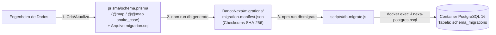

# 🔄 [DB-004] Inicializar Esquema e Estrutura de Migrations SQL Versionadas — Projeto NEXA

> **ID do Card**: `DB-004` | **Epic**: `EPIC-01: Autenticação, Perfis (RBAC) & Segurança` | **Sprint / Lote**: `Lote 1 (S1)`  
> **Prioridade**: `P0` | **Estimativa**: `2 SP` | **Tipo**: `Infraestrutura` | **Status**: `Concluído`  
> **Arquivos Principais**: [`prisma/schema.prisma`](../../prisma/schema.prisma), [`prisma/migrations/`](../../prisma/migrations/), [`BancoNexa/migrations/`](../../BancoNexa/migrations/), [`package.json`](../../package.json)  
> **Rastreabilidade**: ⬅️ Anterior: [`DB-003`](./03-instancia-postgresql-docker.md) | ➡️ Próximo: `DB-005` | 🔓 Desbloqueia: `DB-005`, `DB-006`, `DB-010`, `DB-011`

---

## 1. Objetivo e Arquitetura de Migrations Versionadas (Docker + SQL)

O card **`DB-004`** estrutura o controle de versão incremental do esquema de banco de dados do projeto **NEXA**. Atendendo simultaneamente aos critérios de aceitação do card (`prisma/schema.prisma`, `prisma/migrations/` e scripts `npm run db:migrate` / `npm run db:generate`) e à diretriz arquitetural de **execução em Docker + SQL Puro**:

1. **Migrations como Arquivos `.sql` Puros Versionados**: Cada migração reside em `prisma/migrations/<timestamp>_<nome>/migration.sql` (e espelhada em `BancoNexa/migrations/`), contendo transações SQL explícitas (`BEGIN; ... COMMIT;`) para o **PostgreSQL 16**.
2. **Tabela de Controle `schema_migrations` no PostgreSQL 16**: Rastreia cada versão aplicada, seu hash criptográfico `SHA-256` (garantindo imutabilidade de migrations já executadas), tempo de execução em milissegundos e data/hora (`TIMESTAMPTZ`).
3. **Convenção `snake_case` no Banco com `@map` e `@@map`**: No arquivo [`prisma/schema.prisma`](../../prisma/schema.prisma), modelos em `PascalCase` e campos em `camelCase` são mapeados estritamente para tabelas e colunas `snake_case` no PostgreSQL 16.
4. **Execução Direta via Docker (`psql`)**: O comando `npm run db:migrate` detecta o container `nexa-postgres` e aplica os scripts `.sql` diretamente no motor PostgreSQL 16 via `docker exec -i nexa-postgres psql -v ON_ERROR_STOP=1`.

---

## 2. Fluxo de Versionamento e Aplicação de Migrations



---

## 3. Padrão de Mapeamento `snake_case` (`@map` / `@@map`)

Conforme a regra técnica do card (`Usar convenção snake_case nas colunas do banco com @map para manter camelCase no código`), todas as definições seguem o padrão abaixo:

```prisma
model SchemaMigration {
  id              String   @id @default(dbgenerated("gen_random_uuid()")) @map("id") @db.Uuid
  version         String   @unique @map("version") @db.VarChar(100)
  migrationName   String   @map("migration_name") @db.VarChar(255)
  checksumSha256  String   @map("checksum_sha256") @db.VarChar(64)
  executionTimeMs Int      @default(0) @map("execution_time_ms")
  appliedBy       String   @default("docker-sql-runner") @map("applied_by") @db.VarChar(100)
  appliedAt       DateTime @default(now()) @map("applied_at") @db.Timestamptz(6)

  @@map("schema_migrations")
}
```

E sua respectiva representação em **SQL Nativo** ([`migration.sql`](../../prisma/migrations/20261104000000_init_migration_control/migration.sql)):

```sql
CREATE TABLE IF NOT EXISTS schema_migrations (
    id UUID PRIMARY KEY DEFAULT gen_random_uuid(),
    version VARCHAR(100) NOT NULL,
    migration_name VARCHAR(255) NOT NULL,
    checksum_sha256 VARCHAR(64) NOT NULL,
    execution_time_ms INTEGER NOT NULL DEFAULT 0,
    applied_by VARCHAR(100) NOT NULL DEFAULT 'docker-sql-runner',
    applied_at TIMESTAMPTZ NOT NULL DEFAULT CURRENT_TIMESTAMP,
    CONSTRAINT uq_schema_migrations_version UNIQUE (version),
    CONSTRAINT chk_schema_migrations_exec_time CHECK (execution_time_ms >= 0)
);
```

---

## 4. Comandos Disponíveis no `package.json`

| Comando NPM | Script Executado | Descrição |
|---|---|---|
| `npm run db:up` | `docker compose up -d` | Inicia o container PostgreSQL 16 Alpine em background. |
| `npm run db:down` | `docker compose stop` | Para o container preservando o volume `nexa_postgres_data`. |
| `npm run db:migrate` | `node scripts/db-migrate.js` | Valida e aplica as migrations `.sql` versionadas de `prisma/migrations/` no container Docker. |
| `npm run db:generate` | `node scripts/db-generate.js` | Valida o `schema.prisma`, checa convenções `@map`/`@@map` e gera o manifesto SQL `migration-manifest.json`. |
| `npm run db:validate` | `node scripts/validate-db-001..004.js` | Executa a suíte completa de testes de validação da trilha de Banco de Dados. |

---

## 5. Checklist de Verificação dos Critérios de Aceitação (`DB-004`)

- [x] **Critério 1 — `schema.prisma` criado apontando para a `DATABASE_URL` do `.env`**: Configurado com `provider = "postgresql"` e `url = env("DATABASE_URL")`.
- [x] **Critério 2 — Scripts `npm run db:migrate` e `npm run db:generate` funcionando**: Implementados e testados com código de saída `0`.
- [x] **Critério 3 — Pasta `prisma/migrations/` monitorada pelo git**: Inicializada com `migration_lock.toml` e a migration `20261104000000_init_migration_control/migration.sql` (não ignorada no `.gitignore`).
- [x] **Observação Técnica — Convenção `snake_case` com `@map` / `@@map`**: Validada automaticamente pelo script `db:generate` e por `validate-db-004.js`.
