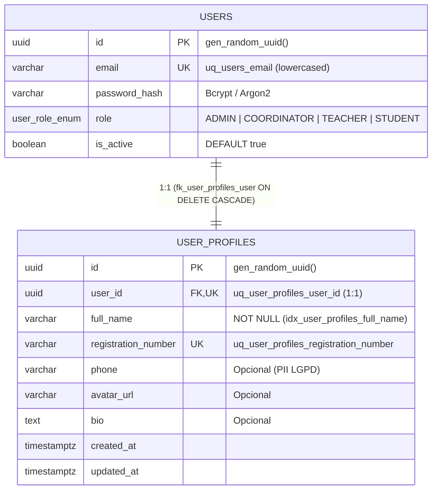

# 👤 [DB-007] Tabela de Perfis de Usuário (`user_profiles`) e Dados de Contato — Projeto NEXA

> **ID do Card**: `DB-007` | **Epic**: `EPIC-01: Autenticação, Perfis (RBAC) & Segurança` | **Sprint / Lote**: `Lote 1 (S1)`  
> **Prioridade**: `P1` | **Estimativa**: `2 SP` | **Tipo**: `Feature` | **Status**: `Concluído`  
> **Arquivos Principais**: [`prisma/migrations/20261105010000_create_user_profiles_table/migration.sql`](../../prisma/migrations/20261105010000_create_user_profiles_table/migration.sql), [`BancoNexa/sql/07_tabela_user_profiles.sql`](../../BancoNexa/sql/07_tabela_user_profiles.sql), [`prisma/schema.prisma`](../../prisma/schema.prisma)  
> **Rastreabilidade**: ⬅️ Anterior: [`DB-006`](./06-tabela-usuarios-hash-senha.md) | ➡️ Próximo: `DB-008` | 🔓 Desbloqueia: `DB-010`, `DB-049`, `BE-010`

---

## 1. Objetivo e Princípio de Minimização da LGPD

O card **`DB-007`** implementa a tabela `user_profiles` no **PostgreSQL 16 (Docker)** para isolar os **Dados Pessoais Identificáveis (PII)** das credenciais de autenticação (`users`).

### Por que separar `users` de `user_profiles` em uma relação `1:1`?
1. **Princípio da Minimização de Dados (LGPD — Art. 6º, III)**: Middlewares de autenticação JWT e verificação de permissões RBAC consultam apenas `users` (`id`, `role`, `is_active`), sem carregar desnecessariamente nome completo, telefone ou biografia em memória.
2. **Anonimização Simplificada no Fim do Ciclo de Retenção (`DB-049`)**: Quando um ex-aluno atinge o término do período legal de guarda ou solicita anonimização LGPD, a rotina atua de forma cirúrgica sobre `user_profiles` (`full_name`, `phone`, `avatar_url`, `bio`), mantendo intacto o `users.id` e preservando a integridade referencial das estatísticas agregadas de desempenho por curso e módulo.
3. **Identificação Institucional SENAI (`registration_number`)**: Permite localizar rapidamente qualquer estudante ou docente pelo número único de matrícula/registro funcional SENAI através do índice `B-Tree` `idx_user_profiles_registration_number`.

---

## 2. Diagrama de Relacionamento `1:1` e Comportamento `ON DELETE CASCADE`

---

## 3. Especificação Relacional da Tabela `user_profiles` (PostgreSQL 16)

| Coluna | Tipo SQL Nativo | Nulo? | Default | Constraints e Regras de Negócio |
|---|---|:---:|---|---|
| `id` | `UUID` | `NOT NULL` | `gen_random_uuid()` | `PRIMARY KEY` |
| `user_id` | `UUID` | `NOT NULL` | — | `UNIQUE (uq_user_profiles_user_id)`, `FK -> users(id) ON DELETE CASCADE ON UPDATE CASCADE` |
| `full_name` | `VARCHAR(150)` | `NOT NULL` | — | `CHECK (CHAR_LENGTH(BTRIM(full_name)) >= 2)`, Indexado (`idx_user_profiles_full_name`) |
| `registration_number` | `VARCHAR(50)` | `NOT NULL` | — | `UNIQUE (uq_user_profiles_registration_number)`, Normalizado em `UPPER(BTRIM(...))` por Trigger |
| `phone` | `VARCHAR(25)` | `NULL` | `NULL` | Telefone de contato (isolado para anonimização LGPD) |
| `avatar_url` | `VARCHAR(500)` | `NULL` | `NULL` | URL da foto de perfil institucional |
| `bio` | `TEXT` | `NULL` | `NULL` | Resumo profissional/acadêmico |
| `created_at` | `TIMESTAMPTZ` | `NOT NULL` | `CURRENT_TIMESTAMP` | Data/hora de criação |
| `updated_at` | `TIMESTAMPTZ` | `NOT NULL` | `CURRENT_TIMESTAMP` | Atualizado automaticamente por Trigger em `UPDATE` |

---

## 4. Índices e Triggers Implementados em SQL

1. **`uq_user_profiles_user_id`**: Constraint `UNIQUE` sobre a FK `user_id`, garantindo no motor PostgreSQL 16 que um `user` jamais possua mais de um `user_profile` (cardinalidade estrita `1:1`).
2. **`uq_user_profiles_registration_number` + `idx_user_profiles_registration_number`**: Garante unicidade da matrícula SENAI e indexação `B-Tree` para consultas instantâneas da secretaria.
3. **`idx_user_profiles_full_name`**: Índice `B-Tree` em `full_name` para ordenação alfabética em listas de chamada e busca por nome.
4. **Trigger `trg_user_profiles_normalize_and_touch`**: Padroniza `registration_number` em caixa alta sem espaços (`UPPER(BTRIM(NEW.registration_number))`) — ex.: `' ra-2026-001 '` torna-se `'RA-2026-001'` — e atualiza `updated_at` em `UPDATE`.

---

## 5. Checklist de Verificação dos Critérios de Aceitação (`DB-007`)

- [x] **Critério 1 — Relacionamento `1:1` entre `users` e `user_profiles` com `cascade delete`**: Implementado via `CONSTRAINT uq_user_profiles_user_id UNIQUE (user_id)` e `FOREIGN KEY (user_id) REFERENCES users (id) ON DELETE CASCADE ON UPDATE CASCADE`.
- [x] **Critério 2 — `registration_number` único no sistema**: Implementado via `CONSTRAINT uq_user_profiles_registration_number UNIQUE (registration_number)` com normalização `UPPER(BTRIM(...))`.
- [x] **Critério 3 — Campos pessoais isolados facilitando futuras rotinas de anonimização LGPD**: Todos os dados PII (`full_name`, `phone`, `avatar_url`, `bio`) estão segregados em `user_profiles`.
- [x] **Observação Técnica — Índices em `registration_number`**: Criado `idx_user_profiles_registration_number` (além de `idx_user_profiles_full_name`).
