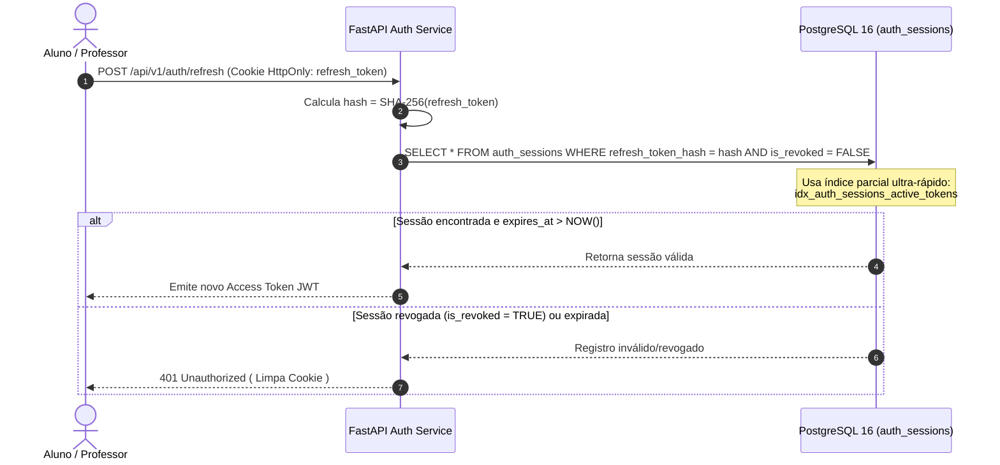

# 🔑 [DB-008] Tabela de Sessões e Refresh Tokens com Revogação (`auth_sessions`) — Projeto NEXA

> **ID do Card**: `DB-008` | **Epic**: `EPIC-01: Autenticação, Perfis (RBAC) & Segurança` | **Sprint / Lote**: `Lote 1 (S1)`  
> **Prioridade**: `P0` | **Estimativa**: `3 SP` | **Tipo**: `Feature` | **Status**: `Concluído`  
> **Arquivos Principais**: [`prisma/migrations/20261105020000_create_auth_sessions_table/migration.sql`](../../prisma/migrations/20261105020000_create_auth_sessions_table/migration.sql), [`BancoNexa/sql/08_tabela_auth_sessions.sql`](../../BancoNexa/sql/08_tabela_auth_sessions.sql), [`prisma/schema.prisma`](../../prisma/schema.prisma)  
> **Rastreabilidade**: ⬅️ Anterior: [`DB-007`](./07-tabela-perfis-usuario-lgpd.md) | ➡️ Próximo: `DB-009` | 🔓 Desbloqueia: `DB-010`, `BE-005`, `BE-006`, `BE-007`

---

## 1. Objetivo e Arquitetura de Segurança de Sessões JWT

O card **`DB-008`** implementa a tabela `auth_sessions` no **PostgreSQL 16 (Docker)** para gerenciar o ciclo de vida dos **Refresh Tokens JWT** com rastreamento de dispositivos (`user_agent`, `ip_address`) e capacidade de revogação instantânea (`is_revoked`).

### Como funciona a proteção contra vazamento de Refresh Tokens?
1. **Armazenamento Exclusivo do Hash `SHA-256` (`chk_auth_sessions_sha256_hash`)**:
   - O Refresh Token JWT emitido ao navegador (em Cookie `HttpOnly`) **jamais é salvo em texto puro no banco de dados**.
   - A aplicação calcula o digest `SHA-256` hexadecimal (64 caracteres `0-9a-f`) do token antes do `INSERT`.
   - No próprio PostgreSQL 16, a constraint `CHECK (refresh_token_hash ~ '^[a-f0-9]{64}$')` bloqueia qualquer tentativa acidental de gravar um JWT bruto (`eyJ...`). Se um dump do banco vazar, nenhum atacante conseguirá forjar requisições de refresh!
2. **Revogação Imediata e Rastreamento por Dispositivo**:
   - Quando o aluno ou professor clica em "Sair" (`BE-007`) ou desconecta sessões antigas, o campo `is_revoked` passa para `TRUE`, invalidando imediatamente a sessão.
   - Se um usuário for excluído (`ON DELETE CASCADE`), todas as suas sessões são removidas automaticamente.
3. **Validação Estrita de Expiração (`chk_auth_sessions_expiration`)**:
   - A constraint `CHECK (expires_at > created_at)` garante no nível do banco que nenhuma sessão já nasça expirada ou com carimbo temporal inconsistente.

---

## 2. Fluxo de Validação e Renovação de Sessão (`BE-005` / `BE-006` / `BE-007`)

---

## 3. Especificação Relacional da Tabela `auth_sessions` (PostgreSQL 16)

| Coluna | Tipo SQL Nativo | Nulo? | Default | Constraints e Regras de Negócio |
|---|---|:---:|---|---|
| `id` | `UUID` | `NOT NULL` | `gen_random_uuid()` | `PRIMARY KEY` |
| `user_id` | `UUID` | `NOT NULL` | — | `FK -> users(id) ON DELETE CASCADE ON UPDATE CASCADE` |
| `refresh_token_hash` | `VARCHAR(255)` | `NOT NULL` | — | `UNIQUE (uq_auth_sessions_token_hash)`, `CHECK (refresh_token_hash ~ '^[a-f0-9]{64}$')` |
| `user_agent` | `VARCHAR(500)` | `NULL` | `NULL` | Identificação do navegador/dispositivo (ex.: tablet da oficina) |
| `ip_address` | `VARCHAR(45)` | `NULL` | `NULL` | Endereço IPv4 ou IPv6 da conexão |
| `expires_at` | `TIMESTAMPTZ` | `NOT NULL` | — | `CHECK (expires_at > created_at)` |
| `is_revoked` | `BOOLEAN` | `NOT NULL` | `FALSE` | Flag de revogação imediata (Indexada) |
| `created_at` | `TIMESTAMPTZ` | `NOT NULL` | `CURRENT_TIMESTAMP` | Data/hora de abertura da sessão |

---

## 4. Estratégia de Indexação para o Middleware de Autenticação

Para atender ao Critério de Aceitação *"Campo `is_revoked` indexado para consulta ultra-rápida no middleware de auth"* e ao DoD *"Migration criada com índices eficientes em `refresh_token_hash`"*, foram criados 4 índices complementares:

1. **`idx_auth_sessions_refresh_token_hash`**: Índice `B-Tree` direto sobre `refresh_token_hash`.
2. **`idx_auth_sessions_is_revoked`**: Índice `B-Tree` dedicado ao campo `is_revoked`.
3. **`idx_auth_sessions_user_revoked_expires`**: Índice composto em `(user_id, is_revoked, expires_at)` para listar rapidamente os dispositivos ativos de um usuário ou revogar todas as sessões de uma conta.
4. **`idx_auth_sessions_active_tokens` (Partial Index)**: Índice parcial `ON auth_sessions (refresh_token_hash, expires_at) WHERE is_revoked = FALSE`, mantendo na árvore de busca apenas sessões ativas não revogadas.

---

## 5. Checklist de Verificação dos Critérios de Aceitação (`DB-008`)

- [x] **Critério 1 — Tabela criada com chave estrangeira para `users(id)`**: Implementada via `CONSTRAINT fk_auth_sessions_user FOREIGN KEY (user_id) REFERENCES users (id) ON DELETE CASCADE ON UPDATE CASCADE`.
- [x] **Critério 2 — Campo `is_revoked` indexado para consulta ultra-rápida no middleware de auth**: Criados `idx_auth_sessions_is_revoked`, `idx_auth_sessions_user_revoked_expires` e o índice parcial `idx_auth_sessions_active_tokens`.
- [x] **Critério 3 — Constraint de expiração verificável**: Implementada via `CONSTRAINT chk_auth_sessions_expiration CHECK (expires_at > created_at)`.
- [x] **Observação Técnica — O token nunca é salvo puro, apenas o hash SHA-256 do mesmo**: Garantido no banco via `CONSTRAINT chk_auth_sessions_sha256_hash CHECK (refresh_token_hash ~ '^[a-f0-9]{64}$')`.
