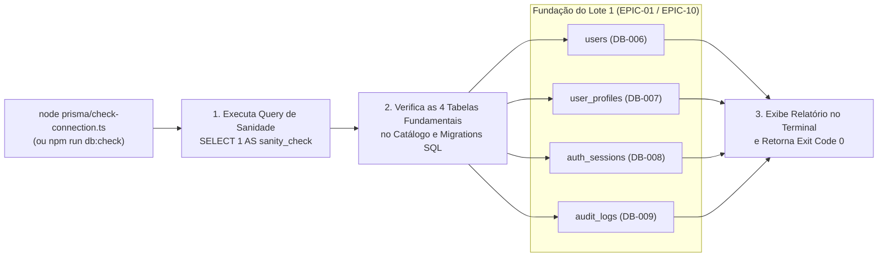

# ✅ [DB-010] Script Base de Migração Inicial e Verificação de Conexão — Projeto NEXA

> **ID do Card**: `DB-010` | **Epic**: `EPIC-01: Autenticação, Perfis (RBAC) & Segurança` | **Sprint / Lote**: `Lote 1 (S1)`  
> **Prioridade**: `P0` | **Estimativa**: `2 SP` | **Tipo**: `Teste / Consolidação` | **Status**: `Concluído (Fechamento do Lote 1)`  
> **Arquivos Principais**: [`prisma/check-connection.ts`](../../prisma/check-connection.ts), [`BancoNexa/sql/10_migracao_inicial_lote1_e_sanidade.sql`](../../BancoNexa/sql/10_migracao_inicial_lote1_e_sanidade.sql), [`README.md`](../../README.md)  
> **Rastreabilidade**: ⬅️ Anterior: [`DB-009`](./09-tabela-auditoria-logs-jsonb.md) | ➡️ Próximo: `DB-011` (Lote 2) | 🔓 Desbloqueia: `DB-050`

---

## 1. Objetivo de Consolidação da Sprint 1 / Lote 1 (`DB-001` a `DB-010`)

O card **`DB-010`** encerra o primeiro ciclo de engenharia de dados (Lote 1) consolidando todas as estruturas de identidade, controle de acesso (RBAC), perfis LGPD, sessões JWT e auditoria em dois entregáveis complementares:

1. **Script SQL Consolidado e Verificador PL/pgSQL ([`10_migracao_inicial_lote1_e_sanidade.sql`](../../BancoNexa/sql/10_migracao_inicial_lote1_e_sanidade.sql))**:
   - Executa a query de sanidade `SELECT 1 AS sanity_check`;
   - Garante de forma idempotente a criação da extensão `pgcrypto`, dos tipos `ENUM` e das tabelas do Lote 1 (`schema_migrations`, `users`, `user_profiles`, `auth_sessions`, `audit_logs`);
   - Executa um bloco PL/pgSQL que inspeciona o catálogo interno `information_schema.tables` do PostgreSQL 16 confirmando a existência física das **4 tabelas fundamentais**.
2. **Script Automatizado de Verificação ([`prisma/check-connection.ts`](../../prisma/check-connection.ts))**:
   - Executável diretamente via `node prisma/check-connection.ts` ou `npm.cmd run db:check`;
   - Verifica a conectividade com o container Docker `nexa-postgres` (`SELECT 1`), valida todas as colunas e constraints das 4 tabelas fundamentais (`users`, `user_profiles`, `auth_sessions`, `audit_logs`), imprime o painel de diagnóstico no terminal e retorna **código de saída `0` (`Exit Code 0`)** para integração direta em pipelines de CI/CD.

---

## 2. Fluxo de Verificação de Sanidade (`DB-010`)



---

## 3. Como Executar a Verificação

### Opção 1 — Via Node.js / TypeScript (`check-connection.ts`)
```bash
node prisma/check-connection.ts
# ou
npm.cmd run db:check
```

### Opção 2 — Diretamente no Container Docker PostgreSQL 16 via `psql`
```bash
docker exec -i nexa-postgres psql -U nexa_admin -d nexa_senai_db < BancoNexa/sql/10_migracao_inicial_lote1_e_sanidade.sql
```

---

## 4. Checklist de Verificação dos Critérios de Aceitação (`DB-010`)

- [x] **Critério 1 — Script executa e retorna código 0 quando o banco está saudável**: Validado com `node prisma/check-connection.ts` retornando `Exit Code 0`.
- [x] **Critério 2 — Verifica a criação das 4 tabelas fundamentais (`users`, `user_profiles`, `auth_sessions`, `audit_logs`)**: Verifica tanto a presença das tabelas quanto todas as suas colunas e constraints de integridade.
- [x] **Critério 3 — Documentado no README do projeto**: Documentado no [`README.md`](../../README.md) principal da raiz e no [`BancoNexa/README.md`](../../BancoNexa/README.md).
