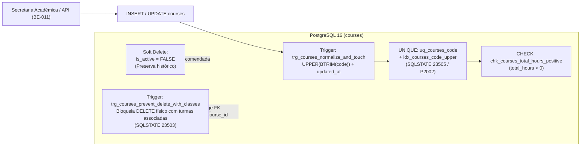

# 🎓 [DB-011] Tabela de Cursos Técnicos (`courses`) — Projeto NEXA

> **ID do Card**: `DB-011` | **Epic**: `EPIC-02: Gestão Acadêmica & Estrutura SENAI` | **Sprint / Lote**: `Lote 2 (S2)`  
> **Prioridade**: `P0` | **Estimativa**: `2 SP` | **Tipo**: `Feature` | **Status**: `Concluído`  
> **Arquivos Principais**: [`prisma/migrations/20261118000000_create_courses_table/migration.sql`](../../prisma/migrations/20261118000000_create_courses_table/migration.sql), [`BancoNexa/sql/11_tabela_courses.sql`](../../BancoNexa/sql/11_tabela_courses.sql), [`prisma/schema.prisma`](../../prisma/schema.prisma), [`BancoNexa/types/schema-models.ts`](../../BancoNexa/types/schema-models.ts)  
> **Rastreabilidade**: ⬅️ Anterior: [`DB-010`](./10-migracao-inicial-verificacao-conexao.md) | ➡️ Próximo: `DB-012` | 🔒 Depende de: `DB-004` | 🔓 Desbloqueia: `DB-012`, `DB-013`, `DB-020`, `BE-011`

---

## 1. Objetivo e Modelagem de Domínio SENAI

O card **`DB-011`** inaugura o **Lote 2 (EPIC-02: Gestão Acadêmica & Estrutura SENAI)**, implementando a tabela `courses` no **PostgreSQL 16 (Docker)** para modelar e persistir os cursos técnicos ofertados pela unidade SENAI (como *Técnico em Mecânica*, *Técnico em Eletromecânica* e *Análise e Desenvolvimento de Sistemas — ADS*).

A entidade `courses` atua como raiz estrutural para:
- **Turmas Acadêmicas (`classes` — `DB-012`)**: Referencia `courses(id)` com `ON DELETE RESTRICT`;
- **Disciplinas Teórico-Práticas (`subjects` — `DB-013`)**: Referencia `courses(id)` com `ON DELETE RESTRICT`;
- **Seed Curricular SENAI (`DB-020`)** e **Endpoints CRUD Administrativos (`BE-011`)**: Consomem a tabela com busca paginada, validação de código único (`HTTP 409`) e desativação lógica (`is_active = FALSE`).

---

## 2. Arquitetura de Integridade e Preservação de Histórico

1. **Código SENAI Único e Normalizado (`uq_courses_code` + `idx_courses_code_upper`)**: O código do curso (ex.: `TEC-MEC-01`, `TEC-ELT-01`, `TEC-ADS-01`) é normalizado automaticamente em caixa alta sem espaços laterais (`UPPER(BTRIM(code))`) pela trigger `trg_courses_normalize_and_touch`, impedindo duplicatas por variação de maiúsculas/minúsculas (`tec-mec-01` vs. `TEC-MEC-01`) com disparo de `SQLSTATE 23505` / Prisma `P2002`.
2. **Carga Horária Estritamente Positiva (`chk_courses_total_hours_positive`)**: A constraint `CHECK (total_hours > 0)` bloqueia no motor do banco qualquer tentativa de gravar carga horária nula, zero ou negativa (`SQLSTATE 23514`).
3. **Preservação de Histórico (`is_active` — Soft Delete)**: Cursos encerrados ou fora de oferta são inativados logicamente (`is_active = FALSE`), mantendo íntegros os registros de turmas, matrículas, notas e certificados passados.
4. **Bloqueio de Exclusão Física com Turmas Associadas**: Além da política `ON DELETE RESTRICT` nas tabelas filhas (`classes` em `DB-012` e `subjects` em `DB-013`), a trigger defensiva `trg_courses_prevent_delete_with_classes` verifica dinamicamente a existência de turmas vinculadas em `public.classes` e bloqueia o `DELETE` físico com `SQLSTATE 23503`, orientando o uso de desativação lógica (`is_active = FALSE`).

---

## 3. Especificação Relacional da Tabela `courses` (PostgreSQL 16)

| Coluna | Tipo SQL Nativo | Campo Prisma / TS | Nulo? | Default | Constraints e Regras de Negócio |
|---|---|---|:---:|---|---|
| `id` | `UUID` | `id: string` | `NOT NULL` | `gen_random_uuid()` | `PRIMARY KEY` |
| `code` | `VARCHAR(30)` | `code: string` | `NOT NULL` | — | `UNIQUE (uq_courses_code)`, `CHECK (code = UPPER(BTRIM(code)) AND CHAR_LENGTH(code) >= 3)` |
| `name` | `VARCHAR(150)` | `name: string` | `NOT NULL` | — | `CHECK (CHAR_LENGTH(BTRIM(name)) >= 3)` |
| `description` | `TEXT` | `description: string \| null` | `NULL` | `NULL` | Descrição pedagógica e perfil profissional do curso |
| `total_hours` | `INTEGER` | `totalHours: number` | `NOT NULL` | — | `CHECK (total_hours > 0)` (`chk_courses_total_hours_positive`) |
| `is_active` | `BOOLEAN` | `isActive: boolean` | `NOT NULL` | `TRUE` | Flag de soft delete para preservação do histórico |
| `created_at` | `TIMESTAMPTZ` | `createdAt: Date` | `NOT NULL` | `CURRENT_TIMESTAMP` | Data/hora de criação com timezone |
| `updated_at` | `TIMESTAMPTZ` | `updatedAt: Date` | `NOT NULL` | `CURRENT_TIMESTAMP` | Atualizado automaticamente por Trigger em `UPDATE` |

---

## 4. Índices e Triggers Implementados em SQL

### 4.1. Índices Criados
- **`uq_courses_code`**: Constraint `UNIQUE` primária sobre a coluna `code`.
- **`idx_courses_code`**: Índice `B-Tree` explícito em `code` para buscas diretas por código SENAI.
- **`idx_courses_code_upper`**: Índice único funcional em `UPPER(code)` garantindo unicidade case-insensitive absoluta.
- **`idx_courses_name`**: Índice `B-Tree` em `name` para filtros e listagens ordenadas no endpoint `GET /api/v1/courses` (`BE-011`).
- **`idx_courses_is_active`**: Índice `B-Tree` em `is_active` para filtragem rápida de cursos ativos.

### 4.2. Triggers PL/pgSQL
- **`trg_courses_normalize_and_touch` (`fn_courses_normalize_and_touch`)**: Normaliza `code` (`UPPER(BTRIM(...))`), limpa espaços laterais de `name`/`description` e atualiza `updated_at` em todo `UPDATE`.
- **`trg_courses_prevent_delete_with_classes` (`fn_courses_prevent_delete_with_classes`)**: Impede `DELETE` físico de cursos que possuam turmas associadas em `public.classes` (`ERRCODE = '23503'`).

---

## 5. Checklist de Verificação dos Critérios de Aceitação (`DB-011`)

- [x] **Critério 1 — Código do curso único (`UNIQUE`)**: Garantido por `CONSTRAINT uq_courses_code UNIQUE (code)`, índice funcional `idx_courses_code_upper` e `@unique(map: "uq_courses_code")` no Prisma.
- [x] **Critério 2 — Validação de `total_hours` maior que zero**: Garantida por `CONSTRAINT chk_courses_total_hours_positive CHECK (total_hours > 0)`.
- [x] **Critério 3 — Soft delete ou flag `is_active` para preservação de histórico**: Coluna `is_active BOOLEAN NOT NULL DEFAULT TRUE` indexada por `idx_courses_is_active`.
- [x] **Observação Técnica — Proteção contra exclusão física com turmas associadas**: Implementada via `trg_courses_prevent_delete_with_classes` em conjunto com `ON DELETE RESTRICT` previsto para `classes` (`DB-012`).
- [x] **DoD — Migration versionada, schema Prisma e tipos TypeScript atualizados**: Migration `20261118000000_create_courses_table`, `model Course` em `prisma/schema.prisma`, tipos gerados em `BancoNexa/types/schema-models.ts` e validados por `scripts/validate-db-011.js`.
