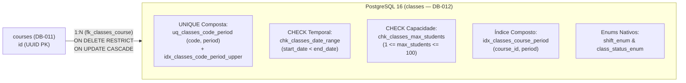

# 🏫 [DB-012] Tabela de Turmas Acadêmicas (`classes`) — Projeto NEXA

> **ID do Card**: `DB-012` | **Epic**: `EPIC-02: Gestão Acadêmica & Estrutura SENAI` | **Sprint / Lote**: `Lote 2 (S2)`  
> **Prioridade**: `P0` | **Estimativa**: `3 SP` | **Tipo**: `Feature` | **Status**: `Concluído`  
> **Arquivos Principais**: [`prisma/migrations/20261118010000_create_classes_table/migration.sql`](../../prisma/migrations/20261118010000_create_classes_table/migration.sql), [`BancoNexa/sql/12_tabela_classes.sql`](../../BancoNexa/sql/12_tabela_classes.sql), [`prisma/schema.prisma`](../../prisma/schema.prisma), [`BancoNexa/types/schema-models.ts`](../../BancoNexa/types/schema-models.ts)  
> **Rastreabilidade**: ⬅️ Anterior: [`DB-011`](./11-tabela-cursos-tecnicos-senai.md) | ➡️ Próximo: `DB-013` | 🔒 Depende de: `DB-011` | 🔓 Desbloqueia: `DB-017`, `DB-018`, `DB-020`, `DB-021`, `DB-023`, `DB-027`, `DB-029`, `DB-031`, `DB-041`, `BE-012`

---

## 1. Objetivo e Modelagem de Domínio SENAI

O card **`DB-012`** implementa a tabela `classes` no **PostgreSQL 16 (Docker)** para modelar as turmas letivas ofertadas em cada período acadêmico (ex.: `MEC-2026-1T` no período `'2026.1'`), vinculadas a um curso técnico (`courses` — `DB-011`).

A entidade `classes` é o eixo operacional para:
- **Matrículas de Estudantes (`enrollments` — `DB-017`)** e **Alocação de Docentes (`teacher_assignments` — `DB-018`)**;
- **Diário de Bordo e Aulas (`class_lessons` — `DB-021`)**, **Tarefas Práticas (`practical_tasks` — `DB-023`)** e **Avaliações (`academic_assessments` — `DB-027`)**;
- **Validação de Período Letivo Fechado (`DB-029`)**, **Autoavaliação (`DB-031`)**, **Mural de Avisos (`DB-041`)** e **Endpoints CRUD (`BE-012`)**.

---

## 2. Arquitetura Relacional e Integridade Referencial

1. **Integridade Referencial Estrita (`ON DELETE RESTRICT`)**: A chave estrangeira `fk_classes_course` liga `classes.course_id` a `courses.id` com `ON DELETE RESTRICT ON UPDATE CASCADE`, garantindo no motor SQL que nenhum curso com turmas cadastradas possa ser excluído fisicamente.
2. **Unicidade de Código por Período Letivo (`uq_classes_code_period`)**: A constraint `UNIQUE (code, period)` combinada ao índice único funcional `idx_classes_code_period_upper` impede duas turmas com o mesmo código no mesmo semestre (disparando `SQLSTATE 23505` / Prisma `P2002`), mas permite reutilizar um padrão de código em períodos letivos distintos (ex.: `MEC-T1` em `'2026.1'` e em `'2026.2'`).
3. **Validação Cronológica (`chk_classes_date_range`)**: A constraint `CHECK (start_date < end_date)` bloqueia qualquer cadastro com data de término igual ou anterior ao início (`SQLSTATE 23514`).
4. **Índice Composto `(course_id, period)`**: O índice `idx_classes_course_period` otimiza as consultas mais frequentes da coordenação e da API (`BE-012`) para listar turmas de um curso em um determinado semestre letivo.

---

## 3. Especificação Relacional da Tabela `classes` (PostgreSQL 16)

| Coluna | Tipo SQL Nativo | Campo Prisma / TS | Nulo? | Default | Constraints e Regras de Negócio |
|---|---|---|:---:|---|---|
| `id` | `UUID` | `id: string` | `NOT NULL` | `gen_random_uuid()` | `PRIMARY KEY` |
| `course_id` | `UUID` | `courseId: string` | `NOT NULL` | — | `FK -> courses(id) ON DELETE RESTRICT ON UPDATE CASCADE` |
| `code` | `VARCHAR(40)` | `code: string` | `NOT NULL` | — | Parte de `uq_classes_code_period`, `CHECK (code = UPPER(BTRIM(code)) AND CHAR_LENGTH(code) >= 3)` |
| `period` | `VARCHAR(20)` | `period: string` | `NOT NULL` | — | Parte de `uq_classes_code_period`, `CHECK (period = BTRIM(period) AND CHAR_LENGTH(period) >= 4)` |
| `shift` | `shift_enum` | `shift: Shift` | `NOT NULL` | — | `MORNING`, `AFTERNOON`, `NIGHT` |
| `max_students` | `INTEGER` | `maxStudents: number` | `NOT NULL` | `40` | `CHECK (max_students > 0 AND max_students <= 100)` |
| `status` | `class_status_enum` | `status: ClassStatus` | `NOT NULL` | `'PLANNING'` | `PLANNING`, `ACTIVE`, `COMPLETED`, `ARCHIVED` |
| `start_date` | `DATE` | `startDate: Date` | `NOT NULL` | — | `CHECK (start_date < end_date)` (`chk_classes_date_range`) |
| `end_date` | `DATE` | `endDate: Date` | `NOT NULL` | — | `CHECK (start_date < end_date)` (`chk_classes_date_range`) |
| `created_at` | `TIMESTAMPTZ` | `createdAt: Date` | `NOT NULL` | `CURRENT_TIMESTAMP` | Data/hora de criação com timezone |
| `updated_at` | `TIMESTAMPTZ` | `updatedAt: Date` | `NOT NULL` | `CURRENT_TIMESTAMP` | Atualizado automaticamente por Trigger em `UPDATE` |

---

## 4. Índices e Triggers Implementados em SQL

### 4.1. Índices Criados
- **`idx_classes_course_period`**: Índice composto `B-Tree` em `(course_id, period)` para consultas de turmas por curso e semestre letivo (Observação Técnica).
- **`uq_classes_code_period`**: Constraint `UNIQUE` composta em `(code, period)`.
- **`idx_classes_code_period_upper`**: Índice único funcional em `(UPPER(code), UPPER(period))` para proteção case-insensitive.
- **`idx_classes_status_period`**: Índice `B-Tree` composto em `(status, period)` para listagens de turmas ativas ou encerradas por semestre.
- **`idx_classes_shift`**: Índice `B-Tree` em `shift` para filtragem por turno (`BE-012`).

### 4.2. Trigger PL/pgSQL
- **`trg_classes_normalize_and_touch` (`fn_classes_normalize_and_touch`)**: Padroniza `code` (`UPPER(BTRIM(...))`), limpa espaços de `period` (`BTRIM(...)`) e atualiza `updated_at` em toda operação `UPDATE`.

---

## 5. Checklist de Verificação dos Critérios de Aceitação (`DB-012`)

- [x] **Critério 1 — Chave estrangeira para `courses` com `ON DELETE RESTRICT`**: Implementada via `CONSTRAINT fk_classes_course FOREIGN KEY (course_id) REFERENCES courses (id) ON DELETE RESTRICT ON UPDATE CASCADE` e `@relation(..., onDelete: Restrict)` no Prisma.
- [x] **Critério 2 — Restrição de unicidade em `code` por período letivo**: Implementada via `CONSTRAINT uq_classes_code_period UNIQUE (code, period)`, índice funcional `idx_classes_code_period_upper` e `@@unique([code, period], map: "uq_classes_code_period")` no Prisma.
- [x] **Critério 3 — Constraint verificando `start_date < end_date`**: Implementada via `CONSTRAINT chk_classes_date_range CHECK (start_date < end_date)`.
- [x] **Observação Técnica — Índice composto em `(course_id, period)`**: Criado `idx_classes_course_period ON classes USING BTREE (course_id, period)` e `@@index([courseId, period], map: "idx_classes_course_period")`.
- [x] **DoD — Migration criada com integridade referencial testada**: Migration `20261118010000_create_classes_table`, `model Class` em `prisma/schema.prisma`, tipos gerados em `BancoNexa/types/schema-models.ts` e validados por `scripts/validate-db-012.js`.
