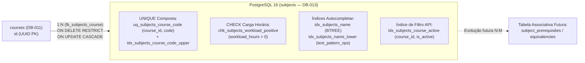

# 📚 [DB-013] Tabela de Disciplinas Teórico-Práticas (`subjects`) — Projeto NEXA

> **ID do Card**: `DB-013` | **Epic**: `EPIC-02: Gestão Acadêmica & Estrutura SENAI` | **Sprint / Lote**: `Lote 2 (S2)`  
> **Prioridade**: `P0` | **Estimativa**: `2 SP` | **Tipo**: `Feature` | **Status**: `Concluído`  
> **Arquivos Principais**: [`prisma/migrations/20261118020000_create_subjects_table/migration.sql`](../../prisma/migrations/20261118020000_create_subjects_table/migration.sql), [`BancoNexa/sql/13_tabela_subjects.sql`](../../BancoNexa/sql/13_tabela_subjects.sql), [`prisma/schema.prisma`](../../prisma/schema.prisma), [`BancoNexa/types/schema-models.ts`](../../BancoNexa/types/schema-models.ts)  
> **Rastreabilidade**: ⬅️ Anterior: [`DB-012`](./12-tabela-turmas-academicas-classes.md) | ➡️ Próximo: `DB-014` | 🔒 Depende de: `DB-011` | 🔓 Desbloqueia: `DB-014`, `DB-018`, `DB-020`, `DB-021`, `DB-027`, `DB-041`, `DB-042`, `BE-013`

---

## 1. Objetivo e Modelagem de Domínio SENAI

O card **`DB-013`** implementa a tabela `subjects` no **PostgreSQL 16 (Docker)** para estruturar as unidades curriculares teórico-práticas da matriz técnica SENAI (como *Metrologia Dimensional*, *Desenho Técnico Mecânico*, *Processos de Fabricação Mecânica* e *Segurança do Trabalho*).

A entidade `subjects` conecta a estrutura do curso (`courses`) às camadas pedagógicas e operacionais:
- **Módulos de Aprendizagem Prática (`learning_modules` — `DB-014`)**: Cada disciplina organiza módulos sequenciais de oficina;
- **Alocação de Docentes (`teacher_assignments` — `DB-018`)** e **Diário de Aulas (`class_lessons` — `DB-021`)**;
- **Avaliações Formativas (`academic_assessments` — `DB-027`)**, **Mural (`class_announcements` — `DB-041`)**, **Apoio Confidencial (`help_requests` — `DB-042`)** e **CRUD de Disciplinas (`BE-013`)**.

---

## 2. Arquitetura Relacional, Autocompletar e Evolução Curricular

1. **Vínculo Obrigatório ao Curso (`fk_subjects_course`)**: Toda disciplina pertence obrigatoriamente a um curso (`course_id UUID NOT NULL`) com `ON DELETE RESTRICT ON UPDATE CASCADE`, garantindo integridade referencial da matriz curricular.
2. **Carga Horária Estritamente Positiva (`chk_subjects_workload_positive`)**: A constraint `CHECK (workload_hours > 0)` impede no motor SQL o registro de unidades curriculares com carga horária zero ou negativa (`SQLSTATE 23514`).
3. **Pesquisa Autocompletar em `name` (`idx_subjects_name` + `idx_subjects_name_lower`)**: Além do índice `B-Tree` padrão em `name`, o índice funcional `idx_subjects_name_lower` com classe de operador `text_pattern_ops` acelera buscas prefixadas case-insensitive (`LOWER(name) LIKE 'metro%'`) nas telas de cadastro e filtros da API (`BE-013`).
4. **Preparação para Equivalências e Pré-requisitos (Observação Técnica)**: Em aderência à 3ª Forma Normal (3FN), a tabela `subjects` não embute colunas rígidas de pré-requisito único ou listas em texto. Equivalências curriculares e pré-requisitos múltiplos serão modelados futuramente por meio de tabela associativa N:M (`subject_prerequisites(subject_id, prerequisite_subject_id, relation_type)`), sem alterar ou quebrar `subjects`.

---

## 3. Especificação Relacional da Tabela `subjects` (PostgreSQL 16)

| Coluna | Tipo SQL Nativo | Campo Prisma / TS | Nulo? | Default | Constraints e Regras de Negócio |
|---|---|---|:---:|---|---|
| `id` | `UUID` | `id: string` | `NOT NULL` | `gen_random_uuid()` | `PRIMARY KEY` |
| `course_id` | `UUID` | `courseId: string` | `NOT NULL` | — | `FK -> courses(id) ON DELETE RESTRICT ON UPDATE CASCADE` |
| `code` | `VARCHAR(50)` | `code: string` | `NOT NULL` | — | Parte de `uq_subjects_course_code`, `CHECK (code = UPPER(BTRIM(code)) AND CHAR_LENGTH(code) >= 2)` |
| `name` | `VARCHAR(150)` | `name: string` | `NOT NULL` | — | Indexado (`idx_subjects_name` e `idx_subjects_name_lower`), `CHECK (CHAR_LENGTH(BTRIM(name)) >= 3)` |
| `workload_hours` | `INTEGER` | `workloadHours: number` | `NOT NULL` | — | `CHECK (workload_hours > 0)` (`chk_subjects_workload_positive`) |
| `syllabus` | `TEXT` | `syllabus: string \| null` | `NULL` | `NULL` | Ementa teórico-prática da unidade curricular |
| `is_active` | `BOOLEAN` | `isActive: boolean` | `NOT NULL` | `TRUE` | Controle de ativação/desativação lógica |
| `created_at` | `TIMESTAMPTZ` | `createdAt: Date` | `NOT NULL` | `CURRENT_TIMESTAMP` | Data/hora de criação com timezone |
| `updated_at` | `TIMESTAMPTZ` | `updatedAt: Date` | `NOT NULL` | `CURRENT_TIMESTAMP` | Atualizado automaticamente por Trigger em `UPDATE` |

---

## 4. Índices e Trigger Implementados em SQL

### 4.1. Índices Criados
- **`idx_subjects_name`**: Índice `B-Tree` em `name` para ordenação e autocompletar (Critério de Aceitação 3).
- **`idx_subjects_name_lower`**: Índice funcional em `LOWER(name) text_pattern_ops` para buscas autocompletar case-insensitive (`LIKE 'termo%'`).
- **`uq_subjects_course_code`** / **`idx_subjects_course_code_upper`**: Unicidade composta `(course_id, code)` impedindo duplicação de código dentro do mesmo curso.
- **`idx_subjects_course_active`**: Índice composto `(course_id, is_active)` para listagens filtradas por curso e status ativo (`BE-013`).

### 4.2. Trigger PL/pgSQL
- **`trg_subjects_normalize_and_touch` (`fn_subjects_normalize_and_touch`)**: Padroniza `code` em caixa alta (`UPPER(BTRIM(...))`), remove espaços laterais de `name`/`syllabus` e atualiza `updated_at` em todo `UPDATE`.

---

## 5. Checklist de Verificação dos Critérios de Aceitação (`DB-013`)

- [x] **Critério 1 — Disciplina vinculada obrigatoriamente a um curso**: `course_id UUID NOT NULL` com `fk_subjects_course REFERENCES courses(id) ON DELETE RESTRICT ON UPDATE CASCADE` e relação obrigatória no Prisma.
- [x] **Critério 2 — Carga horária estritamente positiva**: `CONSTRAINT chk_subjects_workload_positive CHECK (workload_hours > 0)`.
- [x] **Critério 3 — Índice em `name` para pesquisas autocompletar**: Criados `idx_subjects_name` (`BTREE (name)`) e `idx_subjects_name_lower` (`LOWER(name) text_pattern_ops`).
- [x] **Observação Técnica — Equivalências futuras via tabela associativa de pré-requisitos**: Estrutura mantida limpa em 3FN e documentada para extensão N:M sem migração destrutiva.
- [x] **DoD — Tabela `subjects` criada, schema Prisma e tipos TypeScript atualizados e validados**: Migration `20261118020000_create_subjects_table`, `model Subject` em `prisma/schema.prisma`, tipos gerados em `BancoNexa/types/schema-models.ts` e validados por `scripts/validate-db-013.js`.
