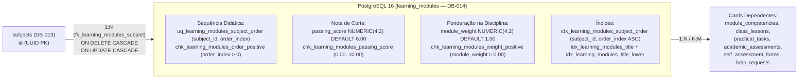

# 🛠️ [DB-014] Tabela de Módulos de Aprendizagem Prática SENAI (`learning_modules`) — Projeto NEXA

> **ID do Card**: `DB-014` | **Epic**: `EPIC-02: Gestão Acadêmica & Estrutura SENAI` | **Sprint / Lote**: `Lote 2 (S2)`  
> **Prioridade**: `P0` | **Estimativa**: `3 SP` | **Tipo**: `Feature` | **Status**: `Concluído`  
> **Arquivos Principais**: [`prisma/migrations/20261118030000_create_learning_modules_table/migration.sql`](../../prisma/migrations/20261118030000_create_learning_modules_table/migration.sql), [`BancoNexa/sql/14_tabela_learning_modules.sql`](../../BancoNexa/sql/14_tabela_learning_modules.sql), [`prisma/schema.prisma`](../../prisma/schema.prisma), [`BancoNexa/types/schema-models.ts`](../../BancoNexa/types/schema-models.ts)  
> **Rastreabilidade**: ⬅️ Anterior: [`DB-013`](./13-tabela-disciplinas-subjects.md) | ➡️ Próximo: `DB-015` | 🔒 Depende de: `DB-013` | 🔓 Desbloqueia: `DB-016`, `DB-020`, `DB-021`, `DB-023`, `DB-027`, `DB-031`, `DB-037`, `DB-039`, `DB-042`, `BE-014`, `BE-028`

---

## 1. Objetivo e Modelagem de Domínio SENAI

O card **`DB-014`** implementa a tabela `learning_modules` no **PostgreSQL 16 (Docker)** para modelar a estrutura modular prática característica das oficinas e laboratórios do SENAI (ex.: *Módulo de Tornearia Cilíndrica*, *Metrologia com Micrômetro*, *Furação e Rosqueamento em Bancada*).

A entidade `learning_modules` estrutura a progressão pedagógica gradual dentro de cada disciplina (`subjects`) e serve de eixo central para os próximos cards:
- **Competências por Módulo (`module_competencies` — `DB-016`)** e **Seed Curricular SENAI (`DB-020`)**;
- **Diário de Aulas (`class_lessons` — `DB-021`)**, **Tarefas Práticas de Oficina (`practical_tasks` — `DB-023`)** e **Avaliações Formativas (`academic_assessments` — `DB-027`)**;
- **Autoavaliações (`self_assessment_forms` — `DB-031`)**, **View Analítica de Frequência e Evasão (`vw_module_attendance_risk` — `DB-037`)**, **Marcos Acadêmicos (`student_milestone_history` — `DB-039`)** e **Apoio Confidencial (`help_requests` — `DB-042`)**;
- **Endpoints de Módulos (`BE-014`)** e **Fechamento de Médias com Cálculo Ponderado Automático (`BE-028`)**.

---

## 2. Arquitetura Relacional, Sequência Didática e Composição Ponderada

1. **Associação Obrigatória à Disciplina com Cascade (`fk_learning_modules_subject`)**: Todo módulo pertence obrigatoriamente a uma disciplina (`subject_id UUID NOT NULL`) com `ON DELETE CASCADE ON UPDATE CASCADE`, garantindo remoção encadeada de módulos órfãos caso uma disciplina em rascunho/planejamento seja excluída. Quando o módulo já possui histórico acadêmico em turmas (`class_lessons`, `practical_tasks`, `academic_assessments`), as FKs filhas (`ON DELETE RESTRICT`) preservam a integridade histórica.
2. **Sequência Didática Recomendada (`order_index`)**: A constraint composta `uq_learning_modules_subject_order UNIQUE (subject_id, order_index)` combinada com `chk_learning_modules_order_positive CHECK (order_index > 0)` impede posições inválidas ou duplicadas na mesma disciplina, permitindo que o endpoint `GET /api/v1/subjects/{subject_id}/modules` (`BE-014`) entregue a trilha na ordem exata de oficina.
3. **Validação de Nota de Corte (`passing_score`)**: Armazenada em `NUMERIC(4,2)` (`DECIMAL(4,2)`) com padrão `6.00` (critério mínimo institucional SENAI) e restrição `CHECK (passing_score >= 0.00 AND passing_score <= 10.00)` no banco de dados (`SQLSTATE 23514`).
4. **Pesos Ponderados na Composição Final (`module_weight`)**: Atende diretamente à Observação Técnica do card permitindo que módulos de maior complexidade técnica (ex.: *Tornearia Cilíndrica* com peso `2.50` vs. *Leitura de Paquímetro* com peso `1.00`) tenham influência proporcional no fechamento de médias (`BE-028`), validada via `chk_learning_modules_weight_positive CHECK (module_weight > 0.00)`.

---

## 3. Especificação Relacional da Tabela `learning_modules` (PostgreSQL 16)

| Coluna | Tipo SQL Nativo | Campo Prisma / TS | Nulo? | Default | Constraints e Regras de Negócio |
|---|---|---|:---:|---|---|
| `id` | `UUID` | `id: string` | `NOT NULL` | `gen_random_uuid()` | `PRIMARY KEY` |
| `subject_id` | `UUID` | `subjectId: string` | `NOT NULL` | — | `FK -> subjects(id) ON DELETE CASCADE ON UPDATE CASCADE` |
| `title` | `VARCHAR(120)` | `title: string` | `NOT NULL` | — | Indexado (`idx_learning_modules_title`), `CHECK (CHAR_LENGTH(BTRIM(title)) >= 3)` |
| `order_index` | `INTEGER` | `orderIndex: number` | `NOT NULL` | — | Parte de `uq_learning_modules_subject_order`, `CHECK (order_index > 0)` |
| `description` | `TEXT` | `description: string \| null` | `NULL` | `NULL` | Escopo prático, bancadas e equipamentos do módulo |
| `practical_hours` | `INTEGER` | `practicalHours: number` | `NOT NULL` | — | `CHECK (practical_hours >= 0)` (`chk_learning_modules_hours_non_negative`) |
| `module_weight` | `NUMERIC(4,2)` | `moduleWeight: number \| string` | `NOT NULL` | `1.00` | `CHECK (module_weight > 0.00)` (peso ponderado na composição final da disciplina) |
| `passing_score` | `NUMERIC(4,2)` | `passingScore: number \| string` | `NOT NULL` | `6.00` | `CHECK (passing_score >= 0.00 AND passing_score <= 10.00)` |
| `created_at` | `TIMESTAMPTZ` | `createdAt: Date` | `NOT NULL` | `CURRENT_TIMESTAMP` | Data/hora de criação com timezone |
| `updated_at` | `TIMESTAMPTZ` | `updatedAt: Date` | `NOT NULL` | `CURRENT_TIMESTAMP` | Atualizado automaticamente por Trigger em `UPDATE` |

---

## 4. Índices e Trigger Implementados em SQL

### 4.1. Índices Criados
- **`uq_learning_modules_subject_order`**: Restrição única composta `(subject_id, order_index)` garantindo unicidade da ordem didática por disciplina.
- **`idx_learning_modules_subject_order`**: Índice `B-Tree` em `(subject_id, order_index ASC)` otimizando listagens ordenadas por sequência prática (`BE-014`).
- **`idx_learning_modules_title`**: Índice `B-Tree` em `title` para consultas e ordenações nominais.
- **`idx_learning_modules_title_lower`**: Índice funcional em `LOWER(title) text_pattern_ops` para buscas prefixadas case-insensitive.

### 4.2. Trigger PL/pgSQL
- **`trg_learning_modules_normalize_and_touch` (`fn_learning_modules_normalize_and_touch`)**: Remove espaços laterais de `title` e `description` via `BTRIM(...)` e atualiza `updated_at` em toda operação `UPDATE`.

---

## 5. Checklist de Verificação dos Critérios de Aceitação (`DB-014`)

- [x] **Critério 1 — Módulo associado a uma disciplina (FK com cascade)**: `subject_id UUID NOT NULL` com `fk_learning_modules_subject REFERENCES subjects(id) ON DELETE CASCADE ON UPDATE CASCADE` e relação equivalente no `prisma/schema.prisma`.
- [x] **Critério 2 — `order_index` garantindo a sequência didática recomendada**: `uq_learning_modules_subject_order UNIQUE (subject_id, order_index)`, `chk_learning_modules_order_positive CHECK (order_index > 0)` e índice `idx_learning_modules_subject_order (subject_id, order_index ASC)`.
- [x] **Critério 3 — `passing_score` com validação entre `0.00` e `10.00`**: `passing_score NUMERIC(4,2) NOT NULL DEFAULT 6.00` com `CONSTRAINT chk_learning_modules_passing_score CHECK (passing_score >= 0.00 AND passing_score <= 10.00)`.
- [x] **Observação Técnica — Pesos ponderados diferentes na composição final da disciplina**: `module_weight NUMERIC(4,2) NOT NULL DEFAULT 1.00` com `CONSTRAINT chk_learning_modules_weight_positive CHECK (module_weight > 0.00)` suportando cálculo ponderado em `BE-028`.
- [x] **DoD — Tabela `learning_modules` funcional, integrada ao schema Prisma e validada**: Migration `20261118030000_create_learning_modules_table`, `model LearningModule` em `prisma/schema.prisma`, tipos TypeScript gerados em `BancoNexa/types/schema-models.ts` e testes unitários/integração aprovados em `scripts/validate-db-014.js`.
