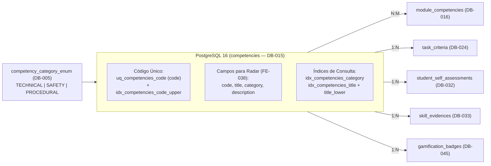

# 🎯 [DB-015] Tabela de Competências e Habilidades Técnicas (`competencies`) — Projeto NEXA

> **ID do Card**: `DB-015` | **Epic**: `EPIC-04: Atividades Práticas de Oficina & Competências` | **Sprint / Lote**: `Lote 2 (S2)`  
> **Prioridade**: `P0` | **Estimativa**: `3 SP` | **Tipo**: `Feature` | **Status**: `Concluído`  
> **Arquivos Principais**: [`prisma/migrations/20261118040000_create_competencies_table/migration.sql`](../../prisma/migrations/20261118040000_create_competencies_table/migration.sql), [`BancoNexa/sql/15_tabela_competencies.sql`](../../BancoNexa/sql/15_tabela_competencies.sql), [`prisma/schema.prisma`](../../prisma/schema.prisma), [`BancoNexa/types/schema-models.ts`](../../BancoNexa/types/schema-models.ts)  
> **Rastreabilidade**: ⬅️ Anterior: [`DB-014`](./14-tabela-modulos-aprendizagem-pratica-learning-modules.md) | ➡️ Próximo: `DB-016` | 🔒 Depende de: `DB-005` | 🔓 Desbloqueia: `DB-016`, `DB-020`, `DB-024`, `DB-032`, `DB-033`, `DB-045`, `BE-015`, `FE-038`

---

## 1. Objetivo e Modelagem de Domínio SENAI

O card **`DB-015`** implementa a tabela `competencies` no **PostgreSQL 16 (Docker)** para cadastrar a taxonomia oficial de competências e habilidades técnicas requeridas pelo perfil profissional SENAI (ex.: `COMP-MET-01` — *Medição com Paquímetro e Tolerância H7*, `COMP-SEG-01` — *Operação Segura de Torno e Uso de EPIs*, `COMP-PRO-01` — *Sequenciamento de Usinagem conforme Ordem de Serviço*).

A entidade `competencies` constitui a base unificada para a **autoavaliação do estudante** e a **avaliação prática verificada pelo professor**, alimentando diretamente:
- **Relacionamento Módulo-Competência (`module_competencies` — `DB-016`)** e **Seed Curricular SENAI (`DB-020`)**;
- **Critérios e Rubricas de Avaliação Prática (`task_criteria` — `DB-024`)**;
- **Respostas de Autoavaliação do Aluno (`student_self_assessments` — `DB-032`)** e **Evidências Práticas Verificadas (`skill_evidences` — `DB-033`)**;
- **Conquistas de Gamificação (`gamification_badges` — `DB-045`)**, **Endpoints de Competências (`BE-015`)** e **Gráfico Radar de Competências Técnicas (`FE-038`)**.

---

## 2. Arquitetura Relacional, Taxonomia Enum e Dashboards de Radar

1. **Código Único Padronizado (`uq_competencies_code` + `idx_competencies_code_upper`)**: Cada competência possui um código institucional único (`VARCHAR(50)`), padronizado automaticamente em caixa alta via trigger (`UPPER(BTRIM(code))`) e protegido contra colisões case-insensitive (`SQLSTATE 23505 / P2002`).
2. **Categorias Definidas via Enum Nativo (`competency_category_enum`)**: Reutiliza o tipo enumerado `competency_category_enum` criado em `DB-005` (`TECHNICAL`, `SAFETY`, `PROCEDURAL`), garantindo validação estrita pelo SGBD (`SQLSTATE 22P02`) e sincronia tipada com Prisma, TypeScript e Pydantic v2 (`BE-015`).
3. **Prontidão para Dashboards de Radar (`FE-038`) e Comparação 360°**: A combinação de `code` (rótulo compacto de eixo), `title` (nome legível no gráfico radar), `category` (agrupamento por pilar técnico/segurança/procedimental) e `description` (tooltip explicativo de tolerâncias e normas) entrega todos os metadados exigidos pelo gráfico radar e pelo motor de diagnóstico comparativo entre autoavaliação (`DB-032`) e evidência prática docente (`DB-033`).

---

## 3. Especificação Relacional da Tabela `competencies` (PostgreSQL 16)

| Coluna | Tipo SQL Nativo | Campo Prisma / TS | Nulo? | Default | Constraints e Regras de Negócio |
|---|---|---|:---:|---|---|
| `id` | `UUID` | `id: string` | `NOT NULL` | `gen_random_uuid()` | `PRIMARY KEY` |
| `code` | `VARCHAR(50)` | `code: string` | `NOT NULL` | — | `UNIQUE` (`uq_competencies_code` + `idx_competencies_code_upper`), `CHECK (code = UPPER(BTRIM(code)) AND CHAR_LENGTH(code) >= 3)` |
| `title` | `VARCHAR(150)` | `title: string` | `NOT NULL` | — | Rótulo de exibição nos dashboards de radar; `CHECK (CHAR_LENGTH(BTRIM(title)) >= 3)` |
| `category` | `competency_category_enum` | `category: CompetencyCategory` | `NOT NULL` | — | Valores válidos: `TECHNICAL`, `SAFETY`, `PROCEDURAL` (`DB-005`) |
| `description` | `TEXT` | `description: string \| null` | `NULL` | `NULL` | Detalhamento técnico/normativo para rubricas, tooltips do radar e autoavaliação |
| `created_at` | `TIMESTAMPTZ` | `createdAt: Date` | `NOT NULL` | `CURRENT_TIMESTAMP` | Data/hora de criação com timezone |
| `updated_at` | `TIMESTAMPTZ` | `updatedAt: Date` | `NOT NULL` | `CURRENT_TIMESTAMP` | Atualizado automaticamente por Trigger em `UPDATE` |

---

## 4. Índices e Trigger Implementados em SQL

### 4.1. Índices Criados
- **`uq_competencies_code`** / **`idx_competencies_code_upper`**: Unicidade absoluta (inclusive case-insensitive) de `code` (Critério de Aceitação 1).
- **`idx_competencies_code`**: Índice `B-Tree` para buscas e ordenação por código de competência.
- **`idx_competencies_category`**: Índice `B-Tree` em `category` para filtros da API (`GET /api/v1/competencies?category=...` — `BE-015`) e agrupamento por categoria no radar (`FE-038`).
- **`idx_competencies_title`** e **`idx_competencies_title_lower`**: Índices `B-Tree` e funcional `text_pattern_ops` para busca rápida e autocompletar por título.

### 4.2. Trigger PL/pgSQL
- **`trg_competencies_normalize_and_touch` (`fn_competencies_normalize_and_touch`)**: Padroniza `code` em caixa alta (`UPPER(BTRIM(...))`), remove espaços laterais de `title`/`description` e atualiza `updated_at` automaticamente em `UPDATE`.

---

## 5. Checklist de Verificação dos Critérios de Aceitação (`DB-015`)

- [x] **Critério 1 — Código da competência único**: `CONSTRAINT uq_competencies_code UNIQUE (code)` + índice funcional único `idx_competencies_code_upper` + normalização via trigger.
- [x] **Critério 2 — Categorias de competência bem definidas via enum**: Coluna `category` tipada com o enum nativo `competency_category_enum` (`TECHNICAL`, `SAFETY`, `PROCEDURAL`) mapeado para `CompetencyCategory` no `prisma/schema.prisma`.
- [x] **Critério 3 — Campos informativos prontos para exibição nos dashboards de radar**: Campos `code`, `title` (`>= 3` chars), `category` e `description` estruturados e indexados para renderização direta no gráfico radar (`FE-038`) e consultas em `BE-015`.
- [x] **Observação Técnica — Base para autoavaliação discente e avaliação prática docente**: Chave primária `id (UUID)` alinhada com as FKs de `module_competencies` (`DB-016`), `task_criteria` (`DB-024`), `student_self_assessments` (`DB-032`), `skill_evidences` (`DB-033`) e `gamification_badges` (`DB-045`).
- [x] **DoD — Tabela `competencies` migrada no PostgreSQL, integrada ao schema Prisma e validada**: Migration `20261118040000_create_competencies_table`, `model Competency` em `prisma/schema.prisma`, tipos gerados em `BancoNexa/types/schema-models.ts` e validados por `scripts/validate-db-015.js`.
