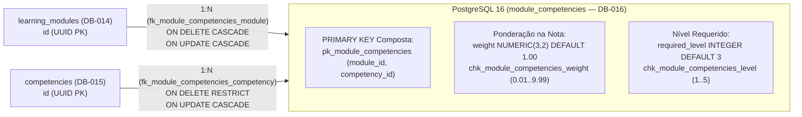

# 🔗 [DB-016] Relacionamento Módulo-Competência (`module_competencies`) — Projeto NEXA

> **ID do Card**: `DB-016` | **Epic**: `EPIC-04: Atividades Práticas de Oficina & Competências` | **Sprint / Lote**: `Lote 2 (S2)`  
> **Prioridade**: `P0` | **Estimativa**: `2 SP` | **Tipo**: `Feature` | **Status**: `Concluído`  
> **Arquivos Principais**: [`prisma/migrations/20261118050000_create_module_competencies_table/migration.sql`](../../prisma/migrations/20261118050000_create_module_competencies_table/migration.sql), [`BancoNexa/sql/16_tabela_module_competencies.sql`](../../BancoNexa/sql/16_tabela_module_competencies.sql), [`BancoNexa/sql/16_seed_preliminar_module_competencies.sql`](../../BancoNexa/sql/16_seed_preliminar_module_competencies.sql), [`prisma/schema.prisma`](../../prisma/schema.prisma), [`BancoNexa/types/schema-models.ts`](../../BancoNexa/types/schema-models.ts)  
> **Rastreabilidade**: ⬅️ Anterior: [`DB-015`](./15-tabela-competencias-habilidades-competencies.md) | ➡️ Próximo: `DB-017` | 🔒 Depende de: `DB-014`, `DB-015` | 🔓 Desbloqueia: `DB-020`, `DB-023`, `DB-031`, `BE-015`

---

## 1. Objetivo e Modelagem de Domínio SENAI

O card **`DB-016`** implementa a tabela associativa N:M `module_competencies` no **PostgreSQL 16 (Docker)** para conectar os **Módulos de Aprendizagem Prática SENAI** (`learning_modules` — `DB-014`) às **Competências e Habilidades Técnicas** (`competencies` — `DB-015`).

Na metodologia prática do SENAI, um único módulo de oficina (ex.: *Módulo de Tornearia Cilíndrica*) desenvolve simultaneamente múltiplas competências com graus de exigência e pesos distintos (ex.: `COMP-TOR-01` nível `5` / peso `3.00`, `COMP-MET-01` nível `4` / peso `2.00` e `COMP-SEG-01` nível `5` / peso `2.00`), enquanto uma mesma competência transversal (como `COMP-MET-01` ou `COMP-SEG-01`) é treinada progressivamente em vários módulos.

Essa relação N:M desbloqueia diretamente:
- **Seed Curricular SENAI (`DB-020`)** — estendendo o seed preliminar validado neste card;
- **Tarefas e Atividades Práticas (`practical_tasks` — `DB-023`)**;
- **Formulários de Autoavaliação (`self_assessment_forms` — `DB-031`)**;
- **Endpoints de Gestão e Vínculo Módulo-Competência (`BE-015`)** (`POST /api/v1/modules/{id}/competencies`).

---

## 2. Arquitetura Relacional N:M, Chave Composta e Ponderação

1. **Chave Primária Composta (`pk_module_competencies`)**: `PRIMARY KEY (module_id, competency_id)` elimina a necessidade de chave substituta redundante e bloqueia nativamente vínculos duplicados entre o mesmo módulo e a mesma competência (`SQLSTATE 23505 / P2002`).
2. **Integridade Referencial com Exclusão em Cascata do Módulo (`fk_module_competencies_module`)**:
   - `module_id -> learning_modules(id) ON DELETE CASCADE ON UPDATE CASCADE`: Se um módulo prático for removido, todos os seus vínculos associativos em `module_competencies` são eliminados automaticamente em cascata.
   - `competency_id -> competencies(id) ON DELETE RESTRICT ON UPDATE CASCADE`: Impede exclusão acidental de uma competência da taxonomia SENAI enquanto ainda estiver vinculada a módulos ativos.
3. **Escala de Proficiência SENAI (`required_level`)**: Validada no banco via `CHECK (required_level BETWEEN 1 AND 5)`:
   - `1` — Básico (execução assistida)
   - `2` — Elementar (execução supervisionada)
   - `3` — Intermediário / Operacional (padrão default)
   - `4` — Proficiente (autonomia técnica com controle de tolerância)
   - `5` — Avançado (domínio industrial completo)
4. **Ponderação de Impacto na Nota do Módulo (`weight`)**: `NUMERIC(3,2) NOT NULL DEFAULT 1.00` com `CHECK (weight > 0.00 AND weight <= 9.99)`, permitindo calibrar o peso relativo de cada competência no cálculo da nota do módulo.

---

## 3. Especificação Relacional da Tabela `module_competencies` (PostgreSQL 16)

| Coluna | Tipo SQL Nativo | Campo Prisma / TS | Nulo? | Default | Constraints e Regras de Negócio |
|---|---|---|:---:|---|---|
| `module_id` | `UUID` | `moduleId: string` | `NOT NULL` | — | Parte da `PK` composta; `FK -> learning_modules(id) ON DELETE CASCADE ON UPDATE CASCADE` |
| `competency_id` | `UUID` | `competencyId: string` | `NOT NULL` | — | Parte da `PK` composta; `FK -> competencies(id) ON DELETE RESTRICT ON UPDATE CASCADE` |
| `weight` | `NUMERIC(3,2)` | `weight: number \| string` | `NOT NULL` | `1.00` | `CHECK (weight > 0.00 AND weight <= 9.99)` (peso da competência na nota do módulo) |
| `required_level` | `INTEGER` | `requiredLevel: number` | `NOT NULL` | `3` | `CHECK (required_level BETWEEN 1 AND 5)` (1 = Básico até 5 = Avançado) |
| `created_at` | `TIMESTAMPTZ` | `createdAt: Date` | `NOT NULL` | `CURRENT_TIMESTAMP` | Data/hora de criação do vínculo |
| `updated_at` | `TIMESTAMPTZ` | `updatedAt: Date` | `NOT NULL` | `CURRENT_TIMESTAMP` | Atualizado automaticamente por Trigger em `UPDATE` |

---

## 4. Índices, Trigger e Seed Preliminar

### 4.1. Índices Criados
- **`pk_module_competencies`**: Índice único composto `(module_id, competency_id)` acelerando listagem de competências por módulo (`BE-015`).
- **`idx_module_competencies_competency`**: Índice `B-Tree` em `(competency_id)` otimizando consultas reversas (módulos que desenvolvem determinada competência).
- **`idx_module_competencies_module_level`**: Índice `B-Tree` em `(module_id, required_level)` para filtros por nível de exigência técnica.

### 4.2. Trigger PL/pgSQL
- **`trg_module_competencies_touch` (`fn_module_competencies_touch`)**: Atualiza automaticamente `updated_at` em alterações de `weight` ou `required_level`.

### 4.3. Seed Preliminar Idempotente (`DB-016` DoD)
- Script [`BancoNexa/sql/16_seed_preliminar_module_competencies.sql`](../../BancoNexa/sql/16_seed_preliminar_module_competencies.sql) com `ON CONFLICT DO NOTHING` populando:
  - Curso `TEC-MEC-01`, disciplina `UC-USIN-01`, 2 módulos práticos (*Metrologia com Micrômetro e Paquímetro* e *Módulo de Tornearia Cilíndrica*), 4 competências (`COMP-MET-01`, `COMP-TOR-01`, `COMP-SEG-01`, `COMP-PRO-01`) e **6 associações N:M ponderadas** validando reuso de competências transversais entre módulos.

---

## 5. Checklist de Verificação dos Critérios de Aceitação (`DB-016`)

- [x] **Critério 1 — Chave primária composta impedindo duplicações**: `CONSTRAINT pk_module_competencies PRIMARY KEY (module_id, competency_id)` no SQL e `@@id([moduleId, competencyId])` no Prisma.
- [x] **Critério 2 — FKs com exclusão em cascata se o módulo for removido**: `fk_module_competencies_module REFERENCES learning_modules(id) ON DELETE CASCADE ON UPDATE CASCADE` e `fk_module_competencies_competency REFERENCES competencies(id) ON DELETE RESTRICT ON UPDATE CASCADE`.
- [x] **Critério 3 — Nível requerido delimitado entre 1 (Básico) e 5 (Avançado)**: `CONSTRAINT chk_module_competencies_level CHECK (required_level BETWEEN 1 AND 5)`.
- [x] **Observação Técnica — Ponderação de habilidades na nota do módulo**: `weight NUMERIC(3,2) NOT NULL DEFAULT 1.00` com `CONSTRAINT chk_module_competencies_weight CHECK (weight > 0.00 AND weight <= 9.99)`.
- [x] **DoD — Relação N:M modelada, integrada ao Prisma e validada com seed preliminar**: Migration `20261118050000_create_module_competencies_table`, seed preliminar `BancoNexa/sql/16_seed_preliminar_module_competencies.sql`, `model ModuleCompetency` em `prisma/schema.prisma`, tipos em `BancoNexa/types/schema-models.ts` e testes aprovados em `scripts/validate-db-016.js`.
