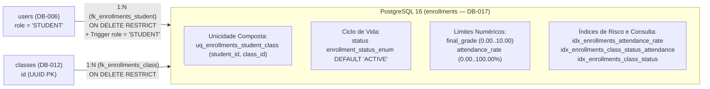

# 🎓 [DB-017] Tabela de Matrículas de Estudantes (`enrollments`) — Projeto NEXA

> **ID do Card**: `DB-017` | **Epic**: `EPIC-02: Gestão Acadêmica & Estrutura SENAI` | **Sprint / Lote**: `Lote 2 (S2)`  
> **Prioridade**: `P0` | **Estimativa**: `3 SP` | **Tipo**: `Feature` | **Status**: `Concluído`  
> **Arquivos Principais**: [`prisma/migrations/20261118060000_create_enrollments_table/migration.sql`](../../prisma/migrations/20261118060000_create_enrollments_table/migration.sql), [`BancoNexa/sql/17_tabela_enrollments.sql`](../../BancoNexa/sql/17_tabela_enrollments.sql), [`prisma/schema.prisma`](../../prisma/schema.prisma), [`BancoNexa/types/schema-models.ts`](../../BancoNexa/types/schema-models.ts)  
> **Rastreabilidade**: ⬅️ Anterior: [`DB-016`](./16-tabela-relacionamento-modulo-competencia-module-competencies.md) | ➡️ Próximo: `DB-018` | 🔒 Depende de: `DB-006`, `DB-012` | 🔓 Desbloqueia: `DB-019`, `DB-020`, `DB-022`, `DB-025`, `DB-028`, `DB-032`, `DB-034`, `DB-036`, `DB-039`, `DB-042`, `DB-043`, `DB-046`, `BE-016`, `BE-017`, `BE-019`

---

## 1. Objetivo e Modelagem de Domínio SENAI

O card **`DB-017`** implementa a tabela `enrollments` no **PostgreSQL 16 (Docker)** para registrar formalmente o ingresso, o ciclo de vida acadêmico e os indicadores consolidados (`final_grade` e `attendance_rate`) de um estudante em uma turma técnica SENAI.

A entidade `enrollments` é o vínculo central que habilita o acesso do estudante ao portal e conecta praticamente toda a camada operacional e analítica do sistema:
- **Constraints de Integridade Acadêmica (`DB-019`)** e **Seed Curricular SENAI (`DB-020`)**;
- **Presença e Faltas (`attendance_records` — `DB-022`)**, **Submissões Práticas (`task_submissions` — `DB-025`)** e **Notas Finais (`student_grades` — `DB-028`)**;
- **Autoavaliação (`DB-032`)**, **Alertas de Risco (`academic_alerts` — `DB-034`)**, **View 360° (`vw_student_360_performance` — `DB-036`)** e **Linha do Tempo (`student_milestone_history` — `DB-039`)**;
- **Apoio Confidencial (`help_requests` — `DB-042`)**, **Observações Pedagógicas Restritas (`pedagogical_notes` — `DB-043`)** e **Conquistas (`student_achievements` — `DB-046`)**;
- **Endpoints de Matrícula, Consulta por Turma e Alteração de Status (`BE-016`, `BE-017`, `BE-019`)**.

---

## 2. Arquitetura Relacional, Validação de Perfil e Filtros de Risco

1. **Unicidade por Estudante e Turma (`uq_enrollments_student_class`)**: A restrição `UNIQUE (student_id, class_id)` impede no motor PostgreSQL (`SQLSTATE 23505 / P2002`) que um mesmo estudante possua mais de uma matrícula simultânea na mesma turma, sustentando o retorno `HTTP 409 Conflict` em `BE-016`.
2. **Validação Estrita de Perfil `STUDENT` (`fk_enrollments_student` + Trigger PL/pgSQL)**: Além da chave estrangeira `fk_enrollments_student REFERENCES users(id) ON DELETE RESTRICT ON UPDATE CASCADE`, o trigger `trg_enrollments_validate_student_role_and_touch` verifica no banco de dados se o usuário referenciado possui `role = 'STUDENT'`. Tentativas de matricular usuários `ADMIN`, `COORDINATOR` ou `TEACHER` falham imediatamente com `SQLSTATE 23514` (`chk_enrollments_student_role`).
3. **Status Padrão `ACTIVE` (`enrollment_status_enum`)**: Utiliza o enum nativo criado em `DB-005` (`ACTIVE`, `COMPLETED`, `DROPPED`, `SUSPENDED`) com valor padrão `'ACTIVE'`.
4. **Indicador de Frequência Percentual Indexado (`attendance_rate`)**: Armazenado como `NUMERIC(5,2)` entre `0.00` e `100.00` (`chk_enrollments_attendance_rate`) com índices dedicados `idx_enrollments_attendance_rate` e `idx_enrollments_class_status_attendance` para consultas rápidas de risco de evasão (ex.: `attendance_rate < 75.00` em `DB-034` / `DB-036`).

---

## 3. Especificação Relacional da Tabela `enrollments` (PostgreSQL 16)

| Coluna | Tipo SQL Nativo | Campo Prisma / TS | Nulo? | Default | Constraints e Regras de Negócio |
|---|---|---|:---:|---|---|
| `id` | `UUID` | `id: string` | `NOT NULL` | `gen_random_uuid()` | `PRIMARY KEY` |
| `student_id` | `UUID` | `studentId: string` | `NOT NULL` | — | `FK -> users(id) ON DELETE RESTRICT`, validado como `role = 'STUDENT'` via trigger; parte de `uq_enrollments_student_class` |
| `class_id` | `UUID` | `classId: string` | `NOT NULL` | — | `FK -> classes(id) ON DELETE RESTRICT ON UPDATE CASCADE`; parte de `uq_enrollments_student_class` |
| `enrollment_date` | `DATE` | `enrollmentDate: Date` | `NOT NULL` | `CURRENT_DATE` | Data formal de ingresso do estudante na turma |
| `status` | `enrollment_status_enum` | `status: EnrollmentStatus` | `NOT NULL` | `'ACTIVE'` | Valores: `ACTIVE`, `COMPLETED`, `DROPPED`, `SUSPENDED` (`DB-005`) |
| `final_grade` | `NUMERIC(4,2)` | `finalGrade: number \| string \| null` | `NULL` | `NULL` | `CHECK (final_grade IS NULL OR (final_grade >= 0.00 AND final_grade <= 10.00))` |
| `attendance_rate` | `NUMERIC(5,2)` | `attendanceRate: number \| string \| null` | `NULL` | `NULL` | Porcentagem `0.00..100.00`; indexado (`idx_enrollments_attendance_rate`) para filtros de risco |
| `created_at` | `TIMESTAMPTZ` | `createdAt: Date` | `NOT NULL` | `CURRENT_TIMESTAMP` | Data/hora de criação com timezone |
| `updated_at` | `TIMESTAMPTZ` | `updatedAt: Date` | `NOT NULL` | `CURRENT_TIMESTAMP` | Atualizado automaticamente por Trigger em `UPDATE` |

---

## 4. Índices e Trigger Implementados em SQL

### 4.1. Índices Criados
- **`uq_enrollments_student_class`**: Índice único composto `(student_id, class_id)` (Critério de Aceitação 1).
- **`idx_enrollments_attendance_rate`**: Índice `B-Tree` em `attendance_rate` para filtros rápidos de risco de evasão (Observação Técnica).
- **`idx_enrollments_class_status_attendance`**: Índice composto `(class_id, status, attendance_rate)` para dashboards docentes/coordenação por turma.
- **`idx_enrollments_class_status`**: Índice composto `(class_id, status)` para contagem atômica de vagas (`BE-016`) e listagem de matriculados por turma (`BE-017`).
- **`idx_enrollments_student_status`**: Índice composto `(student_id, status)` para consulta rápida de turmas ativas no Portal do Aluno.

### 4.2. Trigger PL/pgSQL
- **`trg_enrollments_validate_student_role_and_touch` (`fn_enrollments_validate_student_role_and_touch`)**: Valida em todo `INSERT` e `UPDATE` que `users.role = 'STUDENT'` (levantando `SQLSTATE 23514` caso contrário) e atualiza `updated_at` em toda operação `UPDATE`.

---

## 5. Checklist de Verificação dos Critérios de Aceitação (`DB-017`)

- [x] **Critério 1 — Apenas uma matrícula por estudante por turma (`UNIQUE`)**: `CONSTRAINT uq_enrollments_student_class UNIQUE (student_id, class_id)` no SQL e `@@unique([studentId, classId])` no Prisma.
- [x] **Critério 2 — FK com validação de perfil (`role = STUDENT`)**: `fk_enrollments_student REFERENCES users(id) ON DELETE RESTRICT` combinada ao trigger `trg_enrollments_validate_student_role_and_touch` rejeitando perfis não-estudantes (`ADMIN`, `COORDINATOR`, `TEACHER`).
- [x] **Critério 3 — Status padrão `ACTIVE`**: `status enrollment_status_enum NOT NULL DEFAULT 'ACTIVE'` no SQL e `@default(ACTIVE)` no Prisma.
- [x] **Observação Técnica — `attendance_rate` percentual (`0.00..100.00`) com índice de risco**: Constraint `chk_enrollments_attendance_rate` + índices `idx_enrollments_attendance_rate` e `idx_enrollments_class_status_attendance`.
- [x] **DoD — Tabela `enrollments` implementada com unicidade composta, integrada ao Prisma e validada**: Migration `20261118060000_create_enrollments_table`, `model Enrollment` em `prisma/schema.prisma`, tipos gerados em `BancoNexa/types/schema-models.ts` e testes aprovados em `scripts/validate-db-017.js`.
