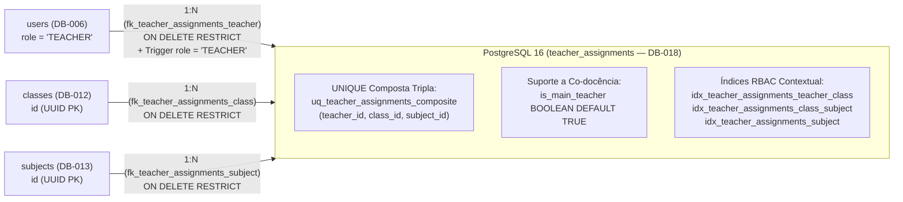

# 👨‍🏫 [DB-018] Associação de Professores a Disciplinas e Turmas (`teacher_assignments`) — Projeto NEXA

> **ID do Card**: `DB-018` | **Epic**: `EPIC-02: Gestão Acadêmica & Estrutura SENAI` | **Sprint / Lote**: `Lote 2 (S2)`  
> **Prioridade**: `P0` | **Estimativa**: `2 SP` | **Tipo**: `Feature` | **Status**: `Concluído`  
> **Arquivos Principais**: [`prisma/migrations/20261118070000_create_teacher_assignments_table/migration.sql`](../../prisma/migrations/20261118070000_create_teacher_assignments_table/migration.sql), [`BancoNexa/sql/18_tabela_teacher_assignments.sql`](../../BancoNexa/sql/18_tabela_teacher_assignments.sql), [`prisma/schema.prisma`](../../prisma/schema.prisma), [`BancoNexa/types/schema-models.ts`](../../BancoNexa/types/schema-models.ts)  
> **Rastreabilidade**: ⬅️ Anterior: [`DB-017`](./17-tabela-matriculas-estudantes-enrollments.md) | ➡️ Próximo: `DB-019` | 🔒 Depende de: `DB-006`, `DB-012`, `DB-013` | 🔓 Desbloqueia: `DB-020`, `DB-021`, `BE-018`, `FE-020`

---

## 1. Objetivo e Modelagem de Domínio SENAI

O card **`DB-018`** implementa a tabela `teacher_assignments` no **PostgreSQL 16 (Docker)** para vincular instrutores e professores (`users` com `role = 'TEACHER'`) às turmas (`classes`) e disciplinas (`subjects`) que ministram, estabelecendo a fonte oficial de autorização contextual (**RBAC contextual**) para lançamento de aulas, chamada rápida, notas e rubricas de oficina.

A modelagem contempla a realidade das oficinas técnicas do SENAI onde uma mesma disciplina e turma podem contar com **múltiplos professores** (ex.: professor titular de teoria com `is_main_teacher = TRUE` e instrutor auxiliar de bancada/usinagem com `is_main_teacher = FALSE`), desbloqueando:
- **Seed Curricular SENAI (`DB-020`)**;
- **Diário de Aulas Ministradas (`class_lessons` — `DB-021`)**;
- **Endpoints de Alocação Docente e Consulta de Alunos por Turma (`BE-018`, `BE-017`)**;
- **Tela de Associação de Professores às Turmas e Oficinas (`FE-020`)**.

---

## 2. Arquitetura Relacional, RBAC Contextual e Múltiplos Instrutores

1. **Chave Única Composta Tripla (`uq_teacher_assignments_composite`)**: `UNIQUE (teacher_id, class_id, subject_id)` impede duplicar a alocação do mesmo professor na mesma turma/disciplina (`HTTP 409 Conflict` em `BE-018`), enquanto permite múltiplos docentes distintos na mesma turma e disciplina (Observação Técnica).
2. **Integridade Referencial Estrita (`ON DELETE RESTRICT`) + Validação de Perfil `TEACHER`**:
   - Todas as 3 chaves estrangeiras (`teacher_id`, `class_id`, `subject_id`) usam `ON DELETE RESTRICT ON UPDATE CASCADE` para preservar o histórico de atribuições docentes.
   - O trigger PL/pgSQL `trg_teacher_assignments_validate_teacher_role` bloqueia no banco (`SQLSTATE 23514`) qualquer tentativa de atribuir usuários cujo `role` não seja `'TEACHER'` (`STUDENT`, `ADMIN`, `COORDINATOR`).
3. **Índices Eficientes para Autorização RBAC Contextual**:
   - `uq_teacher_assignments_composite (teacher_id, class_id, subject_id)` responde em $O(\log n)$ à checagem: *"O docente X tem permissão para lançar aulas/notas na turma Y e disciplina Z?"*.
   - `idx_teacher_assignments_teacher_class (teacher_id, class_id)` responde em $O(\log n)$ à checagem de turma (`BE-017`: *"O docente X está alocado à turma Y?"*) e carrega a pauta de turmas do docente.
   - `idx_teacher_assignments_class_subject (class_id, subject_id)` lista rapidamente todos os instrutores (titular e auxiliares de oficina) de uma disciplina em uma turma (`FE-020`).

---

## 3. Especificação Relacional da Tabela `teacher_assignments` (PostgreSQL 16)

| Coluna | Tipo SQL Nativo | Campo Prisma / TS | Nulo? | Default | Constraints e Regras de Negócio |
|---|---|---|:---:|---|---|
| `id` | `UUID` | `id: string` | `NOT NULL` | `gen_random_uuid()` | `PRIMARY KEY` |
| `teacher_id` | `UUID` | `teacherId: string` | `NOT NULL` | — | `FK -> users(id) ON DELETE RESTRICT`, validado como `role = 'TEACHER'` via trigger; parte de `uq_teacher_assignments_composite` |
| `class_id` | `UUID` | `classId: string` | `NOT NULL` | — | `FK -> classes(id) ON DELETE RESTRICT ON UPDATE CASCADE`; parte de `uq_teacher_assignments_composite` |
| `subject_id` | `UUID` | `subjectId: string` | `NOT NULL` | — | `FK -> subjects(id) ON DELETE RESTRICT ON UPDATE CASCADE`; parte de `uq_teacher_assignments_composite` |
| `assigned_at` | `TIMESTAMPTZ` | `assignedAt: Date` | `NOT NULL` | `CURRENT_TIMESTAMP` | Data/hora de formalização da alocação docente |
| `is_main_teacher` | `BOOLEAN` | `isMainTeacher: boolean` | `NOT NULL` | `TRUE` | Diferencia professor titular (`TRUE`) de instrutor auxiliar/co-docente de oficina (`FALSE`) |

---

## 4. Índices e Trigger Implementados em SQL

### 4.1. Índices Criados
- **`uq_teacher_assignments_composite`**: Índice único composto `(teacher_id, class_id, subject_id)` (Critério de Aceitação 1 + checagem RBAC de disciplina).
- **`idx_teacher_assignments_teacher_class`**: Índice composto `(teacher_id, class_id)` para checagem RBAC por turma (`BE-017`) e listagem das turmas do professor.
- **`idx_teacher_assignments_class_subject`**: Índice composto `(class_id, subject_id)` para listagem de docentes alocados por disciplina/oficina (`FE-020`).
- **`idx_teacher_assignments_subject`**: Índice `B-Tree` em `(subject_id)` para filtros por unidade curricular.

### 4.2. Trigger PL/pgSQL
- **`trg_teacher_assignments_validate_teacher_role` (`fn_teacher_assignments_validate_teacher_role`)**: Garante em todo `INSERT` e `UPDATE` que `users.role = 'TEACHER'`, disparando `SQLSTATE 23514` (`chk_teacher_assignments_teacher_role`) caso contrário.

---

## 5. Checklist de Verificação dos Critérios de Aceitação (`DB-018`)

- [x] **Critério 1 — Chave composta `UNIQUE (teacher_id, class_id, subject_id)`**: `CONSTRAINT uq_teacher_assignments_composite UNIQUE (teacher_id, class_id, subject_id)` no SQL e `@@unique([teacherId, classId, subjectId])` no Prisma.
- [x] **Critério 2 — Foreign keys íntegras com `ON DELETE RESTRICT`**: `fk_teacher_assignments_teacher`, `fk_teacher_assignments_class` e `fk_teacher_assignments_subject` todas com `ON DELETE RESTRICT ON UPDATE CASCADE`, mais validação de perfil `TEACHER` via trigger.
- [x] **Critério 3 — Facilita autorização no backend (RBAC contextual)**: Índices compostos `(teacher_id, class_id, subject_id)`, `(teacher_id, class_id)` e `(class_id, subject_id)` otimizando consultas de permissão de diário.
- [x] **Observação Técnica — Permite múltiplos professores por disciplina**: Unicidade inclui `teacher_id` e flag `is_main_teacher` diferencia teoria/titular e oficina/auxiliar.
- [x] **DoD — Tabela `teacher_assignments` criada, integrada ao Prisma e validada**: Migration `20261118070000_create_teacher_assignments_table`, `model TeacherAssignment` em `prisma/schema.prisma`, tipos gerados em `BancoNexa/types/schema-models.ts` e testes aprovados em `scripts/validate-db-018.js`.
