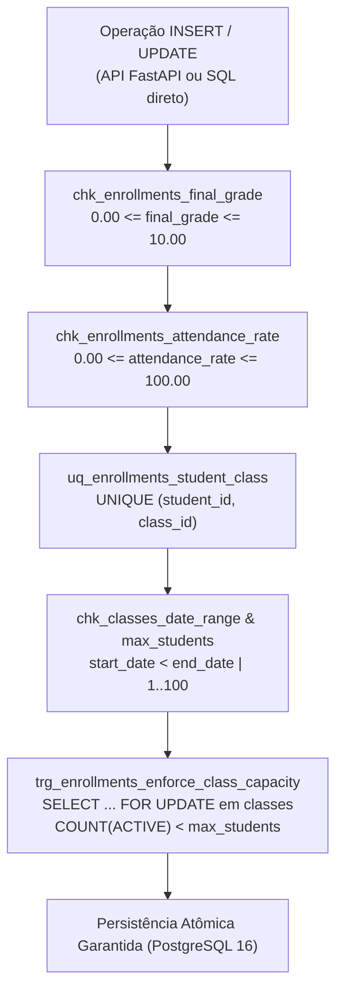

# 🛡️ [DB-019] Constraints de Unicidade e Integridade Acadêmica em Matrículas — Projeto NEXA

> **ID do Card**: `DB-019` | **Epic**: `EPIC-02: Gestão Acadêmica & Estrutura SENAI` | **Sprint / Lote**: `Lote 2 (S2)`  
> **Prioridade**: `P0` | **Estimativa**: `2 SP` | **Tipo**: `Feature` | **Status**: `Concluído`  
> **Arquivos Principais**: [`prisma/migrations/20261118080000_enforce_academic_integrity_constraints/migration.sql`](../../prisma/migrations/20261118080000_enforce_academic_integrity_constraints/migration.sql), [`BancoNexa/sql/19_constraints_integridade_academica_matriculas.sql`](../../BancoNexa/sql/19_constraints_integridade_academica_matriculas.sql), [`BancoNexa/sql/19_testes_violacao_constraints.sql`](../../BancoNexa/sql/19_testes_violacao_constraints.sql), [`prisma/schema.prisma`](../../prisma/schema.prisma)  
> **Rastreabilidade**: ⬅️ Anterior: [`DB-018`](./18-tabela-associacao-professores-teacher-assignments.md) | ➡️ Próximo: `DB-020` | 🔒 Depende de: `DB-017` | 🔓 Desbloqueia: Validação final da trilha de matrículas e integridade do Lote 2

---

## 1. Objetivo e Blindagem no Motor PostgreSQL 16

O card **`DB-019`** consolida e reforça diretamente no **PostgreSQL 16 (Docker)** as regras críticas de unicidade, verificação (`CHECK`) e controle transacional sob concorrência para matrículas (`enrollments`) e turmas (`classes`), assegurando que nenhuma falha de aplicação ou condição de corrida (*race condition*) permita gravar notas impossíveis, frequências inválidas, janelas de datas invertidas ou turmas acima da lotação máxima.

---

## 2. Matriz Completa de Constraints e Triggers de Integridade (`DB-019`)

| Tabela | Nome da Constraint / Trigger | Regra Aplicada no PostgreSQL 16 | SQLSTATE em Violação |
|---|---|---|---|
| `enrollments` | `chk_enrollments_final_grade` | `CHECK (final_grade IS NULL OR (final_grade >= 0.00 AND final_grade <= 10.00))` | `23514` (`check_violation`) |
| `enrollments` | `chk_enrollments_attendance_rate` | `CHECK (attendance_rate IS NULL OR (attendance_rate >= 0.00 AND attendance_rate <= 100.00))` | `23514` (`check_violation`) |
| `enrollments` | `uq_enrollments_student_class` | `UNIQUE (student_id, class_id)` | `23505` (`unique_violation`) |
| `classes` | `chk_classes_date_range` | `CHECK (start_date < end_date)` | `23514` (`check_violation`) |
| `classes` | `chk_classes_max_students` | `CHECK (max_students > 0 AND max_students <= 100)` | `23514` (`check_violation`) |
| `enrollments` | `trg_enrollments_enforce_class_capacity` | Lock pessimista (`SELECT max_students FROM classes WHERE id = NEW.class_id FOR UPDATE`) impedindo exceder `max_students` para matrículas `ACTIVE` | `23514` (`chk_enrollments_class_capacity`) |
| `classes` | `trg_classes_validate_max_students_reduction` | Bloqueia redução de `classes.max_students` para valor menor que o total atual de matrículas `ACTIVE` | `23514` (`chk_classes_max_students_vs_active`) |

---

## 3. Controle de Concorrência (`FOR UPDATE`) e Documentação no Schema

1. **Prevenção de Race Condition em Lotação de Turma**: Quando duas requisições simultâneas (`BE-016` — `POST /api/v1/enrollments`) disputam a última vaga de uma turma de oficina, o trigger `trg_enrollments_enforce_class_capacity` serializa a verificação adquirindo lock de linha (`FOR UPDATE`) sobre a turma em `classes`, garantindo no nível de banco de dados que `COUNT(ACTIVE) <= classes.max_students` mesmo sem coordenação externa.
2. **Reaproveitamento Seguro de Vagas**: Apenas matrículas com `status = 'ACTIVE'` consomem vagas ativas da turma; quando um estudante conclui (`COMPLETED`) ou tranca/evade (`DROPPED`, `SUSPENDED`), a vaga fica disponível sem perda do histórico.
3. **Documentação Registrada no Schema e no Catálogo SQL**:
   - Todas as constraints e triggers foram documentados diretamente nos modelos `Class` e `Enrollment` em [`prisma/schema.prisma`](../../prisma/schema.prisma) (referenciando o padrão `@check` nativo PostgreSQL).
   - A migration também registra `COMMENT ON CONSTRAINT` diretamente no catálogo `pg_description` do PostgreSQL 16.

---

## 4. Testes de Violação Proposital (DoD)

- **Script SQL nativo rollback-safe**: [`BancoNexa/sql/19_testes_violacao_constraints.sql`](../../BancoNexa/sql/19_testes_violacao_constraints.sql) executa inserções propositalmente inválidas (`final_grade = 10.50`, `attendance_rate = -5.00`, `start_date > end_date`, matrícula duplicada, 3º aluno em turma de 2 vagas e redução de `max_students`) dentro de uma transação `BEGIN ... ROLLBACK`, falhando o script caso qualquer violação não seja barrada pelo PostgreSQL.
- **Validação automatizada Node.js**: [`scripts/validate-db-019.js`](../../scripts/validate-db-019.js) verifica as migrations, comentários no `prisma/schema.prisma`, catálogo SQL e executa 6 blocos de testes unitários de violação proposital e cenários de fronteira.

---

## 5. Checklist de Verificação dos Critérios de Aceitação (`DB-019`)

- [x] **Critério 1 — `CHECK` constraints ativas no PostgreSQL**: Migration idempotente `20261118080000_enforce_academic_integrity_constraints` garante todas as constraints `CHECK`, `UNIQUE` e triggers de capacidade.
- [x] **Critério 2 — Nota `10.50` e frequência `-5%` falham com erro de constraint**: Validado tanto no script SQL (`19_testes_violacao_constraints.sql`) quanto nos testes automatizados (`validate-db-019.js`) com `SQLSTATE 23514`.
- [x] **Critério 3 — Documentação das constraints registrada no schema**: Documentação explícita registrada nos blocos `model Class` e `model Enrollment` de `prisma/schema.prisma` e via `COMMENT ON CONSTRAINT` no PostgreSQL.
- [x] **DoD — Script de constraints executado e validado com testes de violação proposital**: Cobertura completa para notas, frequências, datas letivas, unicidade e capacidade máxima de alunos sob concorrência.
