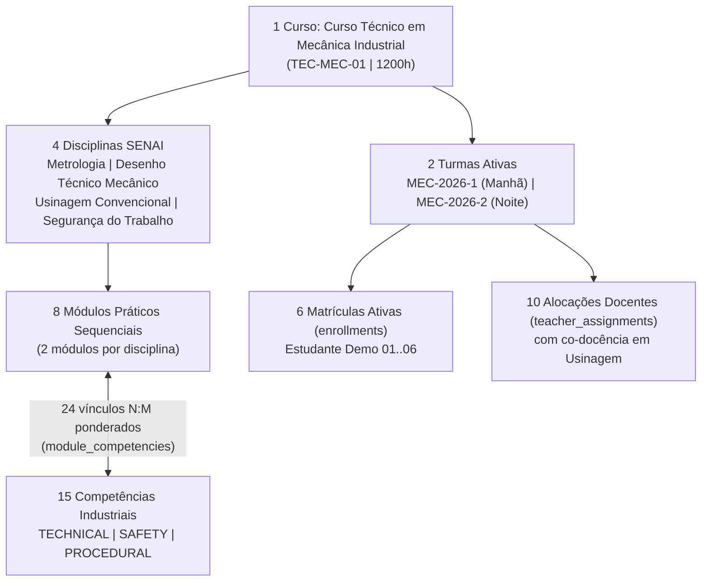

# 🌱 [DB-020] Seed de Estrutura Curricular SENAI (Mecânica e Metrologia) — Projeto NEXA

> **ID do Card**: `DB-020` | **Epic**: `EPIC-02: Gestão Acadêmica & Estrutura SENAI` | **Sprint / Lote**: `Lote 2 (S2)`  
> **Prioridade**: `P1` | **Estimativa**: `3 SP` | **Tipo**: `Feature` | **Status**: `Concluído (Lote 2 Finalizado)`  
> **Arquivos Principais**: [`prisma/seed.ts`](../../prisma/seed.ts), [`BancoNexa/sql/20_seed_estrutura_curricular_senai.sql`](../../BancoNexa/sql/20_seed_estrutura_curricular_senai.sql), [`package.json`](../../package.json)  
> **Rastreabilidade**: ⬅️ Anterior: [`DB-019`](./19-constraints-integridade-academica-matriculas.md) | ➡️ Próximo: `DB-021` | 🔒 Depende de: `DB-011` a `DB-018` | 🔓 Desbloqueia: `DB-030`, `DB-050`, `BE-020`

---

## 1. Objetivo e Comando de Execução

O card **`DB-020`** encerra o **Lote 2 (S2)** entregando o script [`prisma/seed.ts`](../../prisma/seed.ts) e seu script SQL equivalente [`BancoNexa/sql/20_seed_estrutura_curricular_senai.sql`](../../BancoNexa/sql/20_seed_estrutura_curricular_senai.sql) para popular o banco de dados local com uma grade completa, coerente e realista do **Curso Técnico em Mecânica Industrial SENAI**.

Para popular (ou reexecutar com segurança) o banco local a partir da raiz do repositório:

```bash
npm run db:seed
```

---

## 2. Grade Curricular SENAI Populada (`npm run db:seed`)



### 2.1. Inventário Quantitativo

| Entidade (`Tabela PostgreSQL`) | Quantidade | Detalhamento |
|---|:---:|---|
| **Cursos** (`courses`) | `1` | `TEC-MEC-01` — *Curso Técnico em Mecânica Industrial* (`1200h`) |
| **Turmas** (`classes`) | `2` | `MEC-2026-1` (`2026.1`, `MORNING`, 30 vagas) e `MEC-2026-2` (`2026.2`, `NIGHT`, 30 vagas) |
| **Disciplinas** (`subjects`) | `4` | *Metrologia* (`UC-MET-01`), *Desenho Técnico Mecânico* (`UC-DTM-02`), *Usinagem Convencional* (`UC-USI-03`), *Segurança do Trabalho* (`UC-SEG-04`) |
| **Módulos Práticos** (`learning_modules`) | `8` | 2 módulos práticos sequenciais (`order_index` 1 e 2) por disciplina, com pesos ponderados e notas de corte entre `6.00` e `7.50` |
| **Competências** (`competencies`) | `15` | 8 `TECHNICAL`, 3 `SAFETY` e 4 `PROCEDURAL` (`COMP-MET-01..04`, `COMP-DTM-01..03`, `COMP-USI-01..04`, `COMP-SEG-01..03`, `COMP-PRO-01`) |
| **Vínculos Módulo-Competência** (`module_competencies`) | `24` | Todas as 15 competências vinculadas aos 8 módulos com `weight` (`1.00..3.00`) e `required_level` (`2..5`) |
| **Usuários & Perfis Demo** (`users` / `user_profiles`) | `9` | 1 Coordenador, 2 Instrutores e 6 Estudantes 100% anônimos (`*.nexa.local`) |
| **Matrículas** (`enrollments`) | `6` | 3 estudantes ativos em `MEC-2026-1` e 3 em `MEC-2026-2` |
| **Alocações Docentes** (`teacher_assignments`) | `10` | Cobertura completa das 4 disciplinas nas 2 turmas, com co-docência teoria + oficina em *Usinagem Convencional* |

---

## 3. Idempotência (`UPSERT`) e Privacidade (LGPD)

1. **Idempotência Total (`ON CONFLICT ... DO UPDATE`)**: Todas as instruções SQL geradas e executadas por `prisma/seed.ts` utilizam `ON CONFLICT (...) DO UPDATE` sobre as chaves naturais/compostas (`courses.code`, `classes(code, period)`, `subjects(course_id, code)`, `learning_modules(subject_id, order_index)`, `competencies.code`, `module_competencies(module_id, competency_id)`, `users.email`, `user_profiles.user_id`, `enrollments(student_id, class_id)` e `teacher_assignments(teacher_id, class_id, subject_id)`). Reexecutar `npm run db:seed` múltiplas vezes nunca gera duplicatas nem erros de violação de chave única.
2. **Privacidade e Dados Fictícios (Observação Técnica)**: Todos os usuários, nomes (`Estudante Demo 01..06`, `Instrutor Demo 01..02`, `Coordenacao Demo SENAI`), e-mails (`@senai.nexa.local`, `@aluno.nexa.local`), matrículas (`SENAI-2026-0001..0006`) e hashes Bcrypt são **100% sintéticos e anônimos**, sem qualquer dado pessoal real (CPF, telefone pessoal ou nome real).

---

## 4. Checklist de Verificação dos Critérios de Aceitação (`DB-020`)

- [x] **Critério 1 — Script roda de forma idempotente (`upsert`) sem duplicar dados**: Todas as tabelas usam `ON CONFLICT ... DO UPDATE`, validado com reexecução consecutiva de `npm run db:seed`.
- [x] **Critério 2 — Cria turmas e disciplinas com dados coerentes do SENAI**: 1 curso técnico em Mecânica Industrial, 2 turmas (`MEC-2026-1` e `MEC-2026-2`), 4 disciplinas obrigatórias e 8 módulos práticos sequenciais.
- [x] **Critério 3 — Vincula competências reais aos módulos**: 15 competências industriais vinculadas aos 8 módulos via 24 registros ponderados em `module_competencies`.
- [x] **Observação Técnica — Dados completamente anônimos e fictícios**: Nenhum dado pessoal real presente nos scripts de seed.
- [x] **DoD — `npm run db:seed` popula o banco sem erros e pode ser reexecutado com segurança**: Validado por `scripts/validate-db-020.js`.
