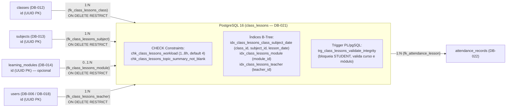

# 📓 [DB-021] Tabela de Aulas Ministradas e Diário de Bordo (`class_lessons`) — Projeto NEXA

> **ID do Card**: `DB-021` | **Epic**: `EPIC-03: Diário de Classe: Notas & Frequência` | **Sprint / Lote**: `Lote 3 (S3)`  
> **Prioridade**: `P0` | **Estimativa**: `3 SP` | **Tipo**: `Feature` | **Status**: `Concluído`  
> **Arquivos Principais**: [`prisma/migrations/20261123000000_create_class_lessons_table/migration.sql`](../../prisma/migrations/20261123000000_create_class_lessons_table/migration.sql), [`BancoNexa/sql/21_tabela_class_lessons.sql`](../../BancoNexa/sql/21_tabela_class_lessons.sql), [`prisma/schema.prisma`](../../prisma/schema.prisma), [`BancoNexa/types/schema-models.ts`](../../BancoNexa/types/schema-models.ts)  
> **Rastreabilidade**: ⬅️ Anterior: [`DB-020`](./20-seed-estrutura-curricular-senai.md) | ➡️ Próximo: `DB-022` | 🔒 Depende de: `DB-012`, `DB-013`, `DB-014`, `DB-018` | 🔓 Desbloqueia: `DB-022`, `DB-030`, `DB-037`, `BE-021`, `FE-021`

---

## 1. Objetivo e Modelagem de Domínio SENAI

O card **`DB-021`** implementa a tabela `class_lessons` no **PostgreSQL 16 (Docker)** para persistir os encontros letivos e aulas práticas ministradas em cada turma (`classes`), disciplina (`subjects`) e módulo de aprendizagem prática (`learning_modules`, opcional), registrando o docente responsável (`users`), a data letiva (`lesson_date`), a carga horária do turno (`workload_hours`), o resumo do conteúdo ministrado (`topic_summary`) e o ambiente/oficina utilizado (`lab_environment`, ex.: `'Oficina de Tornearia 02'`).

A tabela `class_lessons` atua como **âncora obrigatória** para toda a operação do Diário de Classe no SENAI, desbloqueando diretamente:
- **Registros de Presença e Faltas (`attendance_records` — `DB-022`)**;
- **Seed Realista de Frequências e Notas Parciais (`DB-030`)**;
- **View Analítica de Frequência e Evasão por Módulo (`vw_module_attendance_risk` — `DB-037`)**;
- **Endpoint para Registro de Aula Ministrada e Conteúdo Prático (`BE-021`)**;
- **Tela de Diário de Classe: Visão Geral de Aulas da Disciplina (`FE-021`)**.

---

## 2. Arquitetura Relacional, Índice Cronológico e Integridade

1. **Integridade Referencial Estrita (`ON DELETE RESTRICT ON UPDATE CASCADE`)**:
   - Todas as 4 chaves estrangeiras (`class_id`, `subject_id`, `module_id`, `teacher_id`) utilizam `ON DELETE RESTRICT ON UPDATE CASCADE`, garantindo que nenhuma turma, disciplina, módulo prático ou docente vinculado a aulas ministradas seja removido acidentalmente.
   - `module_id` é opcional (`NULL` permitido) para suportar encontros teóricos gerais ou nivelamentos transversais da disciplina, enquanto aulas práticas de oficina vinculam-se diretamente ao módulo prático SENAI correspondente.
2. **Índice Composto para Listagem Cronológica Rápida (`idx_class_lessons_class_subject_date`)**:
   - `CREATE INDEX idx_class_lessons_class_subject_date ON class_lessons USING BTREE (class_id, subject_id, lesson_date)` permite listar em $O(\log n)$ todas as aulas de uma turma e disciplina em ordem cronológica (ou inversa) sem `filesort` em memória.
   - Índices complementares `idx_class_lessons_module (module_id)` e `idx_class_lessons_teacher (teacher_id)` aceleram a agregação de risco por módulo (`DB-037`) e consultas do diário por docente (`BE-021`).
3. **Validação de Carga Horária por Turno (`chk_class_lessons_workload`)**:
   - `CHECK (workload_hours BETWEEN 1 AND 8)` com valor padrão `DEFAULT 4` (turno padrão SENAI de 4 horas) impede registros com carga horária nula, negativa ou superior a 8 horas em um único turno.
4. **Coerência Relacional via Trigger PL/pgSQL (`trg_class_lessons_validate_integrity`)**:
   - Bloqueia usuários com `role = 'STUDENT'` no campo `teacher_id` (`SQLSTATE 23514` / `chk_class_lessons_teacher_role`), mantendo compatibilidade com registros lançados por `TEACHER`, `COORDINATOR` ou `ADMIN` (`BE-021`).
   - Garante que `subjects.course_id = classes.course_id` (`chk_class_lessons_subject_course`).
   - Quando `module_id` é informado, garante que `learning_modules.subject_id = class_lessons.subject_id` (`chk_class_lessons_module_subject`).

---

## 3. Especificação Relacional da Tabela `class_lessons` (PostgreSQL 16)

| Coluna | Tipo SQL Nativo | Campo Prisma / TS | Nulo? | Default | Constraints e Regras de Negócio |
|---|---|---|:---:|---|---|
| `id` | `UUID` | `id: string` | `NOT NULL` | `gen_random_uuid()` | `PRIMARY KEY` |
| `class_id` | `UUID` | `classId: string` | `NOT NULL` | — | `FK -> classes(id) ON DELETE RESTRICT ON UPDATE CASCADE`; parte de `idx_class_lessons_class_subject_date` |
| `subject_id` | `UUID` | `subjectId: string` | `NOT NULL` | — | `FK -> subjects(id) ON DELETE RESTRICT ON UPDATE CASCADE`; deve pertencer ao mesmo curso da turma |
| `module_id` | `UUID` | `moduleId: string \| null` | `NULL` | — | `FK -> learning_modules(id) ON DELETE RESTRICT ON UPDATE CASCADE` (opcional; quando preenchido, deve pertencer a `subject_id`) |
| `teacher_id` | `UUID` | `teacherId: string` | `NOT NULL` | — | `FK -> users(id) ON DELETE RESTRICT ON UPDATE CASCADE`; bloqueia `role = 'STUDENT'` via trigger |
| `lesson_date` | `DATE` | `lessonDate: Date` | `NOT NULL` | — | Data letiva da aula ministrada; parte de `idx_class_lessons_class_subject_date` |
| `workload_hours` | `INTEGER` | `workloadHours: number` | `NOT NULL` | `4` | `CHECK (workload_hours BETWEEN 1 AND 8)` (`chk_class_lessons_workload`) |
| `topic_summary` | `TEXT` | `topicSummary: string` | `NOT NULL` | — | Resumo do conteúdo teórico/prático ministrado; `CHECK (length(btrim(topic_summary)) > 0)` |
| `lab_environment` | `VARCHAR(100)` | `labEnvironment: string \| null` | `NULL` | — | Ambiente ou oficina utilizada (ex.: `'Oficina de Tornearia 02'`) |
| `created_at` | `TIMESTAMPTZ` | `createdAt: Date` | `NOT NULL` | `CURRENT_TIMESTAMP` | Data/hora de registro da aula no diário de bordo |

---

## 4. Índices, Constraints e Trigger Implementados em SQL

### 4.1. Índices Criados
- **`idx_class_lessons_class_subject_date`**: Índice `B-Tree` composto em `(class_id, subject_id, lesson_date)` (Critério de Aceitação 2 — listagem cronológica rápida do diário da turma/disciplina).
- **`idx_class_lessons_module`**: Índice `B-Tree` em `(module_id)` para filtros por módulo prático e cálculo de risco de evasão/frequência (`DB-037`).
- **`idx_class_lessons_teacher`**: Índice `B-Tree` em `(teacher_id)` para histórico e pauta de aulas ministradas por docente (`BE-021`).

### 4.2. Constraints e Trigger PL/pgSQL
- **`chk_class_lessons_workload`**: `CHECK (workload_hours BETWEEN 1 AND 8)` (Critério de Aceitação 3).
- **`chk_class_lessons_topic_summary_not_blank`**: `CHECK (length(btrim(topic_summary)) > 0)`.
- **`trg_class_lessons_validate_integrity` (`fn_class_lessons_validate_integrity`)**: Valida em `BEFORE INSERT OR UPDATE` que `teacher_id` não possui `role = 'STUDENT'`, que `subject_id` pertence ao curso da turma `class_id` e que `module_id` (quando informado) pertence à disciplina `subject_id`.

---

## 5. Checklist de Verificação dos Critérios de Aceitação (`DB-021`)

- [x] **Critério 1 — FKs íntegras para `classes`, `subjects`, `learning_modules` e `users`**: Constraints `fk_class_lessons_class`, `fk_class_lessons_subject`, `fk_class_lessons_module` (opcional/NULL) e `fk_class_lessons_teacher`, todas com `ON DELETE RESTRICT ON UPDATE CASCADE`, reforçadas pelo trigger `trg_class_lessons_validate_integrity`.
- [x] **Critério 2 — Índice composto em `(class_id, subject_id, lesson_date)`**: `idx_class_lessons_class_subject_date` criado no DDL SQL e declarado em `prisma/schema.prisma`, complementado por `idx_class_lessons_module` e `idx_class_lessons_teacher`.
- [x] **Critério 3 — Validação de `workload_hours` entre 1 e 8 horas por turno**: `workload_hours INTEGER NOT NULL DEFAULT 4` + `CONSTRAINT chk_class_lessons_workload CHECK (workload_hours BETWEEN 1 AND 8)`.
- [x] **DoD — Migration criada, integrada ao Prisma e testada com inserção vinculada a módulo prático**: Migration `20261123000000_create_class_lessons_table`, `model ClassLesson` em `prisma/schema.prisma`, tipos gerados em `BancoNexa/types/schema-models.ts` e suíte de testes aprovada em `scripts/validate-db-021.js`.
