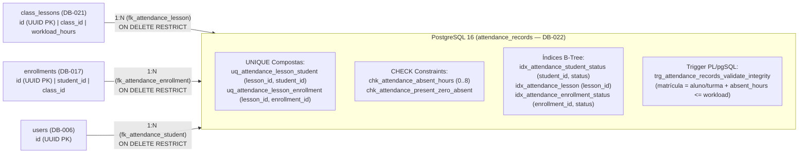

# ✅ [DB-022] Tabela de Registros de Presença e Faltas (`attendance_records`) — Projeto NEXA

> **ID do Card**: `DB-022` | **Epic**: `EPIC-03: Diário de Classe: Notas & Frequência` | **Sprint / Lote**: `Lote 3 (S3)`  
> **Prioridade**: `P0` | **Estimativa**: `3 SP` | **Tipo**: `Feature` | **Status**: `Concluído`  
> **Arquivos Principais**: [`prisma/migrations/20261123010000_create_attendance_records_table/migration.sql`](../../prisma/migrations/20261123010000_create_attendance_records_table/migration.sql), [`BancoNexa/sql/22_tabela_attendance_records.sql`](../../BancoNexa/sql/22_tabela_attendance_records.sql), [`prisma/schema.prisma`](../../prisma/schema.prisma), [`BancoNexa/types/schema-models.ts`](../../BancoNexa/types/schema-models.ts)  
> **Rastreabilidade**: ⬅️ Anterior: [`DB-021`](./21-tabela-aulas-ministradas-class-lessons.md) | ➡️ Próximo: `DB-023` | 🔒 Depende de: `DB-017`, `DB-021` | 🔓 Desbloqueia: `DB-029`, `DB-030`, `DB-034`, `DB-036`, `DB-037`, `DB-047`, `BE-022`, `BE-023`, `FE-022`

---

## 1. Objetivo e Modelagem de Domínio SENAI

O card **`DB-022`** implementa a tabela `attendance_records` no **PostgreSQL 16 (Docker)** para armazenar a frequência individual de cada estudante em cada aula ministrada (`class_lessons`), oferecendo suporte nativo a **chamada rápida em 1 clique** e **upsert em lote** (`INSERT ... ON CONFLICT (lesson_id, student_id) DO UPDATE`) consumidos diretamente pelo endpoint `BE-022` e matriz de chamada `FE-022`.

Essa estrutura atômica em 3FN viabiliza o cálculo automatizado e auditável do limite institucional de **75% de frequência** (e alerta precoce abaixo de 78%), desbloqueando diretamente:
- **Triggers de Período Letivo Fechado (`DB-029`)**;
- **Seed Realista de Frequências e Notas Parciais (`DB-030`)**;
- **Alertas Explicáveis de Risco Acadêmico (`academic_alerts` — `DB-034`)**;
- **Views Analíticas (`vw_student_360_performance` — `DB-036` e `vw_module_attendance_risk` — `DB-037`)**;
- **Otimização de Índices B-Tree e Compostos (`DB-047`)**;
- **Endpoints de Chamada em Lote (`BE-022`) e Consulta Consolidada de Frequência (`BE-023`)**;
- **Interface de Chamada Rápida em 1 Clique (`FE-022`)**.

---

## 2. Arquitetura Relacional, Upsert em Lote e Integridade

1. **Unicidade por Aula e Estudante (`uq_attendance_lesson_student` e `uq_attendance_lesson_enrollment`)**:
   - `UNIQUE (lesson_id, student_id)` impede qualquer duplicidade de chamada para o mesmo estudante na mesma aula (`SQLSTATE 23505` / `P2002`) e serve de chave de conflito determinística para **upsert em lote** (`ON CONFLICT (lesson_id, student_id) DO UPDATE`) em `BE-022`.
   - `UNIQUE (lesson_id, enrollment_id)` complementa a unicidade pela matrícula formal.
2. **Vínculo Obrigatório com `enrollments` + Coerência de Turma**:
   - `fk_attendance_enrollment` (`ON DELETE RESTRICT ON UPDATE CASCADE`) garante que apenas estudantes formalmente matriculados recebam registro de presença.
   - O trigger `trg_attendance_records_validate_integrity` valida no banco (`SQLSTATE 23514`) que `enrollments.student_id = attendance_records.student_id` e que `enrollments.class_id = class_lessons.class_id`, impedindo lançar presença para um aluno matriculado em outra turma.
3. **Agregação Instantânea de Faltas (`idx_attendance_student_status`)**:
   - `CREATE INDEX idx_attendance_student_status ON attendance_records USING BTREE (student_id, status)` permite contabilizar rapidamente presenças, faltas, atrasos e justificativas de um estudante sem varredura sequencial.
   - Índices complementares `idx_attendance_lesson (lesson_id)` e `idx_attendance_enrollment_status (enrollment_id, status)` otimizam o carregamento da matriz de chamada (`FE-022`) e o recálculo de `attendance_rate` (`BE-022` / `BE-023`).
4. **Higiene de Carga Horária de Falta (`absent_hours`)**:
   - `chk_attendance_absent_hours` exige `absent_hours >= 0 AND absent_hours <= 8` (padrão `0`).
   - `chk_attendance_present_zero_absent` impede gravar `status = 'PRESENT'` com `absent_hours > 0`.
   - O trigger também valida `NEW.absent_hours <= class_lessons.workload_hours` (`chk_attendance_absent_exceeds_workload`).

---

## 3. Especificação Relacional da Tabela `attendance_records` (PostgreSQL 16)

| Coluna | Tipo SQL Nativo | Campo Prisma / TS | Nulo? | Default | Constraints e Regras de Negócio |
|---|---|---|:---:|---|---|
| `id` | `UUID` | `id: string` | `NOT NULL` | `gen_random_uuid()` | `PRIMARY KEY` |
| `lesson_id` | `UUID` | `lessonId: string` | `NOT NULL` | — | `FK -> class_lessons(id) ON DELETE RESTRICT ON UPDATE CASCADE`; parte de `uq_attendance_lesson_student` e `uq_attendance_lesson_enrollment` |
| `enrollment_id` | `UUID` | `enrollmentId: string` | `NOT NULL` | — | `FK -> enrollments(id) ON DELETE RESTRICT ON UPDATE CASCADE`; validado na mesma turma da aula e mesmo estudante via trigger |
| `student_id` | `UUID` | `studentId: string` | `NOT NULL` | — | `FK -> users(id) ON DELETE RESTRICT ON UPDATE CASCADE`; parte de `uq_attendance_lesson_student` e `idx_attendance_student_status` |
| `status` | `attendance_status_enum` | `status: AttendanceStatus` | `NOT NULL` | `'PRESENT'` | Valores: `PRESENT`, `ABSENT`, `LATE`, `JUSTIFIED` (`DB-005`) |
| `absent_hours` | `INTEGER` | `absentHours: number` | `NOT NULL` | `0` | `CHECK (absent_hours >= 0 AND absent_hours <= 8)`, `status = 'PRESENT' => 0`, e `<= class_lessons.workload_hours` |
| `justification_note` | `TEXT` | `justificationNote: string \| null` | `NULL` | — | Observação opcional de justificativa (ex.: atestado médico ou dispensa institucional) |
| `recorded_at` | `TIMESTAMPTZ` | `recordedAt: Date` | `NOT NULL` | `CURRENT_TIMESTAMP` | Carimbo de data/hora do registro ou última atualização da chamada |

---

## 4. Índices, Constraints e Trigger Implementados em SQL

### 4.1. Índices Criados
- **`uq_attendance_lesson_student`**: Índice único composto `(lesson_id, student_id)` (Critério de Aceitação 1 + âncora para upsert em lote).
- **`uq_attendance_lesson_enrollment`**: Índice único composto `(lesson_id, enrollment_id)`.
- **`idx_attendance_student_status`**: Índice `B-Tree` composto `(student_id, status)` (Critério de Aceitação 3 — agregação instantânea de faltas).
- **`idx_attendance_lesson`**: Índice `B-Tree` em `(lesson_id)` para carregamento da chamada da aula (`BE-022` / `FE-022`).
- **`idx_attendance_enrollment_status`**: Índice `B-Tree` composto `(enrollment_id, status)` para consolidação de frequência por matrícula (`BE-023` / `DB-036`).

### 4.2. Constraints e Trigger PL/pgSQL
- **`chk_attendance_absent_hours`**: `CHECK (absent_hours >= 0 AND absent_hours <= 8)`.
- **`chk_attendance_present_zero_absent`**: `CHECK (status <> 'PRESENT' OR absent_hours = 0)`.
- **`trg_attendance_records_validate_integrity` (`fn_attendance_records_validate_integrity`)**: Valida em `BEFORE INSERT OR UPDATE` que `enrollment_id` pertence a `student_id`, que a matrícula pertence à turma da aula `lesson_id` e que `absent_hours <= class_lessons.workload_hours`.

---

## 5. Checklist de Verificação dos Critérios de Aceitação (`DB-022`)

- [x] **Critério 1 — Constraint `UNIQUE (lesson_id, student_id)` impedindo chamada duplicada**: `uq_attendance_lesson_student` (e `uq_attendance_lesson_enrollment`) no DDL SQL e no `prisma/schema.prisma`, viabilizando `ON CONFLICT (lesson_id, student_id) DO UPDATE`.
- [x] **Critério 2 — FK ligada a `enrollments` garantindo apenas alunos matriculados na turma**: `fk_attendance_enrollment` com `ON DELETE RESTRICT` + trigger validando `enrollments.class_id = class_lessons.class_id` e `enrollments.student_id = student_id`.
- [x] **Critério 3 — Índice em `(student_id, status)` para agregação instantânea de faltas**: `idx_attendance_student_status` criado no SQL e declarado em `prisma/schema.prisma`, complementado por `idx_attendance_lesson` e `idx_attendance_enrollment_status`.
- [x] **DoD — Tabela `attendance_records` migrada e validada com upsert em lote**: Migration `20261123010000_create_attendance_records_table`, `model AttendanceRecord` em `prisma/schema.prisma`, tipos gerados em `BancoNexa/types/schema-models.ts` e testes unitários/upsert aprovados em `scripts/validate-db-022.js`.
