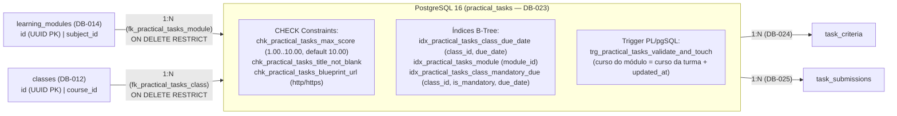

# 🛠️ [DB-023] Tabela de Tarefas e Atividades Práticas (`practical_tasks`) — Projeto NEXA

> **ID do Card**: `DB-023` | **Epic**: `EPIC-04: Atividades Práticas de Oficina & Competências` | **Sprint / Lote**: `Lote 3 (S3)`  
> **Prioridade**: `P0` | **Estimativa**: `3 SP` | **Tipo**: `Feature` | **Status**: `Concluído`  
> **Arquivos Principais**: [`prisma/migrations/20261123020000_create_practical_tasks_table/migration.sql`](../../prisma/migrations/20261123020000_create_practical_tasks_table/migration.sql), [`BancoNexa/sql/23_tabela_practical_tasks.sql`](../../BancoNexa/sql/23_tabela_practical_tasks.sql), [`prisma/schema.prisma`](../../prisma/schema.prisma), [`BancoNexa/types/schema-models.ts`](../../BancoNexa/types/schema-models.ts)  
> **Rastreabilidade**: ⬅️ Anterior: [`DB-022`](./22-tabela-registros-presenca-attendance-records.md) | ➡️ Próximo: `DB-024` | 🔒 Depende de: `DB-012`, `DB-014`, `DB-016` | 🔓 Desbloqueia: `DB-024`, `DB-025`, `BE-024`, `FE-024`

---

## 1. Objetivo e Modelagem de Domínio SENAI

O card **`DB-023`** implementa a tabela `practical_tasks` no **PostgreSQL 16 (Docker)** para modelar as peças, exercícios práticos de bancada e atividades de usinagem/oficina associadas aos módulos de aprendizagem prática SENAI (`learning_modules`) e turmas (`classes`), incluindo referência ao desenho técnico (`blueprint_url`), prazo de entrega (`due_date`), pontuação máxima (`max_score`) e obrigatoriedade (`is_mandatory`).

A tabela `practical_tasks` forma a base operacional do **EPIC-04 (Atividades Práticas de Oficina & Competências)**, desbloqueando diretamente:
- **Critérios de Avaliação Prática / Rubricas (`task_criteria` — `DB-024`)**;
- **Submissões e Entregas Práticas (`task_submissions` — `DB-025`)**;
- **Endpoint de Criação de Atividade Prática com Critérios de Tolerância (`BE-024`)**;
- **Painel de Cadastro e Listagem de Atividades Práticas de Oficina (`FE-024`)**.

---

## 2. Arquitetura Relacional, Integridade Curricular e Pendências

1. **Vínculo Obrigatório com Módulo Prático e Turma (`ON DELETE RESTRICT ON UPDATE CASCADE`)**:
   - `fk_practical_tasks_module` (`module_id -> learning_modules(id)`) e `fk_practical_tasks_class` (`class_id -> classes(id)`) impedem a remoção acidental de módulos ou turmas com peças/atividades cadastradas.
   - O trigger `trg_practical_tasks_validate_and_touch` valida que `subjects.course_id` (via `learning_modules.subject_id`) é igual a `classes.course_id` (`SQLSTATE 23514` / `chk_practical_tasks_module_course`), impedindo vincular uma peça de outro curso técnico à turma — alinhado 100% ao `BE-024`.
2. **Validação de Pontuação Máxima (`max_score` entre `1.00` e `10.00`)**:
   - `NUMERIC(4,2) NOT NULL DEFAULT 10.00` + `CONSTRAINT chk_practical_tasks_max_score CHECK (max_score >= 1.00 AND max_score <= 10.00)` garante escala avaliativa padronizada SENAI sem valores nulos, zerados ou acima de 10,00.
3. **Consulta Rápida de Pendências por Turma e Prazo (`idx_practical_tasks_class_due_date`)**:
   - `CREATE INDEX idx_practical_tasks_class_due_date ON practical_tasks USING BTREE (class_id, due_date)` acelera a listagem ordenada por prazo das peças pendentes da turma (`BE-026` / `FE-024`).
   - Índices auxiliares `idx_practical_tasks_module (module_id)` e `idx_practical_tasks_class_mandatory_due (class_id, is_mandatory, due_date)` aceleram a visão por módulo e alertas de tarefas obrigatórias vencidas.
4. **Validação de Desenho Técnico (`blueprint_url`) e Auditoria Temporal**:
   - `chk_practical_tasks_blueprint_url` exige que `blueprint_url` (quando preenchido) utilize protocolo `http://` ou `https://` (`VARCHAR(500)`), e `updated_at` é atualizado automaticamente em toda alteração via trigger.

---

## 3. Especificação Relacional da Tabela `practical_tasks` (PostgreSQL 16)

| Coluna | Tipo SQL Nativo | Campo Prisma / TS | Nulo? | Default | Constraints e Regras de Negócio |
|---|---|---|:---:|---|---|
| `id` | `UUID` | `id: string` | `NOT NULL` | `gen_random_uuid()` | `PRIMARY KEY` |
| `module_id` | `UUID` | `moduleId: string` | `NOT NULL` | — | `FK -> learning_modules(id) ON DELETE RESTRICT ON UPDATE CASCADE`; curso do módulo deve coincidir com o curso da turma |
| `class_id` | `UUID` | `classId: string` | `NOT NULL` | — | `FK -> classes(id) ON DELETE RESTRICT ON UPDATE CASCADE`; parte de `idx_practical_tasks_class_due_date` |
| `title` | `VARCHAR(150)` | `title: string` | `NOT NULL` | — | Nome técnico da peça/atividade (ex.: `'Usinagem de Eixo Escalonado Ø25mm H7'`); `CHECK (length(btrim(title)) > 0)` |
| `description` | `TEXT` | `description: string \| null` | `NULL` | — | Especificações técnicas, roteiro de operação, tolerâncias e instruções de segurança |
| `blueprint_url` | `VARCHAR(500)` | `blueprintUrl: string \| null` | `NULL` | — | Link opcional do desenho técnico (CAD/PDF); `CHECK (blueprint_url IS NULL OR blueprint_url ~* '^https?://')` |
| `due_date` | `TIMESTAMPTZ` | `dueDate: Date` | `NOT NULL` | — | Prazo limite de entrega da peça na bancada; parte de `idx_practical_tasks_class_due_date` |
| `max_score` | `NUMERIC(4,2)` | `maxScore: number \| string` | `NOT NULL` | `10.00` | `CHECK (max_score >= 1.00 AND max_score <= 10.00)` (`chk_practical_tasks_max_score`) |
| `is_mandatory` | `BOOLEAN` | `isMandatory: boolean` | `NOT NULL` | `TRUE` | Indica se a tarefa prática é obrigatória para fechamento do módulo |
| `created_at` | `TIMESTAMPTZ` | `createdAt: Date` | `NOT NULL` | `CURRENT_TIMESTAMP` | Data/hora de criação da atividade prática |
| `updated_at` | `TIMESTAMPTZ` | `updatedAt: Date` | `NOT NULL` | `CURRENT_TIMESTAMP` | Atualizado automaticamente em todo `UPDATE` via trigger |

---

## 4. Índices, Constraints e Trigger Implementados em SQL

### 4.1. Índices Criados
- **`idx_practical_tasks_class_due_date`**: Índice `B-Tree` composto em `(class_id, due_date)` (Critério de Aceitação 3 — consulta rápida de pendências por turma e prazo).
- **`idx_practical_tasks_module`**: Índice `B-Tree` em `(module_id)` para listagem de peças por módulo prático (`BE-024` / `FE-024`).
- **`idx_practical_tasks_class_mandatory_due`**: Índice `B-Tree` composto em `(class_id, is_mandatory, due_date)` para filtros de pendências obrigatórias (`BE-026`).

### 4.2. Constraints e Trigger PL/pgSQL
- **`chk_practical_tasks_max_score`**: `CHECK (max_score >= 1.00 AND max_score <= 10.00)` (Critério de Aceitação 2).
- **`chk_practical_tasks_title_not_blank`**: `CHECK (length(btrim(title)) > 0)`.
- **`chk_practical_tasks_blueprint_url`**: `CHECK (blueprint_url IS NULL OR blueprint_url ~* '^https?://')`.
- **`trg_practical_tasks_validate_and_touch` (`fn_practical_tasks_validate_and_touch`)**: Garante que o módulo pertence ao mesmo curso da turma (`chk_practical_tasks_module_course`) e atualiza `updated_at` em `BEFORE UPDATE`.

---

## 5. Checklist de Verificação dos Critérios de Aceitação (`DB-023`)

- [x] **Critério 1 — Tarefa vinculada a módulo prático (`learning_modules`) e turma (`classes`)**: FKs `fk_practical_tasks_module` e `fk_practical_tasks_class` com `ON DELETE RESTRICT ON UPDATE CASCADE` + trigger garantindo coerência de curso.
- [x] **Critério 2 — Campo `max_score` validado entre `1.00` e `10.00`**: `NUMERIC(4,2) NOT NULL DEFAULT 10.00` + `CONSTRAINT chk_practical_tasks_max_score CHECK (max_score >= 1.00 AND max_score <= 10.00)`.
- [x] **Critério 3 — Índice por `(class_id, due_date)` para consulta rápida de pendências**: `idx_practical_tasks_class_due_date` criado no SQL e declarado em `prisma/schema.prisma`, complementado por `idx_practical_tasks_module` e `idx_practical_tasks_class_mandatory_due`.
- [x] **DoD — Tabela `practical_tasks` criada no Prisma e migrada no PostgreSQL**: Migration `20261123020000_create_practical_tasks_table`, `model PracticalTask` em `prisma/schema.prisma`, tipos gerados em `BancoNexa/types/schema-models.ts` e suíte validada em `scripts/validate-db-023.js`.
