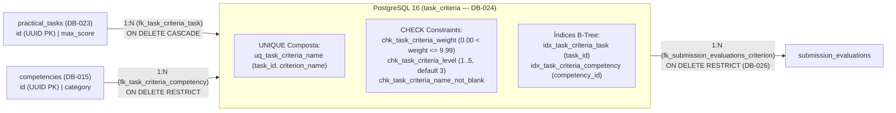

# 📐 [DB-024] Tabela de Critérios de Avaliação Prática / Rubricas (`task_criteria`) — Projeto NEXA

> **ID do Card**: `DB-024` | **Epic**: `EPIC-04: Atividades Práticas de Oficina & Competências` | **Sprint / Lote**: `Lote 3 (S3)`  
> **Prioridade**: `P1` | **Estimativa**: `3 SP` | **Tipo**: `Feature` | **Status**: `Concluído`  
> **Arquivos Principais**: [`prisma/migrations/20261123030000_create_task_criteria_table/migration.sql`](../../prisma/migrations/20261123030000_create_task_criteria_table/migration.sql), [`BancoNexa/sql/24_tabela_task_criteria.sql`](../../BancoNexa/sql/24_tabela_task_criteria.sql), [`prisma/schema.prisma`](../../prisma/schema.prisma), [`BancoNexa/types/schema-models.ts`](../../BancoNexa/types/schema-models.ts)  
> **Rastreabilidade**: ⬅️ Anterior: [`DB-023`](./23-tabela-tarefas-praticas-practical-tasks.md) | ➡️ Próximo: `DB-025` | 🔒 Depende de: `DB-015`, `DB-023` | 🔓 Desbloqueia: `DB-026`, `BE-024`, `FE-024`, `FE-026`

---

## 1. Objetivo e Modelagem de Domínio SENAI

O card **`DB-024`** implementa a tabela `task_criteria` no **PostgreSQL 16 (Docker)** para decompor cada atividade prática de oficina (`practical_tasks`) em critérios técnicos objetivos — como tolerância dimensional no micrômetro (`±0,02mm`), rugosidade superficial (`Ra 1.6`), alinhamento geométrico e cumprimento de normas de segurança/EPI — vinculados diretamente às competências oficiais SENAI (`competencies`).

Essa modelagem estruturada de rubricas permite transparência pedagógica e cálculo ponderado automático da nota final da peça, suportando diretamente:
- **Avaliações por Rubrica dos Professores (`submission_evaluations` — `DB-026`)**;
- **Endpoints de Criação de Atividade com Rubricas (`BE-024`) e Avaliação Prática (`BE-025`)**;
- **Painel de Oficinas (`FE-024`) e Modal de Avaliação por Rubricas (`FE-026`)**.

---

## 2. Arquitetura Relacional, Ponderação e Cascata Segura

1. **Referência a Tarefa Prática e Competência Técnica Oficial**:
   - `fk_task_criteria_task (task_id -> practical_tasks.id)` vincula cada rubrica à sua peça prática.
   - `fk_task_criteria_competency (competency_id -> competencies.id)` com `ON DELETE RESTRICT` garante que toda rubrica esteja ancorada em uma competência técnica/segurança/procedimental oficial do catálogo SENAI.
2. **Ponderação e Cálculo Automático de Nota**:
   - `weight NUMERIC(3,2) NOT NULL DEFAULT 1.00` com `CHECK (weight > 0.00 AND weight <= 9.99)` viabiliza soma ou média ponderada exata:
     $$\text{Nota Final} = \frac{\sum_{i=1}^{n} (\text{score\_awarded}_i \times \text{weight}_i)}{\sum_{i=1}^{n} \text{weight}_i}$$
   - `min_acceptable_level INTEGER NOT NULL DEFAULT 3` (`CHECK (min_acceptable_level BETWEEN 1 AND 5)`) define o patamar mínimo de domínio na escala SENAI (1 a 5) para cada critério.
3. **Exclusão em Cascata Segura (`ON DELETE CASCADE` + Proteção de Histórico Avaliado)**:
   - `fk_task_criteria_task` usa `ON DELETE CASCADE ON UPDATE CASCADE`: ao excluir uma `practical_tasks` que **ainda não possui entregas/avaliações**, todos os seus critérios em `task_criteria` são eliminados automaticamente.
   - Quando já existem entregas em `task_submissions` (`DB-025`) ou avaliações em `submission_evaluations` (`DB-026`), as FKs com `ON DELETE RESTRICT` bloqueiam automaticamente a exclusão da tarefa ou do critério (`SQLSTATE 23503`), protegendo o histórico avaliado.

---

## 3. Especificação Relacional da Tabela `task_criteria` (PostgreSQL 16)

| Coluna | Tipo SQL Nativo | Campo Prisma / TS | Nulo? | Default | Constraints e Regras de Negócio |
|---|---|---|:---:|---|---|
| `id` | `UUID` | `id: string` | `NOT NULL` | `gen_random_uuid()` | `PRIMARY KEY` |
| `task_id` | `UUID` | `taskId: string` | `NOT NULL` | — | `FK -> practical_tasks(id) ON DELETE CASCADE ON UPDATE CASCADE`; parte de `uq_task_criteria_name` |
| `competency_id` | `UUID` | `competencyId: string` | `NOT NULL` | — | `FK -> competencies(id) ON DELETE RESTRICT ON UPDATE CASCADE` |
| `criterion_name` | `VARCHAR(180)` | `criterionName: string` | `NOT NULL` | — | Nome objetivo do critério (ex.: `'Tolerância Dimensional ±0,02mm no Micrômetro'`); `UNIQUE (task_id, criterion_name)` e não vazio |
| `weight` | `NUMERIC(3,2)` | `weight: number \| string` | `NOT NULL` | `1.00` | `CHECK (weight > 0.00 AND weight <= 9.99)` para ponderação automática |
| `min_acceptable_level` | `INTEGER` | `minAcceptableLevel: number` | `NOT NULL` | `3` | `CHECK (min_acceptable_level BETWEEN 1 AND 5)` (escala de proficiência SENAI) |

---

## 4. Índices e Constraints Implementados em SQL

### 4.1. Índices Criados
- **`uq_task_criteria_name`**: Índice único composto `(task_id, criterion_name)` impedindo rubricas duplicadas na mesma peça.
- **`idx_task_criteria_task`**: Índice `B-Tree` em `(task_id)` para carregamento instantâneo da folha de rubricas no modal de avaliação (`BE-024` / `FE-026`).
- **`idx_task_criteria_competency`**: Índice `B-Tree` em `(competency_id)` para rastreabilidade de competências avaliadas em oficina.

### 4.2. Constraints CHECK
- **`chk_task_criteria_weight`**: `CHECK (weight > 0.00 AND weight <= 9.99)`.
- **`chk_task_criteria_level`**: `CHECK (min_acceptable_level BETWEEN 1 AND 5)`.
- **`chk_task_criteria_name_not_blank`**: `CHECK (length(btrim(criterion_name)) > 0)`.

---

## 5. Checklist de Verificação dos Critérios de Aceitação (`DB-024`)

- [x] **Critério 1 — Cada critério referencia uma tarefa prática e uma competência técnica oficial**: FKs `fk_task_criteria_task` (`practical_tasks`) e `fk_task_criteria_competency` (`competencies`, `ON DELETE RESTRICT`).
- [x] **Critério 2 — Soma ou ponderação de pesos suportada para cálculo automático**: `weight NUMERIC(3,2) NOT NULL DEFAULT 1.00` com `chk_task_criteria_weight` (`0.00 < weight <= 9.99`), validado com cálculo de média ponderada automática em rubricas de Metrologia e Tornearia.
- [x] **Critério 3 — Exclusão em cascata caso a tarefa ainda não possua entregas avaliadas**: `fk_task_criteria_task` com `ON DELETE CASCADE` (remova critérios automaticamente quando a tarefa não foi avaliada; bloqueado por `ON DELETE RESTRICT` em `submission_evaluations` / `task_submissions` quando já avaliada).
- [x] **DoD — Tabela `task_criteria` migrada e testada com rubricas de Metrologia e Tornearia**: Migration `20261123030000_create_task_criteria_table`, `model TaskCriterion` em `prisma/schema.prisma`, tipos gerados em `BancoNexa/types/schema-models.ts` e suíte validada em `scripts/validate-db-024.js`.
