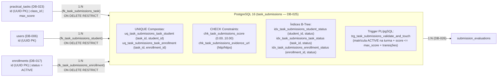
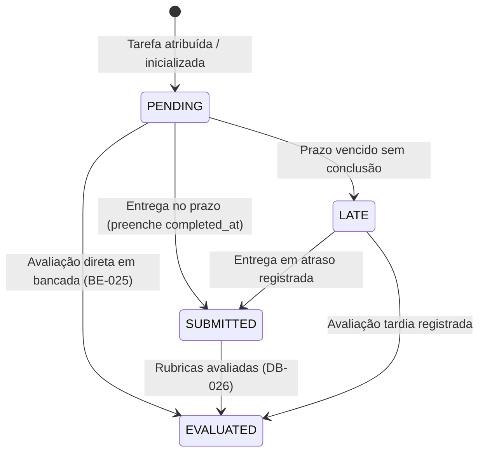

# 📦 [DB-025] Tabela de Submissões e Entregas Práticas (`task_submissions`) — Projeto NEXA

> **ID do Card**: `DB-025` | **Epic**: `EPIC-04: Atividades Práticas de Oficina & Competências` | **Sprint / Lote**: `Lote 3 (S3)`  
> **Prioridade**: `P0` | **Estimativa**: `3 SP` | **Tipo**: `Feature` | **Status**: `Concluído`  
> **Arquivos Principais**: [`prisma/migrations/20261123040000_create_task_submissions_table/migration.sql`](../../prisma/migrations/20261123040000_create_task_submissions_table/migration.sql), [`BancoNexa/sql/25_tabela_task_submissions.sql`](../../BancoNexa/sql/25_tabela_task_submissions.sql), [`prisma/schema.prisma`](../../prisma/schema.prisma), [`BancoNexa/types/schema-models.ts`](../../BancoNexa/types/schema-models.ts)  
> **Rastreabilidade**: ⬅️ Anterior: [`DB-024`](./24-tabela-criterios-avaliacao-pratica-task-criteria.md) | ➡️ Próximo: `DB-026` | 🔒 Depende de: `DB-017`, `DB-023` | 🔓 Desbloqueia: `DB-026`, `DB-029`, `DB-030`, `DB-034`, `DB-036`, `DB-039`, `DB-047`, `BE-024`, `BE-025`, `BE-026`, `FE-025`, `FE-036`

---

## 1. Objetivo e Modelagem de Domínio SENAI

O card **`DB-025`** implementa a tabela `task_submissions` no **PostgreSQL 16 (Docker)** para controlar o estado de entrega, execução e pontuação consolidada de cada atividade prática de oficina (`practical_tasks`) por estudante matriculado (`enrollments` / `users`), utilizando o enum nativo `submission_status_enum` (`PENDING`, `SUBMITTED`, `EVALUATED`, `LATE`).

Essa tabela é a fonte oficial do painel de pendências do estudante (`FE-036` / `BE-026`) e do registro rápido de conclusão prática pelo docente (`FE-025` / `BE-025`), desbloqueando diretamente:
- **Avaliações por Rubrica (`submission_evaluations` — `DB-026`)**;
- **Triggers de Período Letivo Fechado (`DB-029`)**;
- **Seed de Frequências e Notas Parciais (`DB-030`)**;
- **Alertas de Risco Acadêmico (`academic_alerts` — `DB-034`)**;
- **View 360° do Aluno (`vw_student_360_performance` — `DB-036`)** e **Linha do Tempo (`DB-039`)**;
- **Endpoints `BE-024`, `BE-025`, `BE-026` e telas `FE-025`, `FE-036`**.

---

## 2. Arquitetura Relacional, Transições de Estado e Vínculo Ativo

1. **Unicidade por Tarefa e Estudante (`uq_task_submissions_task_student`)**:
   - `UNIQUE (task_id, student_id)` e `UNIQUE (task_id, enrollment_id)` impedem duplicidade de entrega para o mesmo aluno na mesma atividade prática (`SQLSTATE 23505` / `P2002`).
2. **Consulta Rápida de Pendências do Portal do Aluno (`idx_task_submissions_student_status`)**:
   - Índice composto `(student_id, status)` otimiza as abas **Pendentes (`PENDING`)**, **Atrasadas (`LATE`)**, **Entregues (`SUBMITTED`)** e **Avaliadas (`EVALUATED`)** em `BE-026` e `FE-036`.
3. **Integridade com `enrollments` Assegurando Vínculo Ativo na Turma**:
   - `fk_task_submissions_enrollment` (`ON DELETE RESTRICT`) combinada ao trigger `trg_task_submissions_validate_and_touch` garante que:
     - `enrollments.student_id = task_submissions.student_id`;
     - `enrollments.class_id = practical_tasks.class_id`;
     - `enrollments.status = 'ACTIVE'` no `INSERT` (`chk_task_submissions_enrollment_active`).
4. **Ciclo de Vida e Proteção de Avaliações**:
   - `final_task_score` é limitado a `[0.00, 10.00]` e validado contra `practical_tasks.max_score`.
   - Ao entrar em `SUBMITTED` ou `EVALUATED`, `completed_at` é preenchido automaticamente se não informado; uma submissão `EVALUATED` não pode regredir para `PENDING` (`chk_task_submissions_status_transition`).

---

## 3. Especificação Relacional da Tabela `task_submissions` (PostgreSQL 16)

| Coluna | Tipo SQL Nativo | Campo Prisma / TS | Nulo? | Default | Constraints e Regras de Negócio |
|---|---|---|:---:|---|---|
| `id` | `UUID` | `id: string` | `NOT NULL` | `gen_random_uuid()` | `PRIMARY KEY` |
| `task_id` | `UUID` | `taskId: string` | `NOT NULL` | — | `FK -> practical_tasks(id) ON DELETE RESTRICT ON UPDATE CASCADE`; parte de `uq_task_submissions_task_student` |
| `student_id` | `UUID` | `studentId: string` | `NOT NULL` | — | `FK -> users(id) ON DELETE RESTRICT ON UPDATE CASCADE`; parte de `uq_task_submissions_task_student` e `idx_task_submissions_student_status` |
| `enrollment_id` | `UUID` | `enrollmentId: string` | `NOT NULL` | — | `FK -> enrollments(id) ON DELETE RESTRICT ON UPDATE CASCADE`; validado como `ACTIVE` na mesma turma da tarefa via trigger |
| `status` | `submission_status_enum` | `status: SubmissionStatus` | `NOT NULL` | `'PENDING'` | Valores: `PENDING`, `SUBMITTED`, `EVALUATED`, `LATE` (`DB-005`) |
| `completed_at` | `TIMESTAMPTZ` | `completedAt: Date \| null` | `NULL` | — | Data/hora de conclusão/entrega; preenchida automaticamente ao transitar para `SUBMITTED` / `EVALUATED` |
| `evidence_url` | `VARCHAR(500)` | `evidenceUrl: string \| null` | `NULL` | — | Link opcional de foto/laudo/evidência da peça (`http://` ou `https://`) |
| `student_notes` | `TEXT` | `studentNotes: string \| null` | `NULL` | — | Anotações técnicas ou observações registradas pelo estudante |
| `final_task_score` | `NUMERIC(4,2)` | `finalTaskScore: number \| string \| null` | `NULL` | — | `CHECK (0.00..10.00)` e `<= practical_tasks.max_score` via trigger |
| `created_at` | `TIMESTAMPTZ` | `createdAt: Date` | `NOT NULL` | `CURRENT_TIMESTAMP` | Data/hora de criação do registro |
| `updated_at` | `TIMESTAMPTZ` | `updatedAt: Date` | `NOT NULL` | `CURRENT_TIMESTAMP` | Atualizado automaticamente em todo `UPDATE` via trigger |

---

## 4. Índices, Constraints e Trigger Implementados em SQL

### 4.1. Índices Criados
- **`uq_task_submissions_task_student`**: Índice único composto `(task_id, student_id)` (Critério de Aceitação 1).
- **`uq_task_submissions_task_enrollment`**: Índice único composto `(task_id, enrollment_id)`.
- **`idx_task_submissions_student_status`**: Índice `B-Tree` composto `(student_id, status)` (Critério de Aceitação 2 — pendências do portal do aluno).
- **`idx_task_submissions_task_status`**: Índice `B-Tree` composto `(task_id, status)` para matriz docente (`BE-025` / `FE-025`).
- **`idx_task_submissions_enrollment_status`**: Índice `B-Tree` composto `(enrollment_id, status)` para consolidação 360° (`DB-036`).

### 4.2. Constraints e Trigger PL/pgSQL
- **`chk_task_submissions_score`**: `CHECK (final_task_score IS NULL OR (final_task_score >= 0.00 AND final_task_score <= 10.00))`.
- **`chk_task_submissions_evidence_url`**: `CHECK (evidence_url IS NULL OR evidence_url ~* '^https?://')`.
- **`trg_task_submissions_validate_and_touch` (`fn_task_submissions_validate_and_touch`)**: Valida matrícula `ACTIVE` na turma da tarefa, `final_task_score <= max_score`, impede regressão `EVALUATED -> PENDING` e mantém `completed_at` / `updated_at`.

---

## 5. Checklist de Verificação dos Critérios de Aceitação (`DB-025`)

- [x] **Critério 1 — Constraint `UNIQUE` em `(task_id, student_id)`**: `uq_task_submissions_task_student` (e `uq_task_submissions_task_enrollment`) no SQL e no `prisma/schema.prisma`.
- [x] **Critério 2 — Índices em `(student_id, status)` para pendências do portal do aluno**: `idx_task_submissions_student_status` criado no DDL SQL e no Prisma, complementado por `idx_task_submissions_task_status` e `idx_task_submissions_enrollment_status`.
- [x] **Critério 3 — Integridade com `enrollments` assegurando vínculo ativo na turma**: `fk_task_submissions_enrollment` (`ON DELETE RESTRICT`) + trigger validando `status = 'ACTIVE'`, `student_id` e `class_id`.
- [x] **DoD — Tabela `task_submissions` migrada e validada com estados de transição**: Migration `20261123040000_create_task_submissions_table`, `model TaskSubmission` em `prisma/schema.prisma`, tipos gerados em `BancoNexa/types/schema-models.ts` e suíte de transição validada em `scripts/validate-db-025.js`.
