# 📊 [DB-026] Tabela de Avaliações por Rubrica dos Professores (`submission_evaluations`) — Projeto NEXA

> **ID do Card**: `DB-026` | **Epic**: `EPIC-04: Atividades Práticas de Oficina & Competências` | **Sprint / Lote**: `Lote 3 (S3)`  
> **Prioridade**: `P0` | **Estimativa**: `3 SP` | **Tipo**: `Feature` | **Status**: `Concluído`  
> **Arquivos Principais**: [`prisma/migrations/20261123050000_create_submission_evaluations_table/migration.sql`](../../prisma/migrations/20261123050000_create_submission_evaluations_table/migration.sql), [`BancoNexa/sql/26_tabela_submission_evaluations.sql`](../../BancoNexa/sql/26_tabela_submission_evaluations.sql), [`prisma/schema.prisma`](../../prisma/schema.prisma), [`BancoNexa/types/schema-models.ts`](../../BancoNexa/types/schema-models.ts)  
> **Rastreabilidade**: ⬅️ Anterior: [`DB-025`](./25-tabela-submissoes-entregas-praticas-task-submissions.md) | ➡️ Próximo: `DB-027` | 🔒 Depende de: `DB-024`, `DB-025` | 🔓 Desbloqueia: `DB-030`, `DB-033`, `BE-025`, `FE-026`

---

## 1. Objetivo e Modelagem de Domínio SENAI

O card **`DB-026`** implementa a tabela `submission_evaluations` no **PostgreSQL 16 (Docker)** para registrar a nota (`score_awarded`), o nível de domínio técnico (`achieved_level`, escala `1..5`) e o parecer técnico (`technical_feedback`) atribuídos pelo professor em cada critério/rubrica (`task_criteria`) de uma entrega prática (`task_submissions`).

Essa tabela materializa a avaliação real e verificada da peça usinada ou prática de bancada, fornecendo a linha de base objetiva para comparação com a autoavaliação do aluno (`DB-038` / `BE-037`) e desbloqueando diretamente:
- **Seed de Frequências e Notas Parciais (`DB-030`)**;
- **Evidências Práticas de Habilidades (`skill_evidences` — `DB-033`)**;
- **Endpoint de Conclusão e Avaliação por Rubrica (`BE-025`)**;
- **Modal de Avaliação por Rubricas de Habilidade Técnica (`FE-026`)**.

---

## 2. Arquitetura Relacional, Integridade Docente e Consolidação de Nota

```mermaid
flowchart LR
    TS["task_submissions (DB-025)<br/>id (UUID PK) | task_id | final_task_score"] -->|"1:N (fk_submission_evaluations_submission)<br/>ON DELETE RESTRICT"| SE
    TC["task_criteria (DB-024)<br/>id (UUID PK) | task_id | weight"] -->|"1:N (fk_submission_evaluations_criterion)<br/>ON DELETE RESTRICT"| SE
    USR["users (DB-006)<br/>id (UUID PK) | role = TEACHER"] -->|"1:N (fk_submission_evaluations_evaluator)<br/>ON DELETE RESTRICT"| SE
    subgraph SE["PostgreSQL 16 (submission_evaluations — DB-026)"]
        UQ["UNIQUE Composta:<br/>uq_submission_evaluations_composite (submission_id, criterion_id)"]
        CHK["CHECK Constraints:<br/>chk_submission_evaluations_level (1..5)<br/>chk_submission_evaluations_score (0.00..10.00)"]
        IDX["Índices B-Tree:<br/>idx_submission_evaluations_submission (submission_id)<br/>idx_submission_evaluations_criterion (criterion_id)<br/>idx_submission_evaluations_evaluator (evaluator_id, evaluated_at)"]
        TRG1["Trigger BEFORE:<br/>trg_submission_evaluations_validate_integrity<br/>(role != STUDENT + sem autoavaliação + mesmo task_id + score <= max_score)"]
        TRG2["Função + Trigger AFTER:<br/>fn_calculate_submission_consolidated_score<br/>trg_submission_evaluations_sync_final_score"]
    end
    SE -->|"Média Ponderada → final_task_score"| TS
    SE -->|"Evidências Reais (DB-033 / DB-038)"| SK["skill_evidences / Diagnóstico Comparativo"]
```

1. **Unicidade por Submissão e Rubrica (`uq_submission_evaluations_composite`)**:
   - `UNIQUE (submission_id, criterion_id)` impede que um mesmo critério seja avaliado em duplicidade para a mesma submissão (`SQLSTATE 23505` / `P2002`).
2. **Validação da Escala SENAI de Domínio (`chk_submission_evaluations_level`)**:
   - `CHECK (achieved_level BETWEEN 1 AND 5)` assegura que toda avaliação utilize a régua padronizada de 1 a 5 níveis de competência técnica, complementada por `chk_submission_evaluations_score` (`0.00` a `10.00`).
3. **Identificação e Integridade do Docente Avaliador (`fk_submission_evaluations_evaluator`)**:
   - Chave estrangeira `evaluator_id -> users(id)` com `ON DELETE RESTRICT ON UPDATE CASCADE`, reforçada pelo trigger `trg_submission_evaluations_validate_integrity` que bloqueia usuários com `role = 'STUDENT'` (`chk_submission_evaluations_evaluator_role`), impede autoavaliação indevida (`chk_submission_evaluations_no_self_eval`), valida que `criterion_id` pertence à mesma tarefa prática (`chk_submission_evaluations_criterion_task`) e limita `score_awarded <= practical_tasks.max_score`.
4. **Cálculo Automático da Nota Consolidada da Submissão (DoD)**:
   - A função `fn_calculate_submission_consolidated_score(p_submission_id)` calcula a média ponderada:
     $$\text{final\_task\_score} = \min\left(\text{max\_score},\ \text{ROUND}\left(\frac{\sum (\text{score\_awarded}_i \times \text{weight}_i)}{\sum \text{weight}_i},\ 2\right)\right)$$
   - O trigger `trg_submission_evaluations_sync_final_score` (`AFTER INSERT OR UPDATE OR DELETE`) sincroniza `task_submissions.final_task_score` automaticamente e promove o status da submissão para `EVALUATED` (preenchendo `completed_at` se nulo) quando todos os critérios da atividade estiverem avaliados.

---

## 3. Especificação Relacional da Tabela `submission_evaluations` (PostgreSQL 16)

| Coluna | Tipo SQL Nativo | Campo Prisma / TS | Nulo? | Default | Constraints e Regras de Negócio |
|---|---|---|:---:|---|---|
| `id` | `UUID` | `id: string` | `NOT NULL` | `gen_random_uuid()` | `PRIMARY KEY` |
| `submission_id` | `UUID` | `submissionId: string` | `NOT NULL` | — | `FK -> task_submissions(id) ON DELETE RESTRICT ON UPDATE CASCADE`; parte de `uq_submission_evaluations_composite` |
| `criterion_id` | `UUID` | `criterionId: string` | `NOT NULL` | — | `FK -> task_criteria(id) ON DELETE RESTRICT ON UPDATE CASCADE`; deve pertencer ao mesmo `task_id` da submissão |
| `evaluator_id` | `UUID` | `evaluatorId: string` | `NOT NULL` | — | `FK -> users(id) ON DELETE RESTRICT ON UPDATE CASCADE`; perfil docente (bloqueia `STUDENT` e autoavaliação) |
| `achieved_level` | `INTEGER` | `achievedLevel: number` | `NOT NULL` | — | `CHECK (achieved_level BETWEEN 1 AND 5)` (escala SENAI de proficiência) |
| `score_awarded` | `NUMERIC(4,2)` | `scoreAwarded: number \| string` | `NOT NULL` | — | `CHECK (score_awarded >= 0.00 AND score_awarded <= 10.00)` e `<= practical_tasks.max_score` |
| `technical_feedback` | `TEXT` | `technicalFeedback: string \| null` | `NULL` | — | Parecer técnico detalhado do docente sobre tolerâncias, acabamento e procedimentos |
| `evaluated_at` | `TIMESTAMPTZ` | `evaluatedAt: Date` | `NOT NULL` | `CURRENT_TIMESTAMP` | Data/hora do registro da avaliação docente |

---

## 4. Índices, Constraints, Funções e Triggers Implementados em SQL

### 4.1. Índices Criados
- **`uq_submission_evaluations_composite`**: Índice único composto `(submission_id, criterion_id)` (Critério de Aceitação 1).
- **`idx_submission_evaluations_submission`**: Índice `B-Tree` em `(submission_id)` para carregamento das rubricas avaliadas e consolidação da submissão.
- **`idx_submission_evaluations_criterion`**: Índice `B-Tree` em `(criterion_id)` para rastreio por competência (`DB-033` / `DB-038`).
- **`idx_submission_evaluations_evaluator`**: Índice `B-Tree` composto `(evaluator_id, evaluated_at)` para histórico e auditoria do docente avaliador.

### 4.2. Constraints, Funções e Triggers PL/pgSQL
- **`chk_submission_evaluations_level`**: `CHECK (achieved_level BETWEEN 1 AND 5)` (Critério de Aceitação 2).
- **`chk_submission_evaluations_score`**: `CHECK (score_awarded >= 0.00 AND score_awarded <= 10.00)`.
- **`trg_submission_evaluations_validate_integrity` (`fn_submission_evaluations_validate_integrity`)**: Valida perfil docente (`role <> 'STUDENT'`), impede autoavaliação, garante coerência `task_criteria.task_id = task_submissions.task_id` e assegura `score_awarded <= practical_tasks.max_score`.
- **`fn_calculate_submission_consolidated_score(UUID)`**: Calcula a nota ponderada consolidada da submissão pelos pesos de `task_criteria`.
- **`trg_submission_evaluations_sync_final_score` (`fn_submission_evaluations_sync_final_score`)**: Atualiza `task_submissions.final_task_score` e promove `status` para `EVALUATED` ao concluir todas as rubricas da tarefa.

---

## 5. Checklist de Verificação dos Critérios de Aceitação (`DB-026`)

- [x] **Critério 1 — Constraint `UNIQUE` em `(submission_id, criterion_id)`**: `uq_submission_evaluations_composite` declarada no DDL SQL e no `prisma/schema.prisma`.
- [x] **Critério 2 — Validação `CHECK` para `achieved_level` entre `1` e `5`**: `chk_submission_evaluations_level` aplicada no DDL SQL e testada nas fronteiras válidas (`1`, `5`) e inválidas (`0`, `6`, `-1`).
- [x] **Critério 3 — FK para `evaluator_id` identificando o docente avaliador**: `fk_submission_evaluations_evaluator` (`ON DELETE RESTRICT`) + trigger validando perfil docente (bloqueia `STUDENT` e autoavaliação).
- [x] **DoD — Migration aplicada e testada com cálculo de nota consolidada da submissão**: Migration `20261123050000_create_submission_evaluations_table`, `model SubmissionEvaluation` em `prisma/schema.prisma`, tipos gerados em `BancoNexa/types/schema-models.ts` e cálculo ponderado validado em `scripts/validate-db-026.js`.
