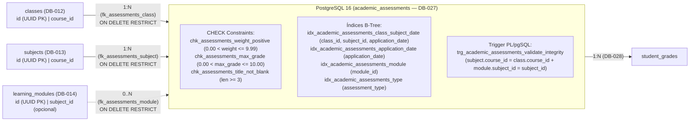

# 📝 [DB-027] Tabela de Avaliações Formativas e Provas (`academic_assessments`) — Projeto NEXA

> **ID do Card**: `DB-027` | **Epic**: `EPIC-03: Diário de Classe: Notas & Frequência` | **Sprint / Lote**: `Lote 3 (S3)`  
> **Prioridade**: `P0` | **Estimativa**: `3 SP` | **Tipo**: `Feature` | **Status**: `Concluído`  
> **Arquivos Principais**: [`prisma/migrations/20261123060000_create_academic_assessments_table/migration.sql`](../../prisma/migrations/20261123060000_create_academic_assessments_table/migration.sql), [`BancoNexa/sql/27_tabela_academic_assessments.sql`](../../BancoNexa/sql/27_tabela_academic_assessments.sql), [`prisma/schema.prisma`](../../prisma/schema.prisma), [`BancoNexa/types/schema-models.ts`](../../BancoNexa/types/schema-models.ts)  
> **Rastreabilidade**: ⬅️ Anterior: [`DB-026`](./26-tabela-avaliacoes-rubrica-submission-evaluations.md) | ➡️ Próximo: `DB-028` | 🔒 Depende de: `DB-012`, `DB-013`, `DB-014` | 🔓 Desbloqueia: `DB-028`, `BE-027`, `FE-027`

---

## 1. Objetivo e Modelagem de Domínio SENAI

O card **`DB-027`** implementa a tabela `academic_assessments` no **PostgreSQL 16 (Docker)** para cadastrar avaliações teóricas, microavaliações e projetos formativos aplicados por turma (`classes`), disciplina (`subjects`) e, opcionalmente, módulo prático SENAI (`learning_modules`), utilizando o enum nativo `assessment_type_enum` (`EXAM`, `MICRO_EVALUATION`, `PROJECT`).

Essa tabela estrutura os instrumentos avaliativos e seus pesos (`weight`) para compor a média do módulo junto com as atividades práticas de oficina, desbloqueando diretamente:
- **Tabela de Notas e Menções Finais (`student_grades` — `DB-028`)**;
- **Endpoint de Lançamento de Notas de Avaliações Formativas (`BE-027`)**;
- **Tela de Lançamento de Notas de Avaliações e Provas (`FE-027`)**.

---

## 2. Arquitetura Relacional, Integridade Curricular e Ordenação Cronológica

1. **Peso Estritamente Positivo (`chk_assessments_weight_positive`)**:
   - `CHECK (weight > 0.00 AND weight <= 9.99)` (default `1.00`) garante que todas as avaliações participem de forma matematicamente válida no cálculo da média ponderada (`BE-028`), impedindo pesos zerados ou negativos (`SQLSTATE 23514`).
2. **Vinculação Obrigatória a Turma e Disciplina**:
   - `class_id NOT NULL` (`fk_assessments_class`) e `subject_id NOT NULL` (`fk_assessments_subject`), além de `module_id` opcional (`fk_assessments_module`), todos com `ON DELETE RESTRICT ON UPDATE CASCADE`.
   - O trigger `trg_academic_assessments_validate_integrity` valida que a disciplina pertence ao mesmo curso da turma (`chk_academic_assessments_subject_course`) e que o módulo opcional pertence à disciplina informada (`chk_academic_assessments_module_subject`).
3. **Ordenação Cronológica por `application_date`**:
   - Índices `idx_academic_assessments_class_subject_date (class_id, subject_id, application_date)` e `idx_academic_assessments_application_date (application_date)` garantem listagem ordenada por data de aplicação no diário docente (`BE-027` / `FE-027`).

---

## 3. Especificação Relacional da Tabela `academic_assessments` (PostgreSQL 16)

| Coluna | Tipo SQL Nativo | Campo Prisma / TS | Nulo? | Default | Constraints e Regras de Negócio |
|---|---|---|:---:|---|---|
| `id` | `UUID` | `id: string` | `NOT NULL` | `gen_random_uuid()` | `PRIMARY KEY` |
| `class_id` | `UUID` | `classId: string` | `NOT NULL` | — | `FK -> classes(id) ON DELETE RESTRICT ON UPDATE CASCADE` |
| `subject_id` | `UUID` | `subjectId: string` | `NOT NULL` | — | `FK -> subjects(id) ON DELETE RESTRICT ON UPDATE CASCADE`; mesmo `course_id` da turma |
| `module_id` | `UUID` | `moduleId: string \| null` | `NULL` | — | `FK -> learning_modules(id) ON DELETE RESTRICT ON UPDATE CASCADE`; opcional; mesmo `subject_id` quando informado |
| `title` | `VARCHAR(150)` | `title: string` | `NOT NULL` | — | `CHECK (length(btrim(title)) >= 3)` (ex.: `'Prova Teórica de Leitura de Paquímetro e Micrômetro'`) |
| `assessment_type` | `assessment_type_enum` | `assessmentType: AssessmentType` | `NOT NULL` | — | Valores: `EXAM`, `MICRO_EVALUATION`, `PROJECT` (`DB-005`) |
| `weight` | `NUMERIC(3,2)` | `weight: number \| string` | `NOT NULL` | `1.00` | `CHECK (weight > 0.00 AND weight <= 9.99)` |
| `application_date` | `DATE` | `applicationDate: Date` | `NOT NULL` | — | Data de aplicação usada para ordenação cronológica (`idx_academic_assessments_class_subject_date`) |
| `max_grade` | `NUMERIC(4,2)` | `maxGrade: number \| string` | `NOT NULL` | `10.00` | `CHECK (max_grade > 0.00 AND max_grade <= 10.00)` |
| `created_at` | `TIMESTAMPTZ` | `createdAt: Date` | `NOT NULL` | `CURRENT_TIMESTAMP` | Data/hora de criação do registro |

---

## 4. Índices, Constraints e Trigger Implementados em SQL

### 4.1. Índices Criados
- **`idx_academic_assessments_class_subject_date`**: Índice `B-Tree` composto `(class_id, subject_id, application_date)` para listagem cronológica por turma e disciplina (Critério de Aceitação 3).
- **`idx_academic_assessments_application_date`**: Índice `B-Tree` em `(application_date)` para ordenação cronológica global.
- **`idx_academic_assessments_module`**: Índice `B-Tree` em `(module_id)` para composição de médias por módulo prático (`BE-028`).
- **`idx_academic_assessments_type`**: Índice `B-Tree` em `(assessment_type)` para filtragem por tipo avaliativo (`EXAM`, `MICRO_EVALUATION`, `PROJECT`).

### 4.2. Constraints e Trigger PL/pgSQL
- **`chk_assessments_weight_positive`**: `CHECK (weight > 0.00 AND weight <= 9.99)` (Critério de Aceitação 1).
- **`chk_assessments_max_grade`**: `CHECK (max_grade > 0.00 AND max_grade <= 10.00)`.
- **`chk_assessments_title_not_blank`**: `CHECK (length(btrim(title)) >= 3)`.
- **`trg_academic_assessments_validate_integrity` (`fn_academic_assessments_validate_integrity`)**: Valida coerência curricular entre turma/disciplina (`course_id`) e disciplina/módulo (`subject_id`).

---

## 5. Checklist de Verificação dos Critérios de Aceitação (`DB-027`)

- [x] **Critério 1 — Peso (`weight`) estritamente maior que zero**: `chk_assessments_weight_positive` validado no DDL SQL e testado com valores positivos aceitos e `0.00`/`-1.00` bloqueados (`SQLSTATE 23514`).
- [x] **Critério 2 — Vinculação obrigatória a turma e disciplina**: `class_id NOT NULL` (`fk_assessments_class`) e `subject_id NOT NULL` (`fk_assessments_subject`) com `ON DELETE RESTRICT`, módulo opcional (`fk_assessments_module`) e trigger de coerência curricular.
- [x] **Critério 3 — Ordenação por `application_date`**: Índices `idx_academic_assessments_class_subject_date` e `idx_academic_assessments_application_date` criados no SQL e no `prisma/schema.prisma`, validados com ordenação cronológica em `scripts/validate-db-027.js`.
- [x] **DoD — Tabela `academic_assessments` criada e integrada ao schema Prisma**: Migration `20261123060000_create_academic_assessments_table`, `model AcademicAssessment` em `prisma/schema.prisma`, tipos gerados em `BancoNexa/types/schema-models.ts` e suíte `scripts/validate-db-027.js` aprovada.
