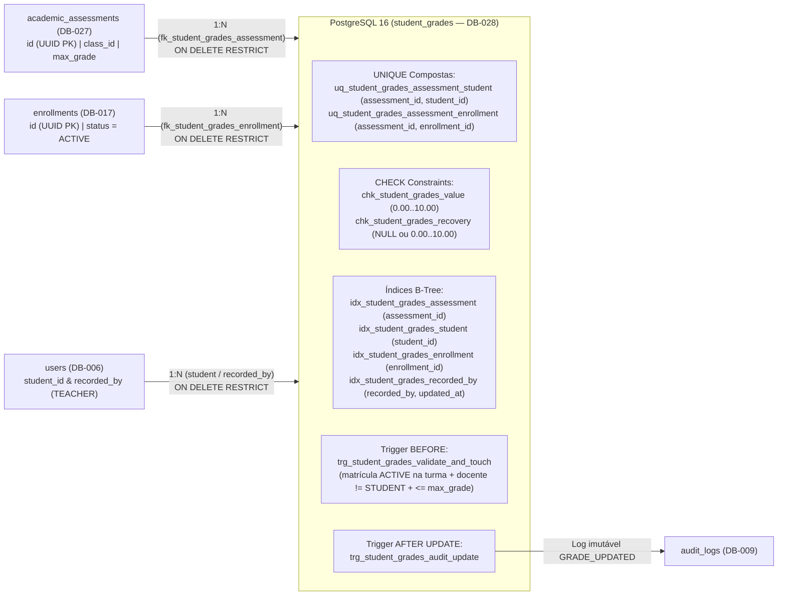

# 🎓 [DB-028] Tabela de Notas e Menções Finais (`student_grades`) — Projeto NEXA

> **ID do Card**: `DB-028` | **Epic**: `EPIC-03: Diário de Classe: Notas & Frequência` | **Sprint / Lote**: `Lote 3 (S3)`  
> **Prioridade**: `P0` | **Estimativa**: `3 SP` | **Tipo**: `Feature` | **Status**: `Concluído`  
> **Arquivos Principais**: [`prisma/migrations/20261123070000_create_student_grades_table/migration.sql`](../../prisma/migrations/20261123070000_create_student_grades_table/migration.sql), [`BancoNexa/sql/28_tabela_student_grades.sql`](../../BancoNexa/sql/28_tabela_student_grades.sql), [`prisma/schema.prisma`](../../prisma/schema.prisma), [`BancoNexa/types/schema-models.ts`](../../BancoNexa/types/schema-models.ts)  
> **Rastreabilidade**: ⬅️ Anterior: [`DB-027`](./27-tabela-avaliacoes-formativas-provas-academic-assessments.md) | ➡️ Próximo: `DB-029` | 🔒 Depende de: `DB-017`, `DB-027` | 🔓 Desbloqueia: `DB-029`, `DB-030`, `DB-033`, `DB-034`, `DB-036`, `DB-047`, `BE-027`, `BE-028`, `FE-027`, `FE-028`, `FE-037`

---

## 1. Objetivo e Modelagem de Domínio SENAI

O card **`DB-028`** implementa a tabela `student_grades` no **PostgreSQL 16 (Docker)** para armazenar as notas individuais (`grade_value`) e notas de recuperação (`recovery_grade`) obtidas por cada estudante nas avaliações formativas e provas (`academic_assessments`), com precisão de duas casas decimais (`NUMERIC(4,2)`) e rastreabilidade integral de lançamentos (`recorded_by`) e alterações posteriores em `audit_logs` (`DB-009` / `BE-048`).

Essa tabela é a fonte atômica de notas (3FN, sem duplicação entre módulos) que alimenta o fechamento de médias ponderadas e o boletim do aluno, desbloqueando diretamente:
- **Triggers de Período Letivo Fechado (`DB-029`)**;
- **Seed de Frequências e Notas Parciais (`DB-030`)**;
- **Evidências de Habilidades (`DB-033`)**, **Alertas de Queda de Rendimento (`DB-034`)**, **View 360° (`DB-036`)** e **Otimização de Índices (`DB-047`)**;
- **Endpoints `BE-027`, `BE-028` e telas `FE-027`, `FE-028`, `FE-037`**.

---

## 2. Arquitetura Relacional, Limites Numéricos e Auditoria Automática

1. **Unicidade por Avaliação e Estudante (`uq_student_grades_assessment_student`)**:
   - `UNIQUE (assessment_id, student_id)` e `UNIQUE (assessment_id, enrollment_id)` garantem no máximo um lançamento de nota por estudante em cada avaliação (`SQLSTATE 23505` / `P2002`).
2. **Validação Estrita de Limites Numéricos (`0.00` a `10.00`)**:
   - `chk_student_grades_value` exige `grade_value >= 0.00 AND grade_value <= 10.00` e `chk_student_grades_recovery` exige `recovery_grade IS NULL OR (recovery_grade >= 0.00 AND recovery_grade <= 10.00)`.
   - O trigger `trg_student_grades_validate_and_touch` valida ainda que `grade_value` e `recovery_grade` não ultrapassam `academic_assessments.max_grade`.
3. **Vínculo Obrigatório com `enrollment_id` Válido e Integridade Docente**:
   - `fk_student_grades_enrollment` (`ON DELETE RESTRICT`) combinada ao trigger assegura que `enrollments.student_id = student_id`, `enrollments.class_id = academic_assessments.class_id` e `enrollments.status = 'ACTIVE'` no lançamento, além de bloquear `recorded_by` com `role = 'STUDENT'` ou auto-lançamento.
4. **Rastreabilidade de Alterações em `audit_logs` (`DB-009` / `BE-048`)**:
   - O trigger `trg_student_grades_audit_update` (`AFTER UPDATE`) grava automaticamente um evento `GRADE_UPDATED` em `audit_logs` com `old_values` e `new_values` em `JSONB` sempre que `grade_value`, `recovery_grade` ou `comments` de uma nota já publicada for modificado.

---

## 3. Especificação Relacional da Tabela `student_grades` (PostgreSQL 16)

| Coluna | Tipo SQL Nativo | Campo Prisma / TS | Nulo? | Default | Constraints e Regras de Negócio |
|---|---|---|:---:|---|---|
| `id` | `UUID` | `id: string` | `NOT NULL` | `gen_random_uuid()` | `PRIMARY KEY` |
| `assessment_id` | `UUID` | `assessmentId: string` | `NOT NULL` | — | `FK -> academic_assessments(id) ON DELETE RESTRICT ON UPDATE CASCADE`; parte de `uq_student_grades_assessment_student` |
| `enrollment_id` | `UUID` | `enrollmentId: string` | `NOT NULL` | — | `FK -> enrollments(id) ON DELETE RESTRICT ON UPDATE CASCADE`; matrícula válida/ativa na turma da avaliação |
| `student_id` | `UUID` | `studentId: string` | `NOT NULL` | — | `FK -> users(id) ON DELETE RESTRICT ON UPDATE CASCADE`; coerente com `enrollments.student_id` |
| `recorded_by` | `UUID` | `recordedBy: string` | `NOT NULL` | — | `FK -> users(id) ON DELETE RESTRICT ON UPDATE CASCADE`; perfil docente (bloqueia `STUDENT` e auto-lançamento) |
| `grade_value` | `NUMERIC(4,2)` | `gradeValue: number \| string` | `NOT NULL` | — | `CHECK (grade_value >= 0.00 AND grade_value <= 10.00)` e `<= academic_assessments.max_grade` |
| `recovery_grade` | `NUMERIC(4,2)` | `recoveryGrade: number \| string \| null` | `NULL` | — | `CHECK (NULL ou 0.00..10.00)` e `<= academic_assessments.max_grade` |
| `comments` | `TEXT` | `comments: string \| null` | `NULL` | — | Observações pedagógicas opcionais sobre o desempenho na prova/avaliação |
| `created_at` | `TIMESTAMPTZ` | `createdAt: Date` | `NOT NULL` | `CURRENT_TIMESTAMP` | Data/hora do lançamento inicial |
| `updated_at` | `TIMESTAMPTZ` | `updatedAt: Date` | `NOT NULL` | `CURRENT_TIMESTAMP` | Atualizado automaticamente em todo `UPDATE` via trigger |

---

## 4. Índices, Constraints e Triggers Implementados em SQL

### 4.1. Índices Criados
- **`uq_student_grades_assessment_student`**: Índice único composto `(assessment_id, student_id)` (Critério de Aceitação 1).
- **`uq_student_grades_assessment_enrollment`**: Índice único composto `(assessment_id, enrollment_id)`.
- **`idx_student_grades_assessment`**: Índice `B-Tree` em `(assessment_id)` para grade de lançamento da turma (`BE-027` / `FE-027`).
- **`idx_student_grades_student`**: Índice `B-Tree` em `(student_id)` para boletim individual (`FE-037`).
- **`idx_student_grades_enrollment`**: Índice `B-Tree` em `(enrollment_id)` para fechamento ponderado de médias (`BE-028` / `DB-036`).
- **`idx_student_grades_recorded_by`**: Índice `B-Tree` composto `(recorded_by, updated_at)` para auditoria docente.

### 4.2. Constraints e Triggers PL/pgSQL
- **`chk_student_grades_value`** e **`chk_student_grades_recovery`**: Limites numéricos `0.00` a `10.00` (Critério de Aceitação 2).
- **`trg_student_grades_validate_and_touch` (`fn_student_grades_validate_and_touch`)**: Valida `enrollment_id` ativo/mesma turma/mesmo aluno, `recorded_by` docente e `grade_value`/`recovery_grade <= max_grade`, atualizando `updated_at`.
- **`trg_student_grades_audit_update` (`fn_student_grades_audit_update`)**: Insere automaticamente registro `GRADE_UPDATED` em `audit_logs` (`DB-009`) ao alterar nota já publicada.

---

## 5. Checklist de Verificação dos Critérios de Aceitação (`DB-028`)

- [x] **Critério 1 — Constraint `UNIQUE` em `(assessment_id, student_id)`**: `uq_student_grades_assessment_student` (e `uq_student_grades_assessment_enrollment`) no DDL SQL e no `prisma/schema.prisma`.
- [x] **Critério 2 — `CHECK` garantindo `grade_value` e `recovery_grade` entre `0.00` e `10.00`**: `chk_student_grades_value` e `chk_student_grades_recovery` testadas nas fronteiras (`0.00`, `10.00`, `-0.01`, `10.01`, `> max_grade`).
- [x] **Critério 3 — Vínculo obrigatório com `enrollment_id` válido**: `fk_student_grades_enrollment` (`ON DELETE RESTRICT`) + trigger validando matrícula `ACTIVE` pertencente ao estudante e à turma da avaliação.
- [x] **DoD — Tabela `student_grades` migrada e validada com testes de limites numéricos**: Migration `20261123070000_create_student_grades_table`, `model StudentGrade` em `prisma/schema.prisma`, auditoria automática em `audit_logs`, tipos gerados em `BancoNexa/types/schema-models.ts` e suíte `scripts/validate-db-028.js` aprovada.
