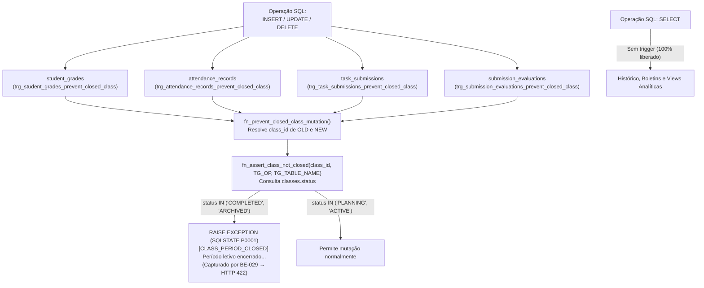

# 🔒 [DB-029] Triggers / Funções para Validação de Período Letivo Fechado — Projeto NEXA

> **ID do Card**: `DB-029` | **Epic**: `EPIC-03: Diário de Classe: Notas & Frequência` | **Sprint / Lote**: `Lote 3 (S3)`  
> **Prioridade**: `P1` | **Estimativa**: `5 SP` | **Tipo**: `Feature` | **Status**: `Concluído`  
> **Arquivos Principais**: [`prisma/migrations/20261123080000_enforce_closed_class_period_triggers/migration.sql`](../../prisma/migrations/20261123080000_enforce_closed_class_period_triggers/migration.sql), [`BancoNexa/sql/29_triggers_periodo_letivo_fechado.sql`](../../BancoNexa/sql/29_triggers_periodo_letivo_fechado.sql), [`prisma/schema.prisma`](../../prisma/schema.prisma), [`scripts/validate-db-029.js`](../../scripts/validate-db-029.js)  
> **Rastreabilidade**: ⬅️ Anterior: [`DB-028`](./28-tabela-notas-mencoes-finais-student-grades.md) | ➡️ Próximo: `DB-030` | 🔒 Depende de: `DB-012`, `DB-022`, `DB-025`, `DB-028` | 🔓 Desbloqueia: `DB-048`, `BE-029`

---

## 1. Objetivo e Defesa em Profundidade

O card **`DB-029`** implementa a proteção nativa no motor **PostgreSQL 16** para impedir que notas, presenças, submissões práticas ou avaliações por rubrica sejam alteradas retroativamente quando a turma já estiver encerrada (`classes.status IN ('COMPLETED', 'ARCHIVED')`).

Essa camada atua em **defesa em profundidade** junto com o middleware/dependência `check_class_is_active` do Back-end (`BE-029`), garantindo que nem mesmo alterações via scripts administrativos, integrações diretas ou bypass da API consigam corromper diários de turmas fechadas, ao mesmo tempo em que mantém consultas de leitura (`SELECT`) 100% liberadas para histórico escolar e auditoria.

---

## 2. Arquitetura das Funções e Triggers PL/pgSQL



### 2.1. Resolução de `class_id` por Tabela Protegida

| Tabela Monitorada | Trigger Associada | Caminho de Resolução do `class_id` | Operações Bloqueadas em Turma Fechada |
|---|---|---|---|
| `student_grades` | `trg_student_grades_prevent_closed_class` | `academic_assessments.class_id` (fallback `enrollments.class_id`) | `INSERT`, `UPDATE`, `DELETE` |
| `attendance_records` | `trg_attendance_records_prevent_closed_class` | `class_lessons.class_id` (fallback `enrollments.class_id`) | `INSERT`, `UPDATE`, `DELETE` |
| `task_submissions` | `trg_task_submissions_prevent_closed_class` | `practical_tasks.class_id` (fallback `enrollments.class_id`) | `INSERT`, `UPDATE`, `DELETE` |
| `submission_evaluations` | `trg_submission_evaluations_prevent_closed_class` | `task_submissions -> practical_tasks.class_id` | `INSERT`, `UPDATE`, `DELETE` |

> Em comandos `UPDATE`, a função inspeciona tanto o `class_id` derivado de `OLD` quanto o de `NEW`, evitando qualquer tentativa de mover registros para fora ou para dentro de uma turma encerrada.

---

## 3. Contrato de Exceção SQL e Integração com o Back-end (`BE-029`)

Quando `classes.status IN ('COMPLETED', 'ARCHIVED')`, a função `fn_assert_class_not_closed()` dispara:

```sql
RAISE EXCEPTION
    '[CLASS_PERIOD_CLOSED] Período letivo encerrado para esta turma (% — status "%"): operação % bloqueada na tabela % pela função fn_prevent_closed_class_mutation.',
    v_class_code, v_class_status, p_operation, p_table_name
    USING ERRCODE = 'P0001',
          HINT = 'Turmas com status COMPLETED ou ARCHIVED são somente leitura (SELECT permitido). Reabra a turma via coordenação acadêmica para ajustes excepcionais.';
```

O handler global `sqlalchemy_exception_handler` (`backend/app/core/exception_handlers.py`, entregue em `BE-029`) identifica automaticamente a exceção pelos marcadores `CLASS_PERIOD_CLOSED`, `fn_prevent_closed_class_mutation` e `Período letivo encerrado`, traduzindo-a para:
- **HTTP Status**: `422 Unprocessable Entity`
- **Error Code**: `CLASS_PERIOD_CLOSED`
- **Message**: `"Período letivo encerrado para esta turma."`

---

## 4. Checklist de Verificação dos Critérios de Aceitação (`DB-029`)

- [x] **Critério 1 — Trigger bloqueia `UPDATE`/`DELETE` (e `INSERT`) em notas, faltas e submissões quando `classes.status IN ('COMPLETED', 'ARCHIVED')`**: Triggers `trg_student_grades_prevent_closed_class`, `trg_attendance_records_prevent_closed_class`, `trg_task_submissions_prevent_closed_class` e `trg_submission_evaluations_prevent_closed_class` ativas.
- [x] **Critério 2 — Lança exceção SQL clara identificável pelo backend (`BE-029`)**: `SQLSTATE P0001` contendo `[CLASS_PERIOD_CLOSED]`, `Período letivo encerrado` e `fn_prevent_closed_class_mutation`.
- [x] **Critério 3 — Permite leitura (`SELECT`) normalmente para histórico**: Triggers operam exclusivamente sobre `BEFORE INSERT OR UPDATE OR DELETE`, mantendo `SELECT` 100% irrestrito.
- [x] **DoD — Migration SQL customizada aplicada e testada tentando alterar nota de turma fechada**: Migration `20261123080000_enforce_closed_class_period_triggers`, documentação atualizada em `prisma/schema.prisma` e testes automatizados aprovados em `scripts/validate-db-029.js`.
