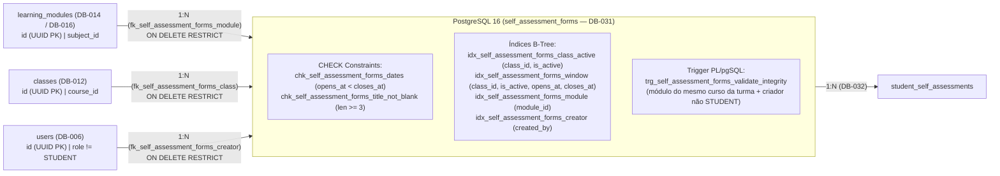

# 🧭 [DB-031] Tabela de Formulários de Autoavaliação (`self_assessment_forms`) — Projeto NEXA

> **ID do Card**: `DB-031` | **Epic**: `EPIC-07: Autoavaliação & Motor de Diagnóstico Explicável` | **Sprint / Lote**: `Lote 4 (S4)`  
> **Prioridade**: `P1` | **Estimativa**: `3 SP` | **Tipo**: `Feature` | **Status**: `Concluído`  
> **Arquivos Principais**: [`prisma/migrations/20261123090000_create_self_assessment_forms_table/migration.sql`](../../prisma/migrations/20261123090000_create_self_assessment_forms_table/migration.sql), [`BancoNexa/sql/31_tabela_self_assessment_forms.sql`](../../BancoNexa/sql/31_tabela_self_assessment_forms.sql), [`prisma/schema.prisma`](../../prisma/schema.prisma), [`BancoNexa/types/schema-models.ts`](../../BancoNexa/types/schema-models.ts)  
> **Rastreabilidade**: ⬅️ Anterior: [`DB-030`](./30-seed-frequencias-notas-parciais.md) | ➡️ Próximo: `DB-032` | 🔒 Depende de: `DB-012`, `DB-014`, `DB-016` | 🔓 Desbloqueia: `DB-032`, `DB-040`, `BE-035`, `FE-041`

---

## 1. Objetivo e Modelagem de Domínio SENAI

O card **`DB-031`** implementa a tabela `self_assessment_forms` no **PostgreSQL 16 (Docker)** para estruturar os ciclos e questionários de autoavaliação de competências práticas aplicados ao final de cada módulo SENAI (`learning_modules`) por turma (`classes`).

Cada formulário referencia um módulo prático (cujas competências oficiais provêm de `module_competencies` — `DB-016`) e define uma janela controlada de abertura e encerramento (`opens_at` / `closes_at`), desbloqueando diretamente:
- **Respostas de Autoavaliação do Estudante (`student_self_assessments` — `DB-032`)**;
- **Seed de Diagnósticos e Alertas Simulados (`DB-040`)**;
- **Endpoint de Cadastro de Questionário de Autoavaliação (`BE-035`)**;
- **Interface de Autoavaliação de Habilidades Práticas no Portal do Aluno (`FE-041`)**.

---

## 2. Arquitetura Relacional, Janela Temporal e Consulta de Formulários Abertos

1. **Vínculo Obrigatório com Módulo de Aprendizagem e Turma**:
   - `fk_self_assessment_forms_module` (`learning_modules.id`) e `fk_self_assessment_forms_class` (`classes.id`) com `ON DELETE RESTRICT ON UPDATE CASCADE`.
   - O trigger `trg_self_assessment_forms_validate_integrity` valida que o módulo pertence ao mesmo curso técnico da turma (`chk_self_assessment_forms_module_course`) e impede que estudantes (`role = 'STUDENT'`) criem formulários (`chk_self_assessment_forms_creator_role`).
2. **Validação Temporal (`chk_self_assessment_forms_dates`)**:
   - `CHECK (opens_at < closes_at)` garante janelas válidas de resposta (`SQLSTATE 23514` se `opens_at >= closes_at`).
3. **Consulta Rápida de Formulários Abertos no Portal do Aluno (`idx_self_assessment_forms_class_active`)**:
   - Índice composto `(class_id, is_active)`, complementado por `idx_self_assessment_forms_window (class_id, is_active, opens_at, closes_at)`, otimiza a listagem imediata dos questionários ativos e dentro do prazo para a turma do estudante (`FE-041`).

---

## 3. Especificação Relacional da Tabela `self_assessment_forms` (PostgreSQL 16)

| Coluna | Tipo SQL Nativo | Campo Prisma / TS | Nulo? | Default | Constraints e Regras de Negócio |
|---|---|---|:---:|---|---|
| `id` | `UUID` | `id: string` | `NOT NULL` | `gen_random_uuid()` | `PRIMARY KEY` |
| `module_id` | `UUID` | `moduleId: string` | `NOT NULL` | — | `FK -> learning_modules(id) ON DELETE RESTRICT ON UPDATE CASCADE`; mesmo `course_id` da turma |
| `class_id` | `UUID` | `classId: string` | `NOT NULL` | — | `FK -> classes(id) ON DELETE RESTRICT ON UPDATE CASCADE`; parte de `idx_self_assessment_forms_class_active` |
| `title` | `VARCHAR(150)` | `title: string` | `NOT NULL` | — | `CHECK (length(btrim(title)) >= 3)` |
| `instructions` | `TEXT` | `instructions: string \| null` | `NULL` | — | Orientações pedagógicas para reflexão do estudante |
| `opens_at` | `TIMESTAMPTZ` | `opensAt: Date` | `NOT NULL` | — | Abertura da janela de resposta (`opens_at < closes_at`) |
| `closes_at` | `TIMESTAMPTZ` | `closesAt: Date` | `NOT NULL` | — | Encerramento da janela de resposta (`opens_at < closes_at`) |
| `is_active` | `BOOLEAN` | `isActive: boolean` | `NOT NULL` | `TRUE` | Controle de publicação/disponibilidade no portal do aluno |
| `created_by` | `UUID` | `createdBy: string` | `NOT NULL` | — | `FK -> users(id) ON DELETE RESTRICT ON UPDATE CASCADE`; perfil docente/gestão (bloqueia `STUDENT`) |
| `created_at` | `TIMESTAMPTZ` | `createdAt: Date` | `NOT NULL` | `CURRENT_TIMESTAMP` | Data/hora de criação do ciclo |

---

## 4. Checklist de Verificação dos Critérios de Aceitação (`DB-031`)

- [x] **Critério 1 — Formulário vinculado a um módulo de aprendizagem e turma**: `fk_self_assessment_forms_module` e `fk_self_assessment_forms_class` (`ON DELETE RESTRICT`) + trigger validando coerência de curso.
- [x] **Critério 2 — Constraint validando `opens_at < closes_at`**: `chk_self_assessment_forms_dates` aplicada no DDL SQL e testada com datas invertidas e iguais (`SQLSTATE 23514`).
- [x] **Critério 3 — Índice por `(class_id, is_active)` para exibir formulários abertos no portal do aluno**: `idx_self_assessment_forms_class_active` (+ `idx_self_assessment_forms_window`) criado no SQL e no `prisma/schema.prisma`.
- [x] **DoD — Tabela `self_assessment_forms` migrada e validada**: Migration `20261123090000_create_self_assessment_forms_table`, `model SelfAssessmentForm` em `prisma/schema.prisma`, tipos gerados em `BancoNexa/types/schema-models.ts` e suíte `scripts/validate-db-031.js` aprovada.
