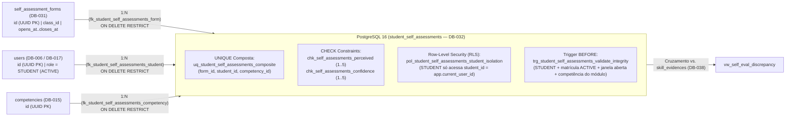

# 🪞 [DB-032] Tabela de Respostas de Autoavaliação do Aluno (`student_self_assessments`) — Projeto NEXA

> **ID do Card**: `DB-032` | **Epic**: `EPIC-07: Autoavaliação & Motor de Diagnóstico Explicável` | **Sprint / Lote**: `Lote 4 (S4)`  
> **Prioridade**: `P1` | **Estimativa**: `3 SP` | **Tipo**: `Feature` | **Status**: `Concluído`  
> **Arquivos Principais**: [`prisma/migrations/20261123100000_create_student_self_assessments_table/migration.sql`](../../prisma/migrations/20261123100000_create_student_self_assessments_table/migration.sql), [`BancoNexa/sql/32_tabela_student_self_assessments.sql`](../../BancoNexa/sql/32_tabela_student_self_assessments.sql), [`prisma/schema.prisma`](../../prisma/schema.prisma), [`BancoNexa/types/schema-models.ts`](../../BancoNexa/types/schema-models.ts)  
> **Rastreabilidade**: ⬅️ Anterior: [`DB-031`](./31-tabela-formularios-autoavaliacao-self-assessment-forms.md) | ➡️ Próximo: `DB-033` | 🔒 Depende de: `DB-015`, `DB-017`, `DB-031` | 🔓 Desbloqueia: `DB-035`, `DB-038`, `DB-040`, `BE-036`, `FE-041`

---

## 1. Objetivo e Modelagem de Domínio SENAI

O card **`DB-032`** implementa a tabela `student_self_assessments` no **PostgreSQL 16 (Docker)** para persistir a percepção de domínio (`perceived_level`, escala `1..5`), o nível de confiança (`confidence_score`, escala `1..5`) e as dificuldades relatadas em oficina (`difficulty_notes`) declarados pelo próprio estudante para cada competência técnica (`competencies`) de um ciclo de autoavaliação (`self_assessment_forms`).

Essa tabela alimenta o cruzamento entre a percepção do estudante e a avaliação objetiva do docente, desbloqueando diretamente:
- **Diagnósticos Explicáveis de Turma (`explainable_diagnostics` — `DB-035`)**;
- **View de Discrepância Autoavaliação vs. Professor (`vw_self_eval_discrepancy` — `DB-038`)**;
- **Seed de Diagnósticos e Alertas Simulados (`DB-040`)**;
- **Endpoint de Submissão de Autoavaliação (`BE-036`)** e **Interface de Autoavaliação (`FE-041`)**.

---

## 2. Arquitetura Relacional, Isolamento RLS e Integridade de Submissão

1. **Unicidade por Formulário, Estudante e Competência (`uq_student_self_assessments_composite`)**:
   - `UNIQUE (form_id, student_id, competency_id)` impede que um aluno registre duas respostas distintas para a mesma competência no mesmo formulário (`SQLSTATE 23505` / `P2002`).
2. **Validação da Escala de 1 a 5 (`chk_self_assessments_perceived` e `chk_self_assessments_confidence`)**:
   - Ambas as colunas exigem inteiros estritamente entre `1` e `5` (`SQLSTATE 23514` fora da faixa).
3. **Isolamento de Acesso via Row-Level Security (RLS PostgreSQL 16)**:
   - `ALTER TABLE student_self_assessments ENABLE ROW LEVEL SECURITY` com política `pol_student_self_assessments_student_isolation`: quando o contexto da sessão for `STUDENT` (`app.current_user_role = 'STUDENT'`), apenas linhas cujo `student_id = app.current_user_id` podem ser lidas ou gravadas — garantindo que um estudante **jamais** leia a autoavaliação de outro colega.
   - Docentes, coordenadores, administradores e rotinas analíticas (`DB-038` / `BE-036`) continuam operando normalmente.
4. **Validação Contextual via Trigger PL/pgSQL**:
   - `trg_student_self_assessments_validate_integrity` valida que `student_id` tem `role = 'STUDENT'`, possui matrícula `ACTIVE` na turma do formulário (`DB-017`), que o formulário está ativo dentro da janela `[opens_at, closes_at]` e que `competency_id` pertence ao módulo do formulário (quando configurado em `module_competencies`).

---

## 3. Especificação Relacional da Tabela `student_self_assessments` (PostgreSQL 16)

| Coluna | Tipo SQL Nativo | Campo Prisma / TS | Nulo? | Default | Constraints e Regras de Negócio |
|---|---|---|:---:|---|---|
| `id` | `UUID` | `id: string` | `NOT NULL` | `gen_random_uuid()` | `PRIMARY KEY` |
| `form_id` | `UUID` | `formId: string` | `NOT NULL` | — | `FK -> self_assessment_forms(id) ON DELETE RESTRICT ON UPDATE CASCADE`; parte da `UNIQUE` tripla |
| `student_id` | `UUID` | `studentId: string` | `NOT NULL` | — | `FK -> users(id) ON DELETE RESTRICT ON UPDATE CASCADE`; `role = STUDENT` com matrícula `ACTIVE` + isolamento RLS |
| `competency_id` | `UUID` | `competencyId: string` | `NOT NULL` | — | `FK -> competencies(id) ON DELETE RESTRICT ON UPDATE CASCADE`; competência do módulo |
| `perceived_level` | `INTEGER` | `perceivedLevel: number` | `NOT NULL` | — | `CHECK (perceived_level BETWEEN 1 AND 5)` |
| `confidence_score` | `INTEGER` | `confidenceScore: number` | `NOT NULL` | — | `CHECK (confidence_score BETWEEN 1 AND 5)` |
| `difficulty_notes` | `TEXT` | `difficultyNotes: string \| null` | `NULL` | — | Relato opcional das dificuldades encontradas na prática de oficina |
| `submitted_at` | `TIMESTAMPTZ` | `submittedAt: Date` | `NOT NULL` | `CURRENT_TIMESTAMP` | Data/hora da submissão dentro de `[opens_at, closes_at]` |

---

## 4. Checklist de Verificação dos Critérios de Aceitação (`DB-032`)

- [x] **Critério 1 — Constraint `UNIQUE` em `(form_id, student_id, competency_id)`**: `uq_student_self_assessments_composite` no DDL SQL e no `prisma/schema.prisma`.
- [x] **Critério 2 — `CHECK` garantindo `perceived_level` e `confidence_score` entre `1` e `5`**: `chk_self_assessments_perceived` e `chk_self_assessments_confidence` testadas nas fronteiras válidas (`1`, `5`) e inválidas (`0`, `6`, `-1`).
- [x] **Critério 3 — Isolamento de acesso (um aluno jamais lê autoavaliação de colega)**: Row-Level Security (`ENABLE ROW LEVEL SECURITY` + `pol_student_self_assessments_student_isolation`) implementada e testada em `scripts/validate-db-032.js`.
- [x] **DoD — Tabela migrada com restrições de integridade e unicidade**: Migration `20261123100000_create_student_self_assessments_table`, `model StudentSelfAssessment` em `prisma/schema.prisma`, tipos gerados em `BancoNexa/types/schema-models.ts` e suíte `scripts/validate-db-032.js` aprovada.
