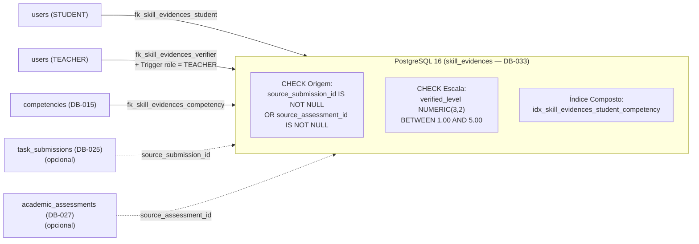

# 🔬 [DB-033] Tabela de Evidências Práticas de Habilidades (`skill_evidences`) — Projeto NEXA

> **ID do Card**: `DB-033` | **Epic**: `EPIC-07: Autoavaliação & Motor de Diagnóstico Explicável` | **Sprint / Lote**: `Lote 4 (S4)`  
> **Prioridade**: `P1` | **Estimativa**: `3 SP` | **Tipo**: `Feature` | **Status**: `Concluído`  
> **Arquivos Principais**: [`prisma/migrations/20261126000000_create_skill_evidences_table/migration.sql`](../../prisma/migrations/20261126000000_create_skill_evidences_table/migration.sql), [`BancoNexa/sql/33_tabela_skill_evidences.sql`](../../BancoNexa/sql/33_tabela_skill_evidences.sql), [`prisma/schema.prisma`](../../prisma/schema.prisma), [`BancoNexa/types/schema-models.ts`](../../BancoNexa/types/schema-models.ts)  
> **Rastreabilidade**: ⬅️ Anterior: [`DB-032`](./32-tabela-respostas-autoavaliacao-student-self-assessments.md) | ➡️ Próximo: `DB-034` | 🔒 Depende de: `DB-015`, `DB-026`, `DB-028` | 🔓 Desbloqueia: `DB-035`, `DB-038`, `DB-040`, `BE-025`, `BE-037`, `BE-038`

---

## 1. Objetivo e Modelagem de Domínio SENAI

O card **`DB-033`** implementa a tabela `skill_evidences` no **PostgreSQL 16 (Docker)** para consolidar as evidências acadêmicas reais (peças usinadas, rubricas de bancada em `task_submissions` ou provas/microavaliações em `academic_assessments`) avaliadas por um docente (`TEACHER`) que comprovam o domínio técnico do estudante em cada competência.

Essa entidade garante o princípio ético central do NEXA: **autoavaliações discentes (`DB-032`) jamais substituem ou são tratadas como prova definitiva sem evidência docente verificável**.

---

## 2. Arquitetura Relacional e Rastreabilidade de Origem

---

## 3. Especificação Relacional da Tabela `skill_evidences` (PostgreSQL 16)

| Coluna | Tipo SQL Nativo | Campo Prisma / TS | Nulo? | Default | Constraints e Regras de Negócio |
|---|---|---|:---:|---|---|
| `id` | `UUID` | `id: string` | `NOT NULL` | `gen_random_uuid()` | `PRIMARY KEY` |
| `student_id` | `UUID` | `studentId: string` | `NOT NULL` | — | `FK -> users(id) ON DELETE RESTRICT`, validado como `role = 'STUDENT'` |
| `competency_id` | `UUID` | `competencyId: string` | `NOT NULL` | — | `FK -> competencies(id) ON DELETE RESTRICT` |
| `source_submission_id` | `UUID` | `sourceSubmissionId: string \| null` | `NULL` | `NULL` | `FK -> task_submissions(id) ON DELETE RESTRICT`; dono deve bater com `student_id` |
| `source_assessment_id` | `UUID` | `sourceAssessmentId: string \| null` | `NULL` | `NULL` | `FK -> academic_assessments(id) ON DELETE RESTRICT`; estudante matriculado na turma |
| `verified_level` | `NUMERIC(3,2)` | `verifiedLevel: number \| string` | `NOT NULL` | — | `CHECK (verified_level >= 1.00 AND verified_level <= 5.00)` |
| `verified_by` | `UUID` | `verifiedBy: string` | `NOT NULL` | — | `FK -> users(id) ON DELETE RESTRICT`, validado como `role = 'TEACHER'` e `<> student_id` |
| `recorded_at` | `TIMESTAMPTZ` | `recordedAt: Date` | `NOT NULL` | `CURRENT_TIMESTAMP` | Data/hora do registro da evidência verificada |

---

## 4. Checklist de Verificação dos Critérios de Aceitação (`DB-033`)

- [x] **Critério 1 — Vínculo à evidência de origem**: `chk_skill_evidences_source` exige `source_submission_id IS NOT NULL OR source_assessment_id IS NOT NULL`, com validação de titularidade pelo trigger.
- [x] **Critério 2 — Escala padronizada 1 a 5**: `verified_level NUMERIC(3,2)` validado via `chk_skill_evidences_level (1.00..5.00)`.
- [x] **Critério 3 — Índice composto em `(student_id, competency_id)`**: `idx_skill_evidences_student_competency` criado para acelerar `vw_self_eval_discrepancy` (`DB-038`).
- [x] **Observação Técnica — Garantia de evidência docente**: Trigger bloqueia autoverificação e perfis não-docentes (`verified_by` exige `role = 'TEACHER'`).
- [x] **DoD — Tabela `skill_evidences` migrada, integrada ao Prisma e validada**: Migration `20261126000000_create_skill_evidences_table`, `model SkillEvidence` e testes em `scripts/validate-db-033.js`.
