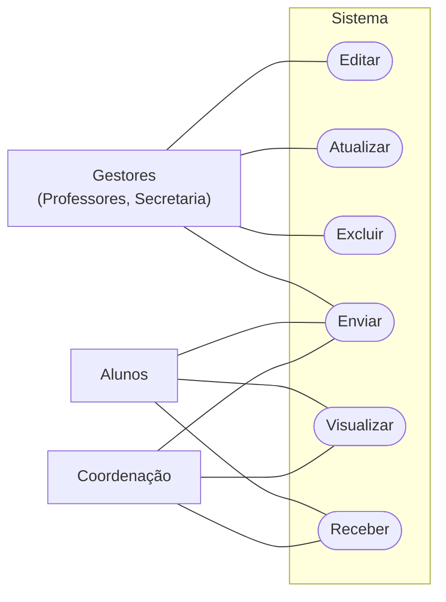

# Diagrama de caso de uso

## Atores

| Ator | Descrição | Casos de uso |
|------|-----------|--------------|
| Gestores | Professores e Secretaria | Enviar, Editar, Atualizar, Excluir |
| Alunos | Usuários finais | Visualizar, Enviar, Receber |
| Coordenação | Acompanhamento e supervisão | Visualizar, Enviar, Receber |

## Diagrama

## Matriz ator x caso de uso

| Caso de uso | Gestores | Alunos | Coordenação |
|-------------|:--------:|:------:|:-----------:|
| Enviar      | X | X | X |
| Editar      | X |   |   |
| Atualizar   | X |   |   |
| Excluir     | X |   |   |
| Visualizar  |   | X | X |
| Receber     |   | X | X |

## Observações

- Editar, Atualizar e Excluir são exclusivos dos gestores.
- Enviar é o único caso de uso compartilhado por todos os atores.
- Os casos de uso estão apenas com verbos; podem ser detalhados conforme o objeto gerenciado (ex.: Enviar aviso, Editar nota, Receber material).
