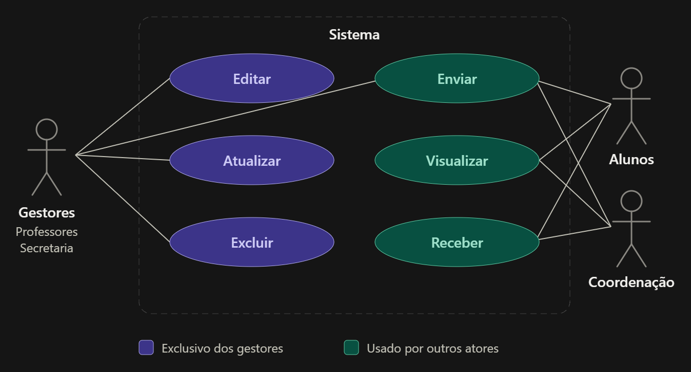
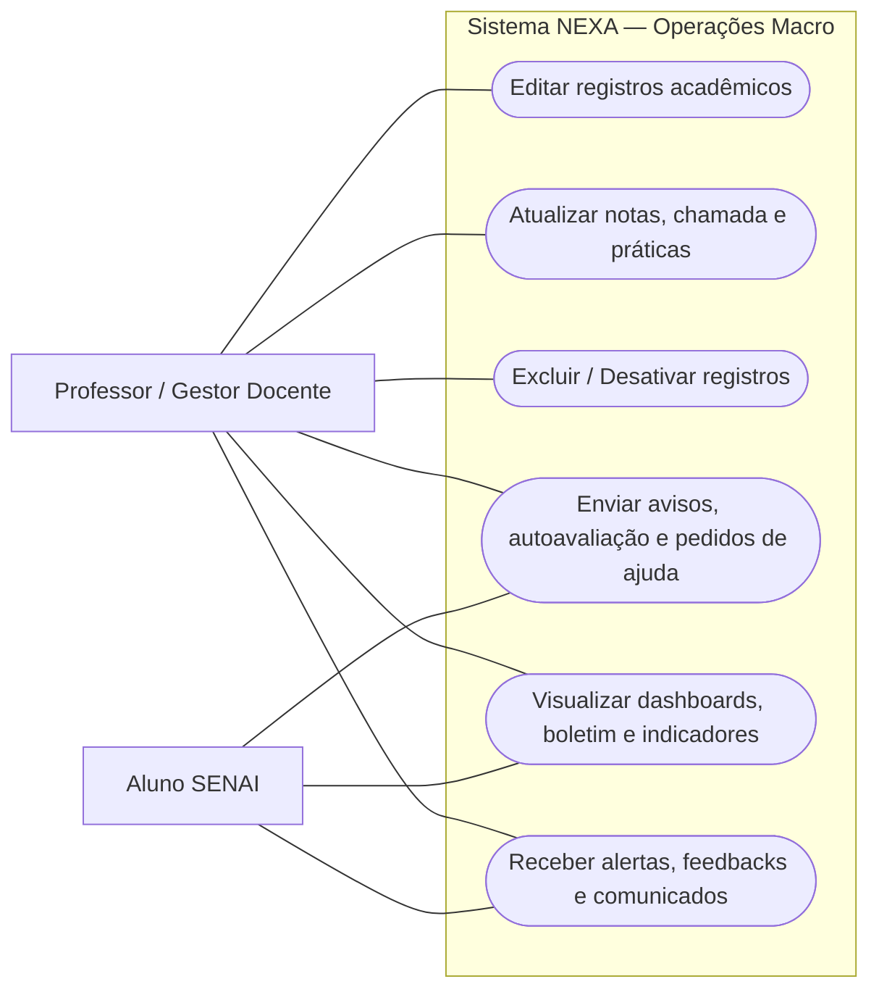
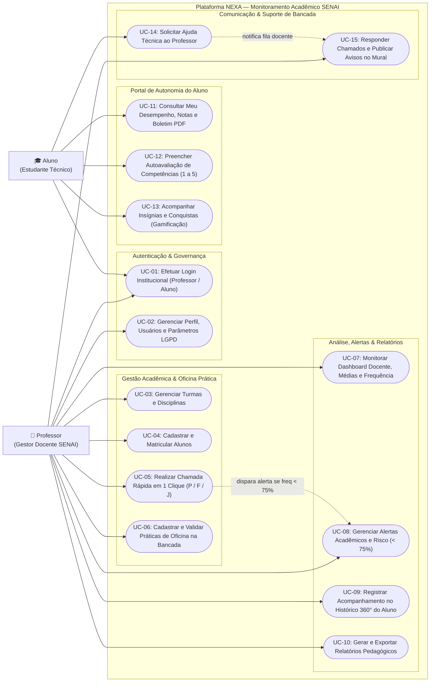

# Diagrama de Casos de Uso — NEXA (Monitoramento Acadêmico SENAI)

Este documento especifica os **Atores**, os **Diagramas de Casos de Uso** (visão macro e visão detalhada de funcionalidades) e a **Matriz de Permissões e Especificações** da plataforma **NEXA**.

---

## 1. Atores do Sistema

| Ator | Perfil no Sistema | Responsabilidades Principais |
| :--- | :--- | :--- |
| **Professor (Gestor Docente)** | `TEACHER` | Gerenciar turmas, disciplinas, matrículas e usuários; realizar chamada rápida em 1 clique; cadastrar e validar atividades práticas de oficina (NR-10/NR-12); acompanhar alertas de risco (< 75% de frequência ou média < 6,0); registrar histórico pedagógico; responder pedidos de ajuda; publicar avisos no mural e exportar relatórios. |
| **Aluno (Estudante SENAI)** | `STUDENT` | Consultar seu painel de desempenho, notas por etapa (`AV1`, `AV2`, `Oficina Prática`), frequência acumulada (limite regimental de 75%) e boletim individual; preencher autoavaliação de competências; acompanhar conquistas/insígnias; visualizar o mural da turma e enviar pedidos de ajuda técnica ao professor. |

---

## 2. Visão Macro (Operações Fundamentais)

Representação geral das operações de manipulação e consulta de dados no sistema:

---

## 3. Diagrama de Casos de Uso Detalhado (Funcionalidades do NEXA)

Mapeamento completo de todos os casos de uso implementados nas **15 telas** da plataforma:

---

## 4. Especificação dos Casos de Uso (`UC-01` a `UC-15`)

| Código | Caso de Uso | Ator Principal | Descrição e Regra de Negócio | Rota no Front-end |
| :--- | :--- | :--- | :--- | :--- |
| **`UC-01`** | Efetuar Login Institucional | Professor / Aluno | Autentica o usuário com e-mail institucional SENAI e direciona para a visão de Professor ou Aluno. | `/` |
| **`UC-02`** | Gerenciar Configurações, Usuários e LGPD | Professor | Permite cadastrar/editar contas de usuários, ativar/desativar acessos e definir parâmetros regimentais (75% frequência e média 6,0). | `/configuracoes` |
| **`UC-03`** | Gerenciar Turmas e Disciplinas | Professor | Consulta a saúde acadêmica das turmas, cria novas turmas e vincula professores às unidades curriculares. | `/turmas` e `/disciplinas` |
| **`UC-04`** | Cadastrar e Matricular Alunos | Professor | Lista estudantes com busca/filtros por situação (`Regular`, `Atenção`, `Crítico`) e matricula novos alunos. | `/alunos` |
| **`UC-05`** | Realizar Chamada Rápida em 1 Clique | Professor | Registra presença (`P`), falta (`F`) ou justificativa (`J`) individualmente ou em lote (*"Marcar todos presentes"*), exibindo alerta se a frequência cair abaixo de **75%**. | `/oficina` |
| **`UC-06`** | Cadastrar e Validar Práticas de Oficina | Professor | Cria atividades práticas com rubricas técnicas e normas `NR-10`/`NR-12` e valida a conclusão por aluno em 1 clique na bancada. | `/oficina` |
| **`UC-07`** | Monitorar Dashboard e Análises | Professor | Visualiza KPIs gerais, gráfico de evolução mensal da média, distribuição de notas e evolução da frequência. | `/dashboard`, `/desempenho`, `/frequencia` |
| **`UC-08`** | Gerenciar Alertas Acadêmicos | Professor | Filtra sinais críticos por prioridade (`Alta`, `Média`, `Baixa`) e marca os casos que já estão em acompanhamento. | `/alertas` |
| **`UC-09`** | Registrar Acompanhamento Pedagógico 360° | Professor | Consulta a ficha individual do estudante e adiciona novos registros na linha do tempo de histórico pedagógico. | `/alunos/:id` |
| **`UC-10`** | Gerar e Exportar Relatórios | Professor | Gera relatórios consolidados de desempenho, frequência e mapa de atenção para reuniões pedagógicas. | `/relatorios` |
| **`UC-11`** | Consultar Desempenho, Notas e Boletim | Aluno | Exibe média geral, termômetro regimental de 75%, notas por etapa (`AV1`, `AV2`, `Oficina Prática`) e exporta o boletim individual em PDF. | `/aluno/painel` e `/aluno/notas` |
| **`UC-12`** | Preencher Autoavaliação de Competências | Aluno | Permite ao estudante avaliar seu domínio (escala 1 a 5) nas competências técnicas e socioemocionais, comparando com a nota docente. | `/aluno/autoavaliacao` |
| **`UC-13`** | Acompanhar Insígnias e Conquistas | Aluno | Exibe medalhas e barras de progresso desbloqueadas por assiduidade exemplar, segurança em laboratório e desempenho prático. | `/aluno/autoavaliacao` |
| **`UC-14`** | Solicitar Ajuda Técnica ao Professor | Aluno | Envia um pedido de apoio informando disciplina, bancada/laboratório, nível de urgência e descrição da dúvida. | `/aluno/ajuda` |
| **`UC-15`** | Responder Chamados e Publicar no Mural | Professor | Responde às dúvidas enviadas pelos alunos nas bancadas e publica comunicados oficiais no mural das turmas. | `/comunicacao` |

---

## 5. Matriz Ator × Caso de Uso

| Caso de Uso | Professor (Gestor Docente) | Aluno SENAI |
| :--- | :---: | :---: |
| `UC-01` — Efetuar Login Institucional | ✅ | ✅ |
| `UC-02` — Gerenciar Configurações, Usuários e Parâmetros LGPD | ✅ | ❌ |
| `UC-03` — Gerenciar Turmas e Disciplinas | ✅ | ❌ |
| `UC-04` — Cadastrar, Filtrar e Matricular Alunos | ✅ | ❌ |
| `UC-05` — Realizar Chamada Rápida em 1 Clique (`P / F / J`) | ✅ | ❌ |
| `UC-06` — Cadastrar e Validar Atividades Práticas de Oficina | ✅ | ❌ |
| `UC-07` — Monitorar Dashboard Docente e Gráficos Analíticos | ✅ | ❌ |
| `UC-08` — Gerenciar Central de Alertas Acadêmicos | ✅ | ❌ |
| `UC-09` — Registrar Acompanhamento no Histórico do Aluno | ✅ | ❌ *(Apenas leitura dos próprios feedbacks)* |
| `UC-10` — Gerar e Exportar Relatórios Gerenciais da Turma | ✅ | ❌ |
| `UC-11` — Consultar Painel Individual, Notas, Faltas e Boletim PDF | ✅ *(Visão por aluno)* | ✅ *(Próprio boletim)* |
| `UC-12` — Preencher Autoavaliação Reflexiva de Competências | ✅ *(Avaliação docente)* | ✅ *(Autoavaliação)* |
| `UC-13` — Visualizar Galeria de Insígnias e Conquistas | ✅ | ✅ |
| `UC-14` — Enviar Solicitação de Ajuda Técnica na Bancada | ❌ | ✅ |
| `UC-15` — Responder Pedidos de Ajuda e Publicar Avisos no Mural | ✅ | ❌ *(Leitura do mural e respostas)* |
