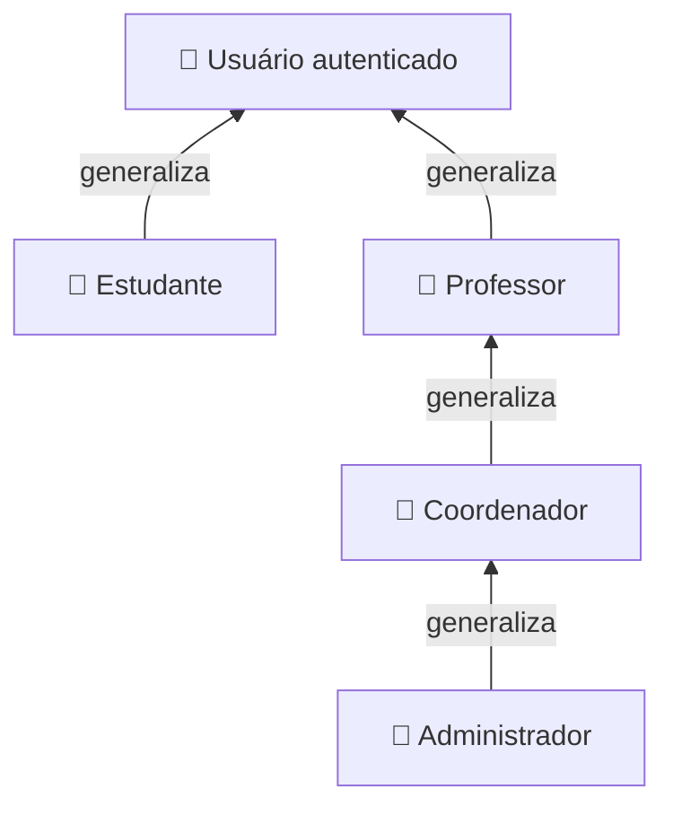
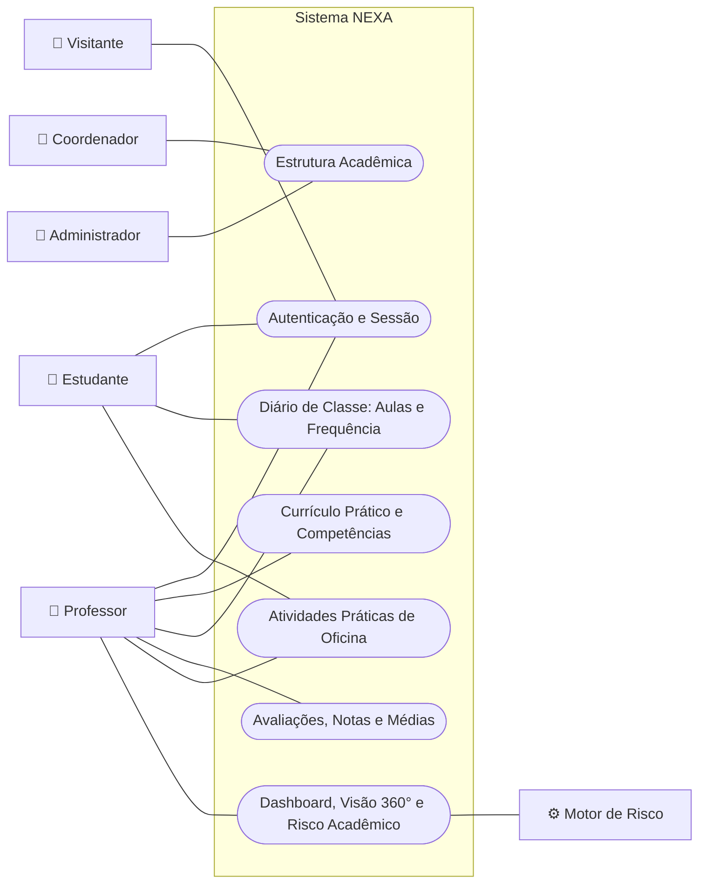
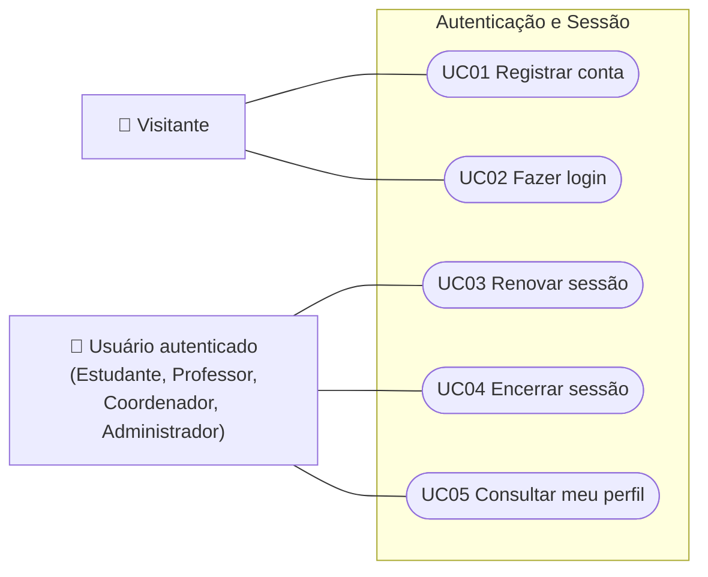
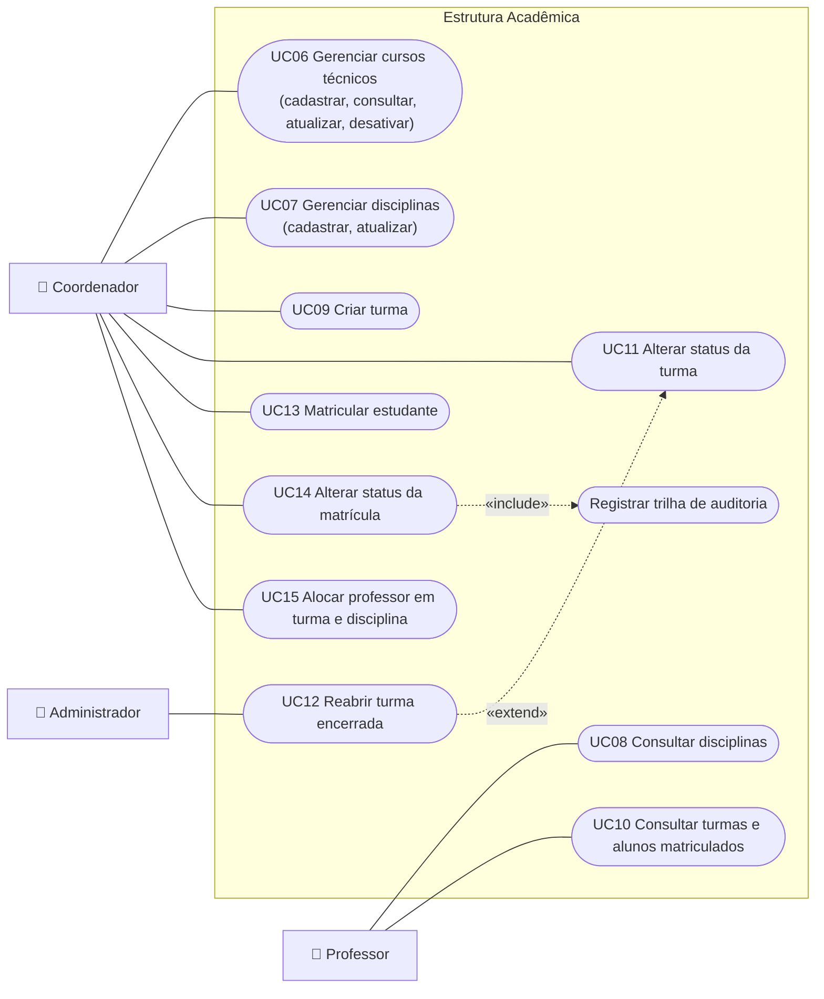
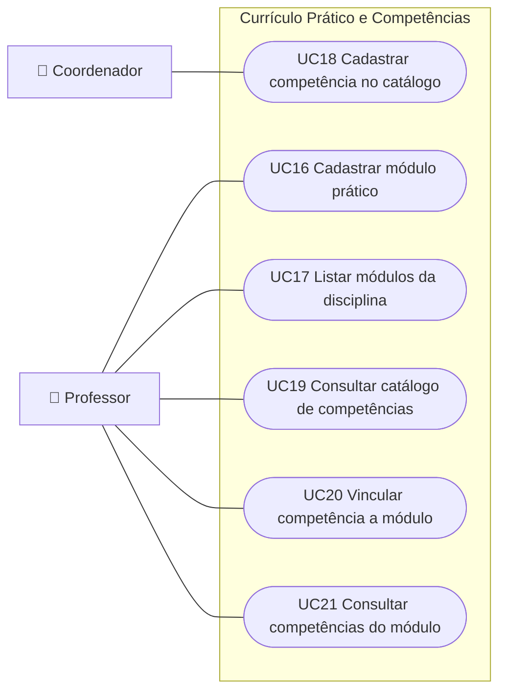
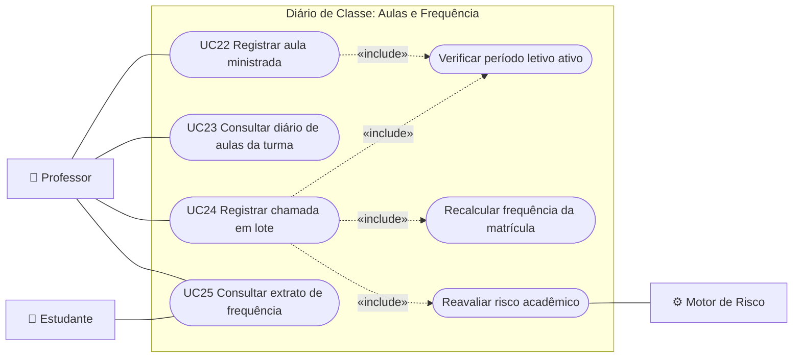
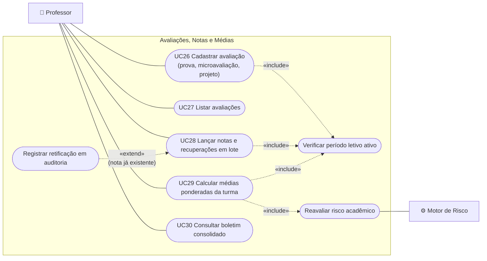
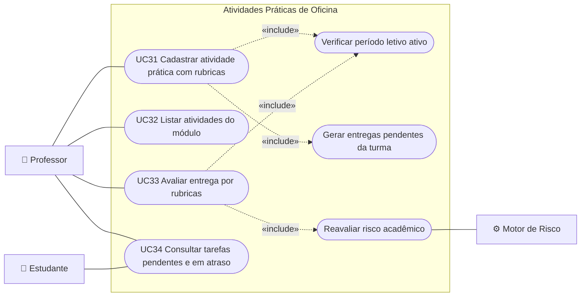
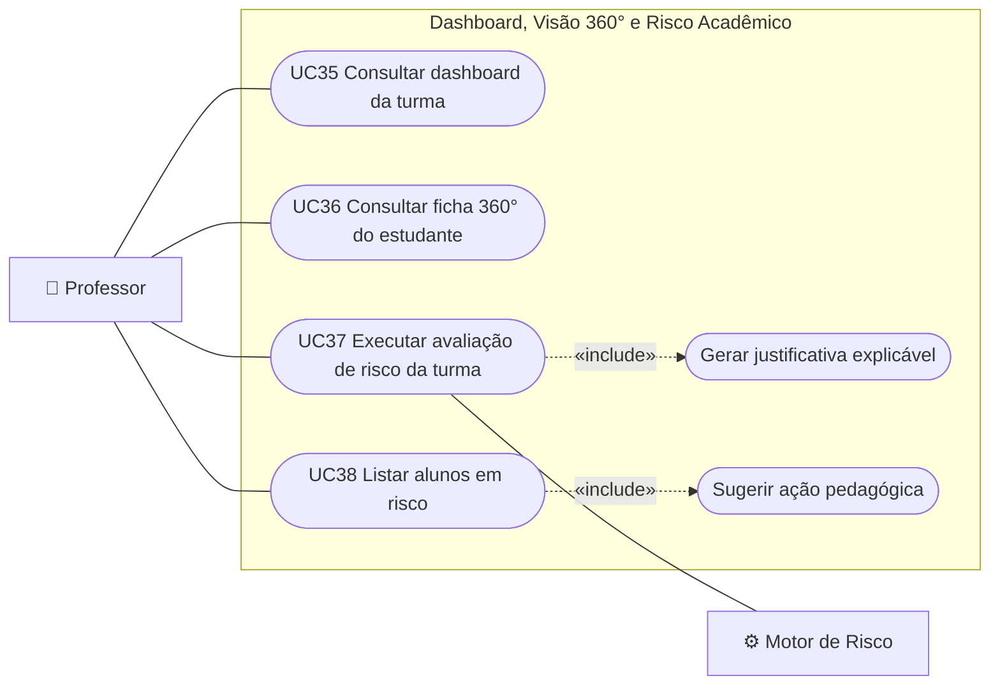

# Diagrama de Caso de Uso — NEXA (versão atualizada)

> Diagrama construído a partir do que **já está implementado no backend** (FastAPI, lotes S1–S4, até o BE-033).
> Os atores refletem exatamente os perfis de acesso (`UserRole`) aplicados nas rotas, e cada caso de uso corresponde a um ou mais endpoints existentes.

---

## 1. Atores

| Ator | Perfil no sistema | Descrição | Restrição de escopo |
|------|-------------------|-----------|---------------------|
| **Visitante** | — (não autenticado) | Pessoa que ainda não possui sessão ativa | Acessa apenas cadastro e login |
| **Estudante** | `STUDENT` | Aluno matriculado em uma turma | Consulta **somente os próprios dados** (proteção contra IDOR) |
| **Professor** | `TEACHER` | Instrutor responsável pelo diário de classe e pelas oficinas | Atua **somente nas turmas em que está alocado** |
| **Coordenador** | `COORDINATOR` | Coordenação pedagógica e gestão acadêmica | Visão global de todas as turmas |
| **Administrador** | `ADMIN` | Gestão total da plataforma | Visão global + **reabertura de turma encerrada** |
| **Motor de Risco** | Ator secundário (sistema) | `RiskEngineService`, executado automaticamente após mutações acadêmicas | Regras determinísticas e explicáveis |

### Generalização entre atores

O Coordenador herda todos os casos de uso do Professor (sem a restrição de turma) e acrescenta a gestão acadêmica. O Administrador herda tudo do Coordenador e acrescenta a reabertura de turmas encerradas.

---

## 2. Visão geral do sistema

---

## 3. Diagramas por módulo

### 3.1 Autenticação e Sessão (EPIC-01)

### 3.2 Estrutura Acadêmica (EPIC-02)

> Coordenador e Administrador também acessam UC08 e UC10, por generalização do Professor.

### 3.3 Currículo Prático e Competências (EPIC-04)

### 3.4 Diário de Classe: Aulas e Frequência (EPIC-03)

> No UC25, o Estudante consulta apenas a **própria** frequência.

### 3.5 Avaliações, Notas e Médias (EPIC-03)

### 3.6 Atividades Práticas de Oficina (EPIC-04)

> No UC34, o Estudante consulta apenas as **próprias** tarefas. Status de entrega: `PENDING`, `LATE` (calculado dinamicamente), `SUBMITTED` e `EVALUATED`.

### 3.7 Dashboard, Visão 360° e Risco Acadêmico (EPIC-05)

> Regras do Motor de Risco: presença < 75% → `CRITICAL`; presença entre 75% e 78% → `HIGH`; 2 tarefas atrasadas → `MODERATE`; 3 ou mais → `HIGH`; média abaixo da nota de corte → `HIGH`. Todo alerta traz o aviso ético de que **não constitui reprovação automática**.

---

## 4. Matriz Ator × Caso de Uso

Legenda: **X** = acesso total · **P** = apenas os próprios dados · **T** = apenas turmas em que está alocado

| Caso de uso | Visitante | Estudante | Professor | Coordenador | Administrador |
|-------------|:---------:|:---------:|:---------:|:-----------:|:-------------:|
| UC01 Registrar conta | X | | | | |
| UC02 Fazer login | X | | | | |
| UC03–UC05 Sessão e perfil | | X | X | X | X |
| UC06 Gerenciar cursos técnicos | | | | X | X |
| UC07 Gerenciar disciplinas | | | | X | X |
| UC08 Consultar disciplinas | | | X | X | X |
| UC09 Criar turma | | | | X | X |
| UC10 Consultar turmas e alunos | | | X | X | X |
| UC11 Alterar status da turma | | | | X | X |
| UC12 Reabrir turma encerrada | | | | | X |
| UC13 Matricular estudante | | | | X | X |
| UC14 Alterar status da matrícula | | | | X | X |
| UC15 Alocar professor | | | | X | X |
| UC16–UC17 Módulos práticos | | | X | X | X |
| UC18 Cadastrar competência | | | | X | X |
| UC19–UC21 Consultar/vincular competências | | | X | X | X |
| UC22–UC24 Aulas e chamada | | | T | X | X |
| UC25 Extrato de frequência | | P | T | X | X |
| UC26–UC30 Avaliações, notas e médias | | | T | X | X |
| UC31–UC33 Atividades práticas | | | T | X | X |
| UC34 Tarefas pendentes | | P | T | X | X |
| UC35–UC38 Dashboard, 360° e risco | | | T | X | X |

---

## 5. Regras transversais

| Regra | Casos de uso afetados | Comportamento |
|-------|-----------------------|---------------|
| **Bloqueio de período letivo encerrado** (BE-029) | UC22, UC24, UC26, UC28, UC29, UC31, UC33 | Turma `COMPLETED` ou `ARCHIVED` → HTTP 422 `CLASS_PERIOD_CLOSED`. Só volta a aceitar alterações se for reaberta (UC12). |
| **Reavaliação automática de risco** (BE-032) | UC24, UC29, UC33 | O Motor de Risco recalcula os alertas da matrícula ou da turma, sem duplicar alertas abertos e encerrando os que normalizaram. |
| **Auditoria** | UC14, UC28 | Mudança de status de matrícula e retificação de nota existente são gravadas em `audit_logs`. |
| **Isolamento de dados** | UC25, UC34, UC35–UC38 | O Estudante vê só os próprios dados; o Professor só acessa as turmas em que está alocado. |

---

## 6. Diferenças em relação à versão anterior

| Versão anterior | Versão atualizada |
|-----------------|-------------------|
| Atores genéricos: "Gestores", "Alunos" e "Coordenação" | Atores iguais aos perfis reais do sistema: Estudante, Professor, Coordenador e Administrador, mais Visitante e o Motor de Risco |
| "Gestores" agrupava Professores e Secretaria | O Professor ficou separado da gestão acadêmica, que é do Coordenador e do Administrador. O perfil "Secretaria" não existe no sistema. |
| Casos de uso só com verbos (Enviar, Editar, Excluir...) | Casos de uso com verbo + objeto, ligados às funcionalidades entregues |
| "Receber" (avisos/materiais) | Removido: ainda não há envio de avisos ou materiais implementado |
| "Excluir" | Só existe a desativação lógica de curso (soft delete), dentro de UC06 |
| Sem relações entre casos de uso | Foram incluídas as relações «include» e «extend» e a generalização entre atores |
