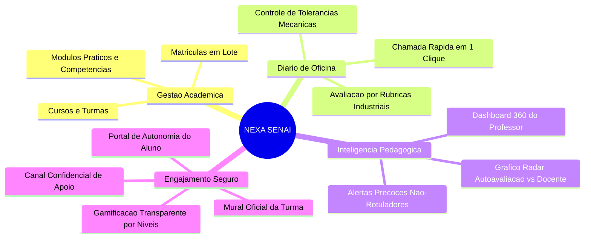
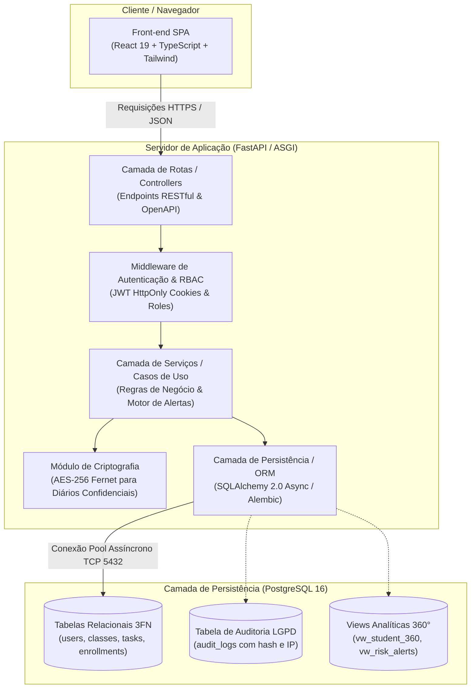
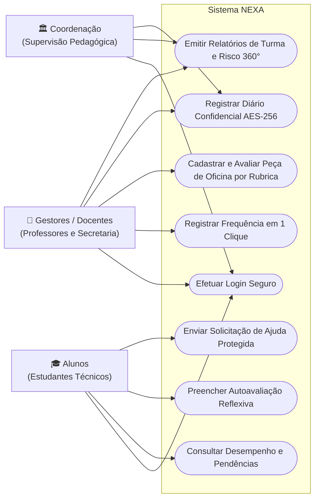

# 🏛️ NEXA — Sistema Inteligente de Monitoramento do Desempenho Acadêmico

> **Plataforma de Governança Pedagógica, Acompanhamento de Competências Práticas de Oficina e Diagnóstico Precoce para a Formação Profissional SENAI.**

---

[](https://github.com/AlmanDMD/NEXA)
[](https://fastapi.tiangolo.com/)
[](https://www.python.org/)
[](https://react.dev/)
[](https://www.typescriptlang.org/)
[](https://tailwindcss.com/)
[](https://www.postgresql.org/)
[](https://www.docker.com/)
[](docs/backlog/04-documentacao.md)

---

## 📌 Sumário
1. [Sobre o Projeto e Tema](#-sobre-o-projeto-e-tema)
2. [Motivo da Criação e Problema de Negócio](#-motivo-da-criação-e-problema-de-negócio)
3. [Diferenciais e Funcionalidades Principais](#-diferenciais-e-funcionalidades-principais)
4. [Stack Tecnológica e Ferramentas Utilizadas](#-stack-tecnológica-e-ferramentas-utilizadas)
5. [Arquitetura e Explicações Técnicas](#-arquitetura-e-explicações-técnicas)
   - [Visão Geral da Arquitetura (C4 Model)](#visão-geral-da-arquitetura-c4-model)
   - [Diagrama de Casos de Uso e Matriz de Permissões (RBAC)](#diagrama-de-casos-de-uso-e-matriz-de-permissões-rbac)
   - [Engenharia de Dados e Views Analíticas 360°](#engenharia-de-dados-e-views-analíticas-360)
   - [Segurança, Criptografia e Conformidade com a LGPD](#segurança-criptografia-e-conformidade-com-a-lgpd)
6. [Estrutura do Repositório](#-estrutura-do-repositório)
7. [Governança Ágil e Gestão de Backlog](#-governança-ágil-e-gestão-de-backlog)
8. [Como Executar o Projeto Localmente (Quick Start)](#-como-executar-o-projeto-localmente-quick-start)
9. [Padronização de Código e Fluxo de Branches (GitFlow)](#-padronização-de-código-e-fluxo-de-branches-gitflow)
10. [Equipe e Informações do Projeto](#-equipe-e-informações-do-projeto)

---

## 📖 Sobre o Projeto e Tema

O **NEXA** é um ecossistema digital desenvolvido para modernizar e potencializar o monitoramento do desempenho acadêmico e formativo em cursos técnicos do **SENAI** (Serviço Nacional de Aprendizagem Industrial).

Diferente de sistemas acadêmicos tradicionais (que apenas armazenam médias bimestrais e faltas globais em bancos de dados estáticos), o **NEXA** atua como uma plataforma de **inteligência pedagógica em tempo real**, voltada especialmente para disciplinas práticas de oficina e laboratório — tais como **Metrologia, Desenho Técnico, Tornearia Mecânica, Ajustagem e Usinagem CNC**.

A plataforma integra a visão dos três principais agentes da comunidade escolar:
- **Estudantes**: acompanham sua evolução técnica, autoavaliam habilidades por critérios industriais, visualizam pendências e contam com um canal protegido para sanar dúvidas.
- **Professores**: realizam chamadas dinâmicas em 1 clique, avaliam peças e tarefas práticas por rubricas de tolerância/acabamento e recebem alertas explicáveis sobre defasagem de aprendizagem.
- **Coordenação Pedagógica**: dispõe de indicadores em tempo real para prevenção de evasão, visão 360° por turma e suporte consultivo a conselhos de classe.

---

## 🎯 Motivo da Criação e Problema de Negócio

No modelo de ensino profissionalizante por competências adotado pelo SENAI, os alunos desenvolvem habilidades manipulativas e cognitivas de alta precisão. No entanto, o ecossistema educacional frequentemente enfrenta gargalos críticos:

| Desafio Identificado | Impacto no Ambiente Escolar | Solução Implementada no NEXA |
|---|---|---|
| **Diagnóstico Tardio de Dificuldades** | O professor só percebe a defasagem no fim do módulo, quando o aluno já reprovou a peça prática ou perdeu os prazos. | **Motor de Alertas Precoces Explicáveis**: regras baseadas em frequência, tolerâncias técnicas e tarefas pendentes sinalizam risco com semanas de antecedência. |
| **Divergência entre Percepção e Realidade** | Estudantes acreditam dominar uma técnica (ex.: medição com micrômetro), mas falham na prática de bancada, ou vice-versa. | **Módulo de Autoavaliação Reflexiva**: cruza a percepção do aluno com os registros do docente, gerando um radar de discrepância pedagógica. |
| **Insegurança e Barreira na Comunicação** | Alunos têm receio de demonstrar fraqueza em sala de aula ou perante os colegas, acumulando dúvidas críticas de segurança e manuseio de máquinas. | **Canal Confidencial de Ajuda**: formulário de comunicação direta com o professor, garantindo acolhimento discreto sem constrangimento público. |
| **Sobrecarga Burocrática Docente** | Professores gastam tempo excessivo transcrevendo anotações de pranchetas de oficina para planilhas isoladas no fim do dia. | **Diário de Classe Otimizado**: lançamento ágil de presença e notas formativas diretamente em dispositivos móveis ou bancadas de oficina. |

---

## ✨ Diferenciais e Funcionalidades Principais



- **Avaliação Baseada em Rubricas de Oficina**: Registro objetivo de critérios como acabamento superficial, precisão dimensional (tolerâncias em milímetros/polegadas) e cumprimento de normas de segurança (EPIs).
- **Autoavaliação e Diagnóstico Explicável**: O sistema não rotula o estudante de forma arbitrária; cada indicador de atenção explica o motivo claro da sinalização (ex.: *“Aluno com 3 atividades de metrologia pendentes nos últimos 15 dias e frequência em 78%”*).
- **Gamificação Pedagógica Saudável**: Níveis de domínio de competências e badges de evolução técnica individuais, dispensando ranqueamentos expositivos ou punitivos.
- **Privacidade e LGPD desde a Concepção (Privacy by Design)**: Registros de observações comportamentais e pareceres pedagógicos individuais criptografados, acessíveis estritamente pelos atores autorizados.

---

## 🛠️ Stack Tecnológica e Ferramentas Utilizadas

A escolha tecnológica priorizou desempenho, segurança em nível corporativo, tipagem estrita de ponta a ponta e aderência a padrões modernos da indústria:

### 1. Front-end (Interface & Experiência do Usuário)
- **[React 19](https://react.dev/)**: biblioteca moderna para construção de interfaces reativas baseadas em componentes.
- **[TypeScript](https://www.typescriptlang.org/)**: garante segurança de tipos estáticos, reduzindo bugs em tempo de compilação.
- **[Vite](https://vite.dev/)**: ferramenta de build e servidor de desenvolvimento ultra-rápido com Hot Module Replacement (HMR).
- **[Tailwind CSS v4](https://tailwindcss.com/)**: framework utilitário moderno configurado com a paleta institucional e tokens de design do SENAI.
- **[TanStack Query (React Query)](https://tanstack.com/query)**: gerenciamento inteligente de estado assíncrono, cache de requisições e sincronização em segundo plano.
- **[Lucide React](https://lucide.dev/)**: conjunto consistente de ícones vetoriais acessíveis.
- **[Oxlint](https://oxc.rs/)**: linter estático de altíssima velocidade em Rust para inspeção de qualidade do código JavaScript/TypeScript.

### 2. Back-end (API & Regras de Negócio)
- **[Python 3.12+](https://www.python.org/)**: linguagem base selecionada pela legibilidade, ecossistema robusto e suporte a computação analítica.
- **[FastAPI](https://fastapi.tiangolo.com/)**: framework web assíncrono de alto rendimento baseado em ASGI, com validação automática de dados e geração nativa de documentação Swagger/OpenAPI.
- **[Uvicorn](https://www.uvicorn.org/)**: servidor web ASGI de padrão industrial para execução assíncrona concorrente.
- **[Pydantic v2](https://docs.pydantic.dev/)**: validação estrita de esquemas de entrada/saída, garantindo higienização de payloads.
- **[SQLAlchemy 2.0](https://www.sqlalchemy.org/) & [Alembic](https://alembic.sqlalchemy.org/)**: ORM assíncrono moderno com suporte a migrações de banco versionadas e rastreáveis.
- **[PyJWT](https://pyjwt.readthedocs.io/) & Passlib / Bcrypt**: autenticação segura por JSON Web Tokens (JWT) com armazenamento em cookies `HttpOnly` e hashing resistente de credenciais.
- **[Cryptography](https://cryptography.io/)**: cifragem simétrica AES-256 para campos sensíveis (como anotações confidenciais de professores).
- **[Loguru](https://github.com/Delgan/loguru)**: estruturação de logs centralizados e rastreabilidade de requisições.
- **[Pytest](https://pytest.org/)**: suíte abrangente para testes unitários, testes de integração de endpoints e validação de regras de negócio.

### 3. Banco de Dados & Engenharia de Dados
- **[PostgreSQL 16](https://www.postgresql.org/)**: SGBD relacional de missão crítica, com suporte a constraints avançadas, triggers de auditoria e alta integridade transacional (ACID).
- **Modelagem Relacional (3FN)**: arquitetura de tabelas estruturada para integridade referencial estrita de matrículas, turmas, aulas e submissões.
- **Views Analíticas Consolidadas**:
  - `vw_student_360_performance`: consolidado analítico de notas, tarefas entregues e percentual de frequência.
  - `vw_module_attendance_risk`: monitoramento de frequência por módulo técnico com alerta do teto legal de 75%.
  - `vw_self_eval_discrepancy`: cálculo de desvio entre autoavaliação do estudante e notas práticas atribuídas pelo instrutor.

### 4. DevOps, Governança & Ferramentas de Suporte
- **[Docker & Docker Compose](https://www.docker.com/)**: conteinerização de ambiente para execução replicável e sem atrito entre sistemas operacionais.
- **[GitHub Actions](https://github.com/features/actions)**: automação de CI/CD e rotinas automatizadas via **API GraphQL v2** para sincronização contínua de issues, cards e status no GitHub Projects.
- **[GitHub Projects (v2)](https://docs.github.com/pt/issues/planning-and-tracking-with-projects)**: ecossistema de gestão visual composto por 5 quadros integrados (Geral + 4 Setoriais).
- **[Mermaid.js](https://mermaid.js.org/)**: documentação viva de diagramas arquiteturais, casos de uso e fluxos de interação diretamente no Markdown.

---

## 🏗️ Arquitetura e Explicações Técnicas

### Visão Geral da Arquitetura (C4 Model)

O sistema segue o padrão de **Arquitetura em Camadas Desacopladas** (*Decoupled Layered Architecture*), separando estritamente as responsabilidades de visualização, lógica de negócio, autenticação e persistência:



---

### Diagrama de Casos de Uso e Matriz de Permissões (RBAC)

O controle de acesso baseado em papéis (*Role-Based Access Control*) garante que cada persona execute exclusivamente as ações pertinentes ao seu domínio de responsabilidade pedagógica ou estudantil:



#### Matriz de Acesso RBAC

| Ação / Recurso do Sistema | `ADMIN` (TI) | `COORDINATOR` | `TEACHER` (Docente) | `STUDENT` (Aluno) |
|---|:---:|:---:|:---:|:---:|
| Gerenciar Usuários, Papéis e Matrículas | ✅ | ✅ | ❌ | ❌ |
| Lançar Frequência e Aulas Ministradas | ❌ | ✅ | ✅ | ❌ (Apenas leitura) |
| Criar Tarefas de Oficina e Avaliar Rubricas | ❌ | ✅ | ✅ | ❌ |
| Submeter Autoavaliação e Solicitação de Ajuda | ❌ | ❌ | ❌ | ✅ |
| Consultar Pareceres Pedagógicos Criptografados | ❌ | ✅ | ✅ (Da própria turma) | ❌ |
| Visualizar Alertas de Risco Precoce e Discrepância | ✅ | ✅ | ✅ | ❌ (Visualiza orientações) |
| Consultar Logs de Auditoria e Segurança | ✅ | ❌ | ❌ | ❌ |

---

### Engenharia de Dados e Views Analíticas 360°

Para responder rapidamente às requisições dos dashboards sem sobrecarregar o banco com agregações complexas a cada clique, a engenharia de dados do NEXA utiliza views otimizadas e consultas indexadas:

1. **`vw_student_360_performance`**: unifica presença percentual, total de tarefas de bancada concluídas com sucesso, média de tolerância técnica atingida e média ponderada formativa.
2. **`vw_module_attendance_risk`**: monitora a carga horária cursada por disciplina, alertando preventivamente quando o discente atinge 15% de faltas (margem de segurança antes do limite legal de 25% de infrequência).
3. **`vw_self_eval_discrepancy`**: subtrai a nota de autoatribuição do estudante da pontuação calculada pelo docente na mesma competência (ex.: Leitura de Paquímetro). Variações expressivas geram gatilho para mentoria orientada.

---

### Segurança, Criptografia e Conformidade com a LGPD

Em conformidade com a Lei Geral de Proteção de Dados (Lei nº 13.709/2018):
- **Isolamento de Credenciais**: Senhas armazenadas com salt dinâmico e algoritmo Bcrypt de alto custo computacional (`rounds >= 12`).
- **Sessões Resistentes a XSS e CSRF**: Tokens JWT de acesso de curta duração (15 minutos) e Refresh Tokens de rotação única, trafegados exclusivamente através de cabeçalhos de cookies `HttpOnly`, `SameSite=Strict` e flag `Secure`.
- **Criptografia Simétrica de Dados Pedagógicos**: Observações sobre dificuldades socioemocionais ou comportamentais são criptografadas no banco via biblioteca `cryptography` (módulo Fernet / AES-256-CBC com derivação de chave segura via HKDF), impossibilitando leitura em caso de vazamento pontual de dumps SQL.
- **Rastreabilidade Transacional (`audit_logs`)**: Toda alteração de nota retroativa, exclusão de registro ou acesso a dados confidenciais gera evento imutável com ID do operador, IP, carimbo de data/hora UTC e payload sanitizado.

---

## 📂 Estrutura do Repositório

O projeto é organizado de forma modular, separando a aplicação em squads operacionais e documentação técnica unificada:

```plaintext
NEXA/
├── .github/
│   └── workflows/
│       └── project-auto-sync.yml      # CI/CD: sincronização de issues com os 5 GitHub Projects
├── BancoNexa/                         # Scripts SQL Nativos (3FN), Docker initdb, Migrations e Tipos Enum
│   ├── docker/initdb/                 # Scripts de inicialização automática do PostgreSQL 16
│   ├── migrations/                    # Migrations SQL versionadas (Lote 1: DB-004 a DB-009)
│   ├── sql/                           # Scripts DDL/PLpgSQL modulares e consolidados
│   └── types/                         # Contratos de tipos exportados (TypeScript, Python, JSON Schema)
├── Diagrama_caso_de_uso/
│   ├── diagrama-caso-de-uso.md        # Documentação inicial de Casos de Uso e Matriz
│   └── image.png                      # Representação gráfica dos atores e casos de uso
├── docs/                              # Portal mestre de governança e engenharia de software
│   ├── banco/                         # Documentação técnica dos cards de Banco de Dados (DB-001 a DB-010)
│   ├── backlog/
│   │   ├── 00-visao-arquitetura.md    # Visão unificada, arquitetura e mapa dos 10 Épicos
│   │   ├── 01-banco-de-dados.md       # Backlog de Engenharia de Dados (50 cards: DB-001 a DB-050)
│   │   ├── 02-back-end.md             # Backlog da API FastAPI (50 cards: BE-001 a BE-050)
│   │   ├── 03-front-end.md            # Backlog da Interface React (50 cards: FE-001 a FE-050)
│   │   └── 04-documentacao.md         # Backlog de Governança e Qualidade (20 cards: DOC-001 a DOC-020)
│   └── infra/
│       └── guia-github-projects.md    # Guia dos 5 quadros no GitHub Projects e automação GraphQL
├── frontend/                          # Aplicação Single Page Application (SPA)
│   ├── public/                        # Ícones, vetores e manifesto web
│   ├── src/                           # Código-fonte React, componentes, hooks e páginas
│   ├── index.html                     # Ponto de entrada HTML5
│   ├── vite.config.js                 # Configuração do Vite e plugins
│   ├── package.json                   # Dependências do Front-end (React 19, Tailwind v4)
│   └── .oxlintrc.json                 # Regras de linting do Oxlint
├── prisma/                            # Schema Prisma, Migrations versionadas e verificador check-connection.ts
├── scripts/                           # Automações de gerenciamento do repositório e validação DB (DB-001 a DB-010)
│   ├── data/                          # Dicionários de dados dos 170 cards divididos por squad
│   │   ├── database.js                # 50 cards de Banco de Dados
│   │   ├── backend.js                 # 50 cards de Back-end
│   │   ├── frontend.js                # 50 cards de Front-end
│   │   └── docs.js                    # 20 cards de Documentação
│   ├── import-to-github.js            # Script para importação automática de issues via API REST
│   ├── setup-github-projects.js       # Automação de criação dos 5 quadros via API GraphQL
│   ├── sync-markdown-docs.js          # Sincronizador de documentação Markdown com cards
│   └── assign-issues.js               # Atribuição e rotulagem em lote de cards
├── .env.example                       # Modelo de variáveis de ambiente para integração
├── .gitignore                         # Regras de exclusão de arquivos no Git
├── docker-compose.yml                 # Orquestração do container PostgreSQL 16 Alpine (DB-003)
└── README.md                          # Este arquivo (guia principal do projeto)
```

---

## 📊 Governança Ágil e Gestão de Backlog

O projeto foi planejado com rigor acadêmico e padrões de engenharia de software corporativa, totalizando **170 cards encadeados** distribuídos em **10 Épicos** e **5 Ondas de Desenvolvimento (Sprints)**:

| Épico | Nome do Épico | Escopo Principal |
|---|---|---|
| **EPIC-01** | Autenticação, Perfis (RBAC) & Segurança | Controle de acesso seguro, JWT em cookies, criptografia de dados e RBAC granular. |
| **EPIC-02** | Gestão Acadêmica & Estrutura SENAI | Cadastro de cursos industriais, turmas, disciplinas, matriz curricular e matrículas. |
| **EPIC-03** | Diário de Classe: Notas & Frequência | Chamada rápida em 1 clique, cálculo de faltas e fechamento ponderado de notas formativas. |
| **EPIC-04** | Atividades Práticas de Oficina & Competências | Tarefas práticas de tornearia, usinagem e metrologia com rubricas de tolerância. |
| **EPIC-05** | Dashboard Híbrido do Professor & Visão 360° | Painel analítico de turma com alertas precoces explicáveis de defasagem técnica. |
| **EPIC-06** | Portal de Autonomia do Aluno & Pendências | Painel do estudante com visualização de prazos, progresso formativo e médias. |
| **EPIC-07** | Autoavaliação & Motor de Diagnóstico Explicável | Formulários reflexivos do estudante e algoritmo de cruzamento com avaliação docente. |
| **EPIC-08** | Comunicação Oficial & Solicitações Confidenciais | Mural da turma e canal protegido para envio de dúvidas e pedidos de mentoria. |
| **EPIC-09** | Gamificação Pedagógica Transparente & Níveis | Badges por competências dominadas e metas de evolução técnica sem ranking punitivo. |
| **EPIC-10** | Relatórios, Governança de Dados & Qualidade | Exportações para conselhos de classe, logs de auditoria e rotinas de manutenção. |

### Estrutura dos 5 Quadros no GitHub Projects (v2)

Os trabalhos são acompanhados na organização **`AlmanDMD`** através de cinco projetos nativos:
1. **`NEXA – Geral`**: Visão executiva consolidada de todos os 170 cards com filtro por Squad (`Frontend`, `Backend`, `Banco de Dados`, `Documentação`).
2. **`NEXA – Frontend`**: Foco operacional da squad de interface (`area:frontend`, cards `[FE-001]` a `[FE-050]`).
3. **`NEXA – Backend`**: Foco operacional da squad de API Python/FastAPI (`area:backend`, cards `[BE-001]` a `[BE-050]`).
4. **`NEXA – Banco de Dados`**: Foco operacional da squad de dados PostgreSQL (`area:database`, cards `[DB-001]` a `[DB-050]`).
5. **`NEXA – Documentação`**: Foco operacional da squad de documentação e qualidade (`area:docs`, cards `[DOC-001]` a `[DOC-020]`).

---

## 🚀 Como Executar o Projeto Localmente (Quick Start)

### Pré-requisitos
Certifique-se de ter instalado em sua máquina:
- **Node.js**: versão `20.x` ou superior ([Download Node.js](https://nodejs.org/))
- **Python**: versão `3.12` ou superior ([Download Python](https://www.python.org/))
- **Docker & Docker Compose**: ([Download Docker Desktop](https://www.docker.com/products/docker-desktop/))
- **Git**: ([Download Git](https://git-scm.com/))

---

### Passo 1: Clonar o Repositório
```bash
git clone https://github.com/AlmanDMD/NEXA.git
cd NEXA
```

---

### Passo 2: Configurar as Variáveis de Ambiente
Copie o arquivo de exemplo e preencha as credenciais necessárias:
```bash
cp .env.example .env
```
> Em sistemas Windows (PowerShell):
> ```powershell
> Copy-Item .env.example .env
> ```

---

### Passo 3: Inicializar o Banco de Dados com Docker, Migrations e Verificação (`DB-001` a `DB-010`)
Para subir uma instância do PostgreSQL 16 Alpine com as portas devidamente mapeadas (`DB-003`):
```bash
docker compose up -d
```

Para executar as migrations SQL versionadas, gerar os contratos de tipos (`DB-004` a `DB-009`) e verificar a conectividade e sanidade das **4 tabelas fundamentais do Lote 1** (`users`, `user_profiles`, `auth_sessions`, `audit_logs`) via [`prisma/check-connection.ts`](./prisma/check-connection.ts) (`DB-010`):
```bash
npm.cmd run db:generate
npm.cmd run db:migrate
node prisma/check-connection.ts
# ou:
npm.cmd run db:check

# Para rodar toda a suíte automatizada de validação (DB-001 a DB-010):
npm.cmd run db:validate
```

#### 📚 Documentação Técnica de Banco de Dados (`Lote 1 / Sprint 1`)
- [`DB-001` — Modelo Conceitual e Entidades SENAI](./docs/banco/01-modelo-conceitual.md)
- [`DB-002` — Modelo Lógico Relacional Normalizado (3FN)](./docs/banco/02-modelo-logico-3fn.md)
- [`DB-003` — Instância PostgreSQL 16 e Docker Compose](./docs/banco/03-instancia-postgresql-docker.md)
- [`DB-004` — Estrutura de Migrations SQL Versionadas](./docs/banco/04-estrutura-migrations-versionadas.md)
- [`DB-005` — Enumerações Globais de Sistema](./docs/banco/05-enumeracoes-globais-sistema.md)
- [`DB-006` — Tabela de Usuários (`users`) e Hash Seguro](./docs/banco/06-tabela-usuarios-hash-senha.md)
- [`DB-007` — Tabela de Perfis (`user_profiles`) e Minimização LGPD](./docs/banco/07-tabela-perfis-usuario-lgpd.md)
- [`DB-008` — Tabela de Sessões e Refresh Tokens (`auth_sessions`)](./docs/banco/08-tabela-sessoes-refresh-tokens.md)
- [`DB-009` — Tabela de Registro de Atividades e Auditoria (`audit_logs`)](./docs/banco/09-tabela-auditoria-logs-jsonb.md)
- [`DB-010` — Migração Inicial Consolidada e Verificação de Conexão](./docs/banco/10-migracao-inicial-verificacao-conexao.md)

---

### Passo 4: Executar o Front-end
Abra um terminal, navegue até a pasta `frontend` e inicie o servidor de desenvolvimento:
```bash
cd frontend
npm install
npm run dev
```
A aplicação estará disponível em `http://localhost:5173`.

---

### Passo 5: Executar o Back-end (FastAPI)
Em outro terminal (na raiz do projeto ou diretório da API):
```bash
# Criar o ambiente virtual
python -m venv .venv

# Ativar o ambiente virtual:
# Windows (PowerShell):
.venv\Scripts\Activate.ps1
# Linux / macOS:
source .venv/bin/activate

# Instalar as dependências do Back-end
pip install -r requirements.txt

# Iniciar o servidor de aplicação com Hot-Reload
uvicorn main:app --reload --port 8000
```
- A API REST estará respondendo em `http://localhost:8000`.
- A documentação interativa estará acessível via Swagger UI em `http://localhost:8000/docs` e Redoc em `http://localhost:8000/redoc`.

---

## 🌿 Padronização de Código e Fluxo de Branches (GitFlow)

O repositório adota o modelo **GitFlow** adaptado para squads colaborativas:

```plaintext
main (produção / releases estáveis)
 └── develop (integração contínua)
      ├── feature/FE-xxx-nome-da-funcionalidade
      ├── feature/BE-xxx-nome-da-funcionalidade
      ├── feature/DB-xxx-modelagem-tabela
      └── bugfix/correcao-ponto-critico
```

### Padrão de Conventional Commits
As mensagens de commit devem seguir o padrão:
```text
tipo(escopo): descrição concisa em letras minúsculas

[corpo opcional detalhando o motivo da alteração]

Refs: #[id-da-issue]
```

**Tipos aceitos**:
- `feat`: inclusão de nova funcionalidade ou endpoint.
- `fix`: correção de bug ou comportamento inadequado.
- `docs`: alterações exclusivas na documentação (ex.: README, arquivos em `docs/`).
- `style`: ajustes de formatação, linting ou folha de estilo sem alteração de lógica.
- `refactor`: refatoração de código sem alteração no comportamento externo.
- `test`: criação ou ajuste de suítes de testes unitários ou de integração.
- `chore`: alterações em rotinas de build, scripts de automação ou dependências.

*Exemplo*:
```bash
git commit -m "feat(auth): implementar rota de refresh token com cookie httponly (Refs #BE-006)"
```

---

## 👥 Equipe e Informações do Projeto

- **Organização / Mantenedores**: [AlmanDMD](https://github.com/AlmanDMD)
- **Instituição de Ensino**: SENAI — Formação Técnica e Profissionalizante
- **Finalidade**: Projeto de Conclusão / Monitoramento Inteligente de Desempenho Escolar
- **Licença**: Projeto educacional e de pesquisa sob diretrizes acadêmicas institucionais.

---

<div align="center">
  <sub>Construído com foco na excelência formativa, inovação pedagógica e no fortalecimento da indústria técnica nacional.</sub>
</div>
