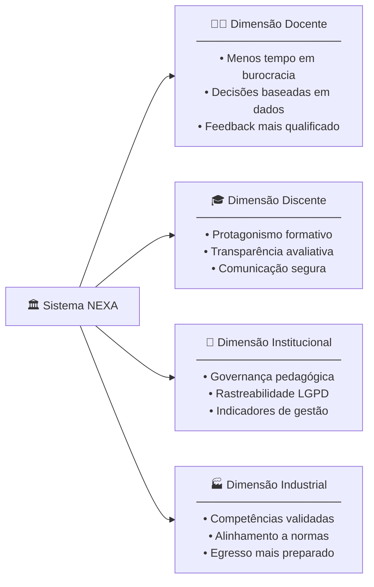

# 📋 Documento de Visão do Produto — NEXA

> **Referência**: DOC-001 | **Epic**: EPIC-01 — Autenticação, Perfis (RBAC) & Segurança  
> **Sprint**: S1 | **Prioridade**: P0  
> **Última Revisão**: Novembro/2026

---

## 📌 Sumário

1. [Declaração do Problema](#1-declaração-do-problema)
2. [Contextualização — Ensino Técnico Modular SENAI](#2-contextualização--ensino-técnico-modular-senai)
3. [Proposta de Valor do Sistema NEXA](#3-proposta-de-valor-do-sistema-nexa)
4. [Público-Alvo e Perfis de Usuário](#4-público-alvo-e-perfis-de-usuário)
5. [Objetivos Gerais e Específicos](#5-objetivos-gerais-e-específicos)
6. [Alinhamento Pedagógico — Metodologia de Competências SENAI](#6-alinhamento-pedagógico--metodologia-de-competências-senai)
7. [Critérios de Sucesso do Projeto](#7-critérios-de-sucesso-do-projeto)
8. [Justificativa de Negócio e Impacto Institucional](#8-justificativa-de-negócio-e-impacto-institucional)
9. [Restrições e Premissas](#9-restrições-e-premissas)
10. [Glossário](#10-glossário)

---

## 1. Declaração do Problema

### 1.1 Contexto Atual

As instituições de ensino técnico e profissionalizante do Brasil — em especial as unidades SENAI — operam frequentemente com sistemas de gestão acadêmica desenvolvidos para o modelo de ensino regular (currículos por conteúdo, avaliações bimestrais, médias aritméticas). Essa estrutura é fundamentalmente inadequada para o modelo de **formação por competências** adotado pelo SENAI, onde o aprendizado ocorre por meio de módulos práticos de oficina, laboratório e atividades manipulativas de alta precisão técnica.

### 1.2 Problemas Identificados nos Sistemas Tradicionais

| # | Problema | Impacto Direto | Consequência para o Aluno |
|---|----------|----------------|--------------------------|
| **P-01** | **Diagnóstico Tardio de Dificuldades** — Plataformas legadas exibem apenas médias bimestrais consolidadas, sem granularidade por atividade ou competência. | O docente só identifica a defasagem no fechamento do módulo, quando a janela de intervenção já foi perdida. | Reprovação em peças práticas, reteste por competência, atraso na formação. |
| **P-02** | **Ausência de Monitoramento de Competências Práticas** — Critérios industriais como tolerância dimensional (µm), acabamento superficial (Ra) e conformidade a EPIs não são registrados em sistemas convencionais. | Avaliações qualitativas ficam na memória do professor ou em pranchetas físicas de oficina. | Subjetividade nas notas, perda de dados históricos e impossibilidade de rastreabilidade formativa. |
| **P-03** | **Divergência entre Autopercepção e Desempenho Real** — Alunos frequentemente superestimam ou subestimam seu domínio técnico, sem mecanismo de contraste com a visão docente. | Desalinhamento entre esforço do aluno e estratégias de ensino do professor. | Desmotivação, lacunas de aprendizagem não endereçadas e baixo engajamento. |
| **P-04** | **Barreira de Comunicação Aluno-Docente** — O ambiente de oficina industrial inibe a verbalização de dúvidas por questões de hierarquia, timidez ou receio de julgamento entre pares. | Dúvidas sobre manuseio seguro de máquinas e processos críticos ficam acumuladas. | Risco à segurança operacional, erros técnicos repetidos, exposição a acidentes. |
| **P-05** | **Sobrecarga Burocrática do Docente** — Professores transcrevem manualmente registros de chamada, notas formativas e observações de bancada para planilhas desconexas ao final do turno. | Tempo pedagógico desperdiçado em atividades administrativas. | Redução da capacidade de atenção individual e de feedback formativo de qualidade. |
| **P-06** | **Invisibilidade do Risco de Evasão** — Coordenação pedagógica não dispõe de indicadores consolidados e em tempo real para identificar estudantes com trajetória de risco antes da reprovação formal. | Intervenções pedagógicas e de apoio social chegam tarde, após o agravamento do quadro. | Evasão escolar, perda de investimento formativo e impacto nos indicadores institucionais do SENAI. |

### 1.3 Lacuna Central

> **A lacuna identificada é a ausência de uma plataforma digital especializada para o ensino técnico por competências que:** integre o registro granular de atividades práticas de oficina, o monitoramento precoce de risco formativo e os canais de comunicação pedagógica segura — de forma unificada, em tempo real e acessível a todos os atores da comunidade escolar (professores, alunos e coordenação).

---

## 2. Contextualização — Ensino Técnico Modular SENAI

### 2.1 O Modelo de Formação por Competências

O SENAI (Serviço Nacional de Aprendizagem Industrial) é a maior rede privada de educação profissional e tecnológica do mundo, com mais de **2.300 unidades** no Brasil. Sua metodologia de ensino é fundamentada nos **Perfis Profissionais de Conclusão (PPC)**, alinhados às demandas reais da indústria e organizados em:

- **Competências Técnicas**: habilidades manipulativas e cognitivas mensuráveis (ex.: operar torno CNC com tolerância ±0,02 mm, interpretar desenho técnico em vistas ortogonais, executar ajustagem por encaixe H7/h6).
- **Competências Socioemocionais**: trabalho em equipe, pontualidade, postura profissional em ambiente industrial e ética no trabalho.
- **Indicadores de Desempenho (IDs)**: subunidades das competências que permitem avaliação formativa contínua ao longo do módulo.

### 2.2 Especificidades das Disciplinas Práticas de Oficina

As disciplinas práticas — como **Metrologia Industrial, Tornearia Mecânica, Ajustagem, Fresagem e Usinagem CNC** — apresentam características únicas que amplificam os desafios pedagógicos:

- **Alta granularidade de avaliação**: cada peça produzida é avaliada por múltiplos critérios mensuráveis (dimensional, visual, funcional), gerando dezenas de pontos de dados por aluno por aula.
- **Ritmo individualizado**: alunos avançam de forma assíncrona dentro do módulo, tornando ineficaz qualquer sistema que trate a turma como unidade homogênea.
- **Segurança crítica**: o manuseio incorreto de máquinas, ferramentas de corte e instrumentos de medição de precisão representa risco real de acidentes.
- **Vínculo do erro com o processo**: identificar *quando* e *em qual etapa* do processo o aluno erra é tão importante quanto registrar *que* ele errou.

### 2.3 Realidade Tecnológica das Unidades SENAI

A infraestrutura tecnológica das unidades SENAI varia significativamente entre regiões. O sistema NEXA foi projetado para operar em ambientes com conectividade intermitente, dispositivos heterogêneos (desktops de oficina, tablets de bancada, smartphones de professores) e com restrições de licenciamento de software proprietário.

---

## 3. Proposta de Valor do Sistema NEXA

**NEXA** (Nexo Educacional de Acompanhamento Acadêmico) é uma **plataforma de inteligência pedagógica em tempo real** desenvolvida especificamente para o contexto do ensino técnico e profissional SENAI.

### 3.1 Declaração de Valor

> *"O NEXA transforma dados dispersos de oficina em inteligência pedagógica acionável — conectando professor, aluno e coordenação em uma trilha formativa contínua, transparente e explicável, sem substituir o julgamento humano, mas potencializando-o."*

### 3.2 Diferenciais Estratégicos

| Diferencial | Descrição | Benefício Mensurável Esperado |
|-------------|-----------|-------------------------------|
| **Alertas Precoces Explicáveis** | O motor de risco não apenas sinaliza o aluno "em risco" — ele explica *por que* (ex.: "3 atividades de metrologia pendentes nos últimos 15 dias + frequência em 78%"). Sem rótulos arbitrários. | Identificação de risco com 3–4 semanas de antecedência em relação ao fechamento do módulo. |
| **Avaliação por Rubricas Industriais** | Critérios de avaliação alinhados a tolerâncias mecânicas (µm/mm), normas de EPI, acabamento Ra e conformidade de processos, configuráveis por disciplina. | Objetividade, rastreabilidade e redução de subjetividade nas avaliações práticas. |
| **Radar de Autoavaliação × Docente** | Cruzamento da percepção do aluno sobre sua própria competência com os registros do professor, gerando um índice de discrepância pedagógica visual. | Identificação precoce de baixa metacognição e direcionamento de feedback individualizado. |
| **Canal Confidencial de Apoio** | Formulário de comunicação direta e segura aluno–professor, sem exposição pública. | Redução da barreira de comunicação; apoio a questões de segurança e dúvidas técnicas sensíveis. |
| **Dashboard 360° do Professor** | Visão consolidada por turma: frequência, pendências, desempenho por competência e alunos sinalizados — tudo em uma única tela. | Economia de tempo docente em tarefas administrativas; mais tempo para feedback de qualidade. |
| **Privacidade por Design (LGPD)** | Registros sensíveis (observações comportamentais, pareceres pedagógicos) são criptografados com AES-256, acessíveis apenas por atores autorizados via RBAC. | Conformidade legal e confiança institucional. |

---

## 4. Público-Alvo e Perfis de Usuário

O NEXA atende a quatro perfis de usuário com necessidades, permissões e jornadas distintas, gerenciados por um sistema de controle de acesso baseado em papéis (RBAC — Role-Based Access Control).

### 4.1 Professores / Docentes (`TEACHER`)

**Quem são**: Instrutores técnicos responsáveis pelo ensino de disciplinas práticas e teóricas nos cursos industriais SENAI.

**Necessidades principais**:
- Registrar chamada de forma ágil (1 clique por aula) em dispositivos móveis ou de bancada.
- Avaliar atividades e peças práticas por critérios objetivos e industriais.
- Visualizar o status formativo da turma em tempo real, sem planilhas manuais.
- Receber sinalizações precoces sobre alunos com trajetória de risco, com justificativa clara.
- Responder confidencialmente a pedidos de ajuda dos alunos.

**Valor entregue pelo NEXA**: Redução da carga administrativa, visibilidade pedagógica granular e instrumentos objetivos de avaliação alinhados à indústria.

---

### 4.2 Alunos / Estudantes (`STUDENT`)

**Quem são**: Jovens e adultos em formação profissional nos cursos técnicos SENAI (Aprendizagem Industrial, Técnico, Qualificação Profissional).

**Necessidades principais**:
- Acompanhar sua própria evolução técnica por competência, não apenas por nota final.
- Autoavaliar habilidades e comparar com os registros do professor.
- Visualizar atividades pendentes e prazos de entrega de forma clara.
- Solicitar ajuda ao professor de forma discreta e segura.
- Consultar comunicados e mural da turma em um canal oficial.

**Valor entregue pelo NEXA**: Protagonismo no processo formativo, transparência na avaliação e canal seguro de comunicação pedagógica.

---

### 4.3 Coordenação Pedagógica (`COORDINATOR`)

**Quem são**: Coordenadores e supervisores pedagógicos responsáveis pela gestão de múltiplas turmas, cursos e pelo acompanhamento institucional dos indicadores de desempenho.

**Necessidades principais**:
- Visualizar indicadores consolidados por turma, curso e unidade em tempo real.
- Identificar turmas e alunos com maior risco de evasão ou reprovação com antecedência suficiente para intervenção.
- Suportar decisões em Conselhos de Classe com dados objetivos e rastreáveis.
- Garantir conformidade com as metas pedagógicas institucionais do SENAI.
- Gestão de usuários, turmas, cursos, matrículas e estrutura curricular.

**Valor entregue pelo NEXA**: Governança pedagógica baseada em dados, visão sistêmica e suporte qualificado à tomada de decisão institucional.

---

### 4.4 Administradores de Sistema (`ADMIN`)

**Quem são**: Equipe de TI da unidade SENAI responsável pela manutenção, configuração e segurança da plataforma.

**Necessidades principais**:
- Gestão completa de usuários, perfis e permissões (RBAC).
- Auditoria de acessos e operações críticas no sistema.
- Configuração de parâmetros de infraestrutura, integrações e backups.
- Garantia de conformidade com políticas de segurança e LGPD.

**Valor entregue pelo NEXA**: Controle total e rastreável da plataforma com ferramentas de administração e auditoria centralizadas.

---

## 5. Objetivos Gerais e Específicos

### 5.1 Objetivo Geral

Desenvolver e disponibilizar uma plataforma web de gestão acadêmica especializada para o ensino técnico profissional SENAI, que integre o monitoramento formativo contínuo por competências, o registro granular de atividades práticas de oficina e a inteligência de risco pedagógico precoce — provendo aos atores da comunidade escolar dados acionáveis em tempo real.

### 5.2 Objetivos Específicos e Métricas de Avaliação

| ID | Objetivo Específico | Indicador de Medição | Meta a ser Avaliada |
|----|---------------------|----------------------|---------------------|
| **OE-01** | Digitalizar e agilizar o registro de frequência e avaliações formativas em disciplinas práticas. | Tempo médio de lançamento de chamada por aula. | Redução ≥ 60% no tempo de registro comparado ao método manual. |
| **OE-02** | Implementar diagnóstico precoce de risco formativo com alertas explicáveis. | Tempo médio de antecedência do alerta em relação ao encerramento do módulo. | Alertas gerados com ≥ 3 semanas de antecedência. |
| **OE-03** | Prover visibilidade granular do progresso por competência para alunos e professores. | % de alunos que acessam seu painel de competências ao menos 1×/semana. | ≥ 70% de engajamento ativo no painel de competências. |
| **OE-04** | Reduzir a barreira de comunicação aluno-docente por meio de canal confidencial. | Número de interações registradas pelo canal confidencial por turma/módulo. | Uso ativo em ≥ 50% das turmas piloto. |
| **OE-05** | Garantir conformidade com a LGPD e segurança dos dados pedagógicos sensíveis. | Resultado de auditorias de segurança (criptografia, controle de acesso, logs). | 100% de conformidade nos requisitos de segurança mapeados (AES-256, JWT HttpOnly, RBAC). |
| **OE-06** | Prover à coordenação pedagógica uma visão consolidada para apoio a Conselhos de Classe. | % de Conselhos de Classe que utilizam dados exportados do NEXA como base de discussão. | ≥ 80% dos Conselhos com suporte do sistema nas unidades piloto. |
| **OE-07** | Implementar módulo de autoavaliação reflexiva com rastreamento de discrepância pedagógica. | % de alunos com pelo menos 1 autoavaliação registrada por módulo. | ≥ 65% de completude de autoavaliação por módulo nas turmas piloto. |

> [!NOTE]
> As metas acima são **alvos a serem avaliados** ao longo do projeto e após implantação piloto. Nenhuma redução de índice (como taxa de reprovação) é garantida a priori — os resultados dependerão da adesão institucional, do perfil das turmas e da qualidade da implementação.

---

## 6. Alinhamento Pedagógico — Metodologia de Competências SENAI

### 6.1 Aderência ao Modelo de Gestão por Competências

O SENAI estrutura seus cursos com base em **Unidades Curriculares (UC)**, cada uma composta por **Indicadores de Desempenho (IDs)** e **Critérios de Avaliação (CA)** definidos nos Perfis Profissionais de Conclusão (PPC). O NEXA mapeia diretamente essa estrutura:

```
Curso Técnico
  └── Módulo / Unidade Curricular (UC)
        └── Competência Técnica
              └── Indicador de Desempenho (ID)
                    └── Critério de Avaliação (rubrica de oficina)
                          └── Registro de Avaliação por Aluno
```

### 6.2 Avaliação Formativa Contínua

O sistema NEXA suporta a lógica de **avaliação formativa** — contrariamente ao modelo somativo (nota única ao final do bimestre). Os registros são acumulados ao longo do módulo, permitindo:

- **Triangulação de evidências**: frequência + tarefas práticas + autoavaliação + avaliação docente.
- **Histórico de evolução**: visualização da curva de aprendizagem por competência ao longo do tempo.
- **Decisão de recuperação antecipada**: identificar quais competências precisam de reforço antes do encerramento do módulo.

### 6.3 Respeito à Individualidade do Percurso Formativo

O SENAI admite ritmos distintos de aprendizagem dentro de um mesmo módulo. O NEXA não força comparações entre alunos (sem rankings públicos), mas oferece:

- **Visão individual**: cada aluno vê apenas seu próprio desempenho.
- **Gamificação não-punitiva**: badges de evolução pessoal por domínio de competências, sem exposição comparativa.
- **Alertas não-rotuladores**: sinalizações sempre acompanhadas de justificativa objetiva (critérios mensuráveis), nunca rótulos genéricos como "aluno problemático".

### 6.4 Cultura de Segurança na Oficina

A metodologia SENAI enfatiza fortemente a cultura de segurança no trabalho (NR-10, NR-12, uso de EPIs). O NEXA incorpora:

- Critério de segurança como campo obrigatório na rubrica de avaliação de atividades práticas.
- Canal confidencial como mecanismo para alunos reportarem preocupações de segurança sem exposição pública.

---

## 7. Critérios de Sucesso do Projeto

### 7.1 Critérios de Aceite Técnico (Entrega do Sistema)

| Critério | Verificação |
|----------|-------------|
| Todos os endpoints de API documentados e testados (cobertura ≥ 80%) | Suite de testes automatizados Pytest + relatório de cobertura |
| Interface responsiva e acessível (WCAG 2.1 nível AA) | Validação de acessibilidade automatizada + revisão manual |
| Autenticação JWT com tokens HttpOnly, refresh token e controle de sessão | Revisão de segurança + testes de penetração básicos |
| RBAC funcional com 4 perfis (ADMIN, COORDINATOR, TEACHER, STUDENT) | Testes de permissão por endpoint e por tela |
| Motor de risco operacional com alertas explicáveis gerados automaticamente | Testes de integração do Risk Engine com seed de dados representativo |
| Conformidade LGPD: criptografia AES-256 em campos sensíveis, logs de auditoria | Auditoria de código e revisão de banco de dados |
| Deploy funcional via Docker Compose em ambiente local | Validação de instalação limpa a partir do README |

### 7.2 Critérios de Sucesso Pedagógico (Pós-Implantação Piloto)

| Critério | Meta a Avaliar | Horizonte |
|----------|---------------|-----------|
| Adoção ativa por professores nas turmas piloto | ≥ 80% dos professores participantes utilizando o sistema semanalmente | Primeiros 60 dias de operação |
| Engajamento discente no painel de competências | ≥ 70% dos alunos acessando seu painel ao menos 1×/semana | Primeiros 60 dias de operação |
| Antecedência dos alertas de risco | Alertas gerados ≥ 3 semanas antes do fechamento de módulo | A validar por análise de logs |
| Satisfação dos usuários | NPS ≥ 7 (escala 0–10) em pesquisa de usabilidade com professores e alunos | 30 dias após lançamento piloto |
| Suporte a Conselhos de Classe | Dados do NEXA utilizados em ≥ 80% dos Conselhos nas unidades piloto | 1º Conselho após implantação |

> [!IMPORTANT]
> Os critérios de sucesso pedagógico são **metas de avaliação pós-piloto** e não compromissos contratuais de resultado. A eficácia pedagógica depende de fatores externos ao sistema, como engajamento institucional, treinamento de usuários e contexto socioeconômico das turmas.

---

## 8. Justificativa de Negócio e Impacto Institucional

### 8.1 Por que o SENAI Precisa do NEXA Agora

O cenário educacional brasileiro tem passado por acelerada transformação digital, impulsionada pela pandemia, pela expansão do ensino híbrido e pelas demandas crescentes do mercado de trabalho por profissionais com habilidades técnicas validadas. Paralelamente:

- O SENAI enfrenta pressão crescente por **eficiência e qualidade formativa**, com indicadores de evasão e reprovação sob monitoramento constante pelo sistema S.
- A indústria 4.0 exige que a formação técnica também seja **orientada a dados**, com rastreabilidade de competências e evidências objetivas de aprendizagem.
- A **LGPD (Lei Geral de Proteção de Dados — Lei nº 13.709/2018)** impõe obrigações legais à gestão de dados de estudantes, que sistemas legados frequentemente não atendem.

### 8.2 Impacto Esperado por Dimensão



### 8.3 Posicionamento Competitivo

O NEXA não compete com sistemas de gestão escolar generalistas (como sistemas de notas tradicionais ou ERPs educacionais). Ele ocupa o nicho específico de **plataforma de inteligência pedagógica para ensino técnico prático**, com as seguintes características únicas:

- **Especialização no domínio industrial**: rubricas de oficina, tolerâncias mecânicas, normas de EPI.
- **Motor de risco pedagógico explicável**: não apenas sinaliza, mas justifica com dados objetivos.
- **Arquitetura para o contexto SENAI**: baixo custo de operação, containerização Docker, suporte a infraestrutura variada.
- **Privacidade por design**: LGPD nativa, não retrofitada.

---

## 9. Restrições e Premissas

### 9.1 Restrições

| Tipo | Descrição |
|------|-----------|
| **Escopo** | O sistema NEXA, em sua versão inicial (MVP), atende exclusivamente ao contexto dos cursos técnicos industriais do SENAI. Adaptações para outros contextos (ensino médio regular, EAD, etc.) estão fora do escopo. |
| **Garantias** | Nenhuma redução absoluta de indicadores como taxa de reprovação, evasão ou acidentes é garantida pelo sistema. O NEXA é um instrumento de apoio à decisão pedagógica, não um substituto do julgamento do educador. |
| **Infraestrutura** | A implantação piloto pressupõe disponibilidade mínima de infraestrutura de rede local nas unidades SENAI e dispositivos com navegador web moderno (Chrome 100+, Firefox 100+). |
| **Legal** | O uso do sistema deve seguir as políticas de privacidade e proteção de dados da instituição, incluindo o consentimento informado para coleta e processamento de dados de menores de 18 anos (quando aplicável). |

### 9.2 Premissas

- A unidade SENAI piloto disporá de um coordenador técnico como ponto de contato para validação funcional.
- Os professores participantes do piloto receberão treinamento básico de uso (mínimo 2 horas) antes do lançamento.
- Os dados de seed inicial (cursos, turmas, alunos) serão fornecidos pela coordenação da unidade piloto em formato compatível.
- O ambiente de produção será gerenciado pela equipe de TI da unidade, com suporte da equipe de desenvolvimento para o período de implantação.

---

## 10. Glossário

| Termo | Definição |
|-------|-----------|
| **RBAC** | Role-Based Access Control — controle de acesso baseado em papéis de usuário. |
| **Competência Técnica** | Conjunto de conhecimentos, habilidades e atitudes mensuráveis requeridas para a execução de uma atividade profissional específica. |
| **Indicador de Desempenho (ID)** | Subunidade de uma competência, observável e avaliável em contexto prático de oficina. |
| **Rubrica de Avaliação** | Conjunto de critérios objetivos e graduados utilizados para avaliar um produto ou desempenho (ex.: tolerância dimensional, acabamento superficial, conformidade de EPI). |
| **Motor de Risco (Risk Engine)** | Módulo do NEXA responsável por calcular, com base em múltiplos indicadores (frequência, tarefas pendentes, discrepância de autoavaliação), um índice de risco formativo para cada aluno, acompanhado de justificativa legível. |
| **Autoavaliação Reflexiva** | Processo pelo qual o aluno registra sua percepção sobre o próprio domínio de cada competência, que é então cruzada com os registros do professor. |
| **PPC** | Perfil Profissional de Conclusão — documento normativo do SENAI que define as competências, indicadores e critérios de avaliação de um curso. |
| **LGPD** | Lei Geral de Proteção de Dados Pessoais (Lei nº 13.709/2018) — legislação brasileira que regula o tratamento de dados pessoais. |
| **AES-256** | Advanced Encryption Standard com chave de 256 bits — padrão de criptografia simétrica utilizado para proteção de dados sensíveis no NEXA. |
| **JWT** | JSON Web Token — padrão de token de autenticação utilizado pelo NEXA para gerenciamento de sessões seguras. |
| **Dashboard 360°** | Painel de visão consolidada do professor, integrando frequência, avaliações, alertas de risco e comunicações de uma turma em uma única interface. |
| **NPS** | Net Promoter Score — métrica de satisfação e lealdade do usuário em escala de 0 a 10. |

---

*Documento elaborado pela Squad de Documentação — Projeto Integrador SENAI.*  
*Referência: DOC-001 | Epic: EPIC-01 | Sprint S1*  
*Próximo documento: [DOC-002 — Especificação de Requisitos Funcionais e Não-Funcionais](./requisitos.md)*

